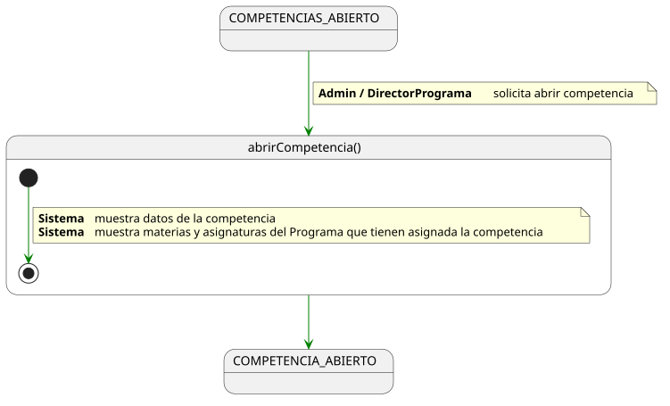
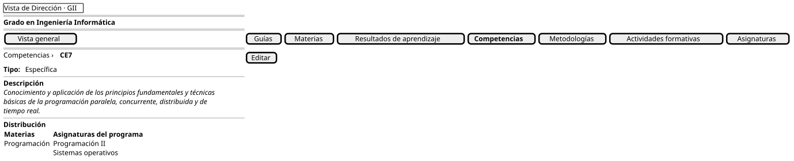

[Modelo del dominio](/RUP/00-modelo-del-dominio/README.md) / [Actores y casos de uso](/RUP/01-requisitos/01-actores-casos-uso/README.md) / [**Detalle**](/RUP/01-requisitos/03-detalle-casos-uso/README.md) / [Análisis](/RUP/02-analisis/casos-uso/abrirCompetencia/README.md) / [Diseño](/RUP/03-diseño/casos-uso/abrirCompetencia/README.md) / [Mockups navegables](/docs/PROPUESTA_WIREFRAME/README.md) Subconjunto público de [pyCelda](https://github.com/mmasias/pyCelda) -- incluye modelo de dominio, requisitos, análisis y diseño completos; desarrollo solo para 5 casos de uso elegidos como ejemplo. Sin dashboard de seguimiento.

# pyCelda > abrirCompetencia()

> |[🏠️](/README.md)|[DdC](/images/RUP/01-requisitos/01-actores-casos-uso/diagramaContextoDirectorPrograma.svg)|**Detalle**|[Análisis](/RUP/02-analisis/casos-uso/abrirCompetencia/README.md)|[Diseño](/RUP/03-diseño/casos-uso/abrirCompetencia/README.md)|Desarrollo|Pruebas|
> |-|-|-|-|-|-|-|

||
|-|
|
Código fuente: [especificacion.puml](especificacion.puml)
|

||
|-|
|
Código fuente: [wireframes.puml](wireframes.puml)
|

## Información del caso de uso

|Atributo|Valor|
|-|-|
|**Actor**|`Admin`, `DirectorPrograma`|
|**Objetivo**|Consultar el detalle de una `Competencia` y su distribución en materias y asignaturas|
|**Tipo**|Primario, esencial|
|**Nivel**|Subfunción|

Ficha de la competencia con su **Distribución**: las `Materia` y las `AsignaturaPrograma` del programa que la tienen asignada, en dos columnas y con enlace a cada una -- mismo diseño que la ficha de `ResultadoAprendizaje` (#740, punto 9). Sin "Código" en el cuerpo: va en la miga (**🧭 Competencias › CE7**).

Códigos y textos de los wireframes ilustrativos: las competencias reales de cada programa se importarán de las memorias verificadas una vez implementado (#761, decisión 9), no están en el seed.

## Notas de diseño y trazabilidad

- Wireframe alineado con la pantalla construida (#858): cabecera con el nombre del programa y las pestañas del programa (activa Competencias); miga "Competencias › CE7" con "Editar" a su derecha; tipo, descripción y distribución (con "Ninguna" en la columna vacía y "Sin asignaciones a materias ni a asignaturas del programa." si no tiene ninguna).
- Wireframe alineado con la pantalla construida (#873): la variante de Admin dibuja la cabecera de programa de Admin (miga de estructura, nombre del programa con Panel y Cerrar sesión, pestañas con Competencias activa, sin etiqueta de vista) y debajo la misma ficha que el director: miga "Competencias › CE7" con "Editar", tipo, descripción y distribución.

## Referencias

- [Diagrama de contexto de DirectorPrograma](/RUP/01-requisitos/01-actores-casos-uso/diagramaContextoDirectorPrograma.puml) -- `COMPETENCIAS_ABIERTO --> COMPETENCIA_ABIERTO : abrirCompetencia()`
- [Diagrama de contexto de Admin](/RUP/01-requisitos/01-actores-casos-uso/diagramaContextoAdmin.puml) -- `COMPETENCIAS_ABIERTO --> COMPETENCIA_ABIERTO : abrirCompetencia()` (misma pantalla conceptual, rutas `/admin/...`)
- [Modelo del dominio](/RUP/00-modelo-del-dominio/modeloDominio.puml) -- `Competencia{codigo, tipo, descripcion}`
- Issue [#761](https://github.com/mmasias/pyCelda/issues/761)
