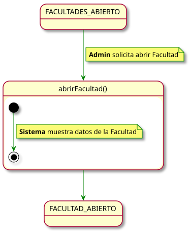
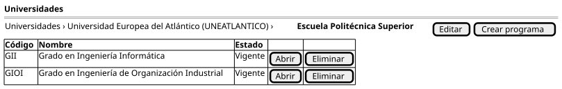

[Modelo del dominio](/RUP/00-modelo-del-dominio/README.md) / [Actores y casos de uso](/RUP/01-requisitos/01-actores-casos-uso/README.md) / [**Detalle**](/RUP/01-requisitos/03-detalle-casos-uso/README.md) / [Análisis](/RUP/02-analisis/casos-uso/abrirFacultad/README.md) / [Diseño](/RUP/03-diseño/casos-uso/abrirFacultad/README.md) / [Mockups navegables](/docs/PROPUESTA_WIREFRAME/README.md) Subconjunto público de [pyCelda](https://github.com/mmasias/pyCelda) -- incluye modelo de dominio, requisitos, análisis y diseño completos; desarrollo solo para 5 casos de uso elegidos como ejemplo. Sin dashboard de seguimiento.

# pyCelda > abrirFacultad()

> |[🏠️](/README.md)|[DdC](/images/RUP/01-requisitos/01-actores-casos-uso/diagramaContextoAdmin.svg)|**Detalle**|[Análisis](/RUP/02-analisis/casos-uso/abrirFacultad/README.md)|[Diseño](/RUP/03-diseño/casos-uso/abrirFacultad/README.md)|Desarrollo|Pruebas|
> |-|-|-|-|-|-|-|

||
|-|
|
Código fuente: [especificacion.puml](especificacion.puml)
|

||
|-|
|
Código fuente: [wireframes.puml](wireframes.puml)
|

## Información del caso de uso

|Atributo|Valor|
|-|-|
|**Actor**|`Admin`|
|**Objetivo**|Consultar el detalle de una `Facultad` concreta|
|**Tipo**|Primario, esencial|
|**Nivel**|Subfunción|

## Notas de diseño y trazabilidad

- Wireframe alineado con la pantalla construida (#872): la ficha de la Facultad es su listado de Programas: cabecera "Universidades", miga `Universidades › <universidad> › <facultad>` con "Editar" y "Crear programa", tabla Código/Nombre/Estado con "Abrir" y "Eliminar"; fuera "Nombre:", "Ver Programas" y "Volver al listado". "Editar" aparece deshabilitado en pantalla (funcionalidad en construcción).

## Referencias

- [Diagrama de contexto de Admin](/RUP/01-requisitos/01-actores-casos-uso/diagramaContextoAdmin.puml) -- `FACULTADES_ABIERTO --> FACULTAD_ABIERTO : abrirFacultad()`
- [actoresCasosUsoAdminCatalogos.puml](/RUP/01-requisitos/01-actores-casos-uso/actoresCasosUsoAdminCatalogos.puml) -- catálogo de casos de uso de `Admin` sobre `Facultad`
- [Modelo del dominio](/RUP/00-modelo-del-dominio/modeloDominio.puml) -- `Facultad`, sin más atributos que `nombre` (demasiado simple para diagramarlo, ver README de esa fase)
