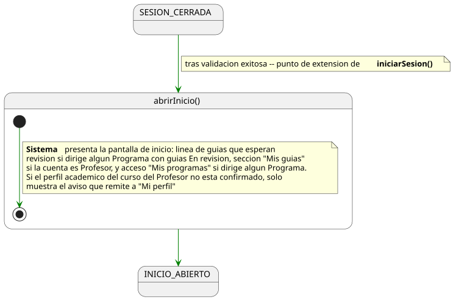
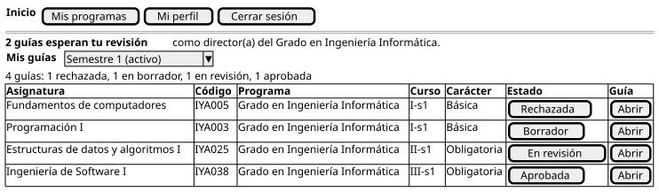

[Modelo del dominio](/RUP/00-modelo-del-dominio/README.md) / [Actores y casos de uso](/RUP/01-requisitos/01-actores-casos-uso/README.md) / [**Detalle**](/RUP/01-requisitos/03-detalle-casos-uso/README.md) / [Análisis](/RUP/02-analisis/casos-uso/abrirInicio/README.md) / [Diseño](/RUP/03-diseño/casos-uso/abrirInicio/README.md) / [Mockups navegables](/docs/PROPUESTA_WIREFRAME/README.md) Subconjunto público de [pyCelda](https://github.com/mmasias/pyCelda) -- incluye modelo de dominio, requisitos, análisis y diseño completos; desarrollo solo para 5 casos de uso elegidos como ejemplo. Sin dashboard de seguimiento.

# pyCelda > abrirInicio()

> |[🏠️](/README.md)|[DdC](/images/RUP/01-requisitos/01-actores-casos-uso/diagramaContextoProfesor.svg)|**Detalle**|[Análisis](/RUP/02-analisis/casos-uso/abrirInicio/README.md)|[Diseño](/RUP/03-diseño/casos-uso/abrirInicio/README.md)|Desarrollo|Pruebas|
> |-|-|-|-|-|-|-|

||
|-|
|
Código fuente: [especificacion.puml](especificacion.puml)
|

||
|-|
|
Código fuente: [wireframes.puml](wireframes.puml)
|

## Información del caso de uso

|Atributo|Valor|
|-|-|
|**Actor**|`Profesor` / `DirectorPrograma`|
|**Objetivo**|Aterrizar tras iniciar sesión en una única pantalla que reúne lo que la cuenta tiene a su cargo: sus guías (como `Profesor`) y las guías que esperan su revisión (como `DirectorPrograma`), con acceso a sus programas desde la cabecera|
|**Tipo**|Primario, esencial|
|**Nivel**|Subfunción|

**Primitiva de navegación, no cuenta en el catálogo de 103 casos de uso** -- misma categoría que [`iniciarSesion()`](../iniciarSesion/README.md)/`cerrarSesion()`/[`abrirPanelAdministracion()`](../abrirPanelAdministracion/README.md), distinta de [`abrirAsignaturasPrograma()`](../abrirAsignaturasPrograma/README.md)/[`abrirProgramas()`](../abrirProgramas/README.md) (que sí cuentan: listan entidades reales del dominio). `abrirInicio()` no lista nada propio: **compone** esos dos casos de uso ya catalogados (`<<include>>`), sin `<<choice>>`, sin lectura de dominio nueva y sin postcondición sobre ninguna entidad. Tener ficha completa (especificación, wireframe, README) no es indicio de que cuente -- `iniciarSesion()`/`abrirPanelAdministracion()` ya establecen ese precedente.

Es el destino que [`iniciarSesion()`](../iniciarSesion/README.md) extiende cuando el rol identificado es `Profesor` o `DirectorPrograma` (condición `rol in {Profesor, DirectorPrograma}`, punto de extensión "tras validación exitosa"). La rama de `Admin` sigue extendiendo a [`abrirPanelAdministracion()`](../abrirPanelAdministracion/README.md), sin cambio.

## Qué muestra, según lo que la cuenta tenga a su cargo

|Elemento|Se muestra cuando|Contenido|
|-|-|-|
|**Cabecera**|siempre|título "Inicio" y, a la derecha, los accesos "Mis programas" (si dirige algún `Programa`) y "Mi perfil" (si es `Profesor`), y "Cerrar sesión"|
|**Aviso de perfil sin confirmar**|la cuenta es `Profesor` y su perfil académico del curso no está confirmado|"Debes confirmar tu perfil académico de este curso antes de continuar." y la remisión a "Mi perfil"; sustituye a todo lo demás (también a la línea de revisión pendiente)|
|**Línea de revisión pendiente**|la cuenta dirige `>= 1` `Programa` con guías En revisión|"N guías esperan tu revisión como director(a) del ..." con el nombre de cada programa como enlace a sus guías (y el número de cada uno entre paréntesis si hay varios)|
|**Mis guías**|la cuenta tiene fila en `Profesor`|el listado de [`abrirAsignaturasPrograma()`](../abrirAsignaturasPrograma/README.md) en su variante filtrada por profesor (`wireframe-porProfesor`), embebido -- con la cardinalidad actual (1 `AsignaturaPrograma` : 1 `Guia`) es de hecho la lista de sus guías; con desplegable "Semestre N (activo)" / "Todas" si Admin ha activado un semestre, y una línea de resumen por estado|

"Mis programas" ya no es una sección de Inicio: la tabla de programas del director ([`abrirProgramas()`](../abrirProgramas/README.md), variante `wireframe-porDirector`) se abre con el acceso "Mis programas" de la cabecera. La cuenta con doble identidad (`DirectorPrograma` **y** `Profesor`, roles independientes no exclusivos en el modelo de dominio) ve la línea de revisión pendiente y "Mis guías" a la vez -- caso que antes exigía un tercer punto de extensión propio de `abrirAsignaturasPrograma()` ([issue #103](https://github.com/mmasias/pyCelda/issues/103), 2026-08-22), **subsumido** por este hub.

Inicio no lleva enlaces a los manuales de usuario: los de "Manual del profesor" ([#321](https://github.com/mmasias/pyCelda/issues/321)) y "Manual del director de programa" ([#333](https://github.com/mmasias/pyCelda/issues/333)) se retiraron de aquí en [#368](https://github.com/mmasias/pyCelda/issues/368) y quedan solo en la pantalla de entrada.

**Una capacidad ausente se presenta como sección vacía, nunca como error.** Un `Profesor` que no dirige ningún `Programa` no ve el acceso "Mis programas" ni la línea de revisión pendiente; una cuenta sin guías ni programas ve "Tu cuenta no tiene guías ni programas asignados todavía."; un ex-director que ya no dirige nada -- fila huérfana en `directores_programa` que `quitarDirectorPrograma()` nunca borra -- entra igual (su rol se resuelve como `Profesor`, ver [`iniciarSesion()`](../iniciarSesion/README.md)) y aterriza aquí, no en un `/programas` vacío sin salida. Nunca se expulsa a una cuenta autenticada y reconocida por el catálogo.

## Origen

Cierre de diseño en la [discussion #274](https://github.com/mmasias/pyCelda/discussions/274) (Opción C). El hecho que lo motiva: `get_current_rol()` resolvía `director_programa` para cualquier email con fila en `directores_programa`, con o sin programas a su cargo, y ese rol enrutaba a `/programas`; un `Profesor` que además fuese (ex-)director quedaba enrutado de forma permanente a un listado de programas vacío, con un clic extra para llegar a sus guías. Afecta a todo ex-director docente, no solo a la beta de profesores. La Opción C sustituye la elección de una sola pantalla por rol por una pantalla de inicio única que compone ambos listados.

## Notas de diseño y trazabilidad

- Las filas de "Mis guías" se ordenan por semestre, curso, nombre y programa (planificación del profesor). Curso y semestre se muestran en una sola columna "Curso" con el curso en números romanos y el semestre por defecto (`I-s1`, `II-s1`): dos columnas separadas cargaban la tabla (issue [#292](https://github.com/mmasias/pyCelda/issues/292)); la columna combinada viene de #508.

- Wireframe alineado con la pantalla construida (#857): sin los enlaces "Manual del profesor" / "Manual del director de programa" (retirados en #368); sin la sección "Mis programas" (la tabla pasó al acceso "Mis programas" de la cabecera, `abrirProgramas()`); cabecera real (título "Inicio" con los accesos "Mis programas", "Mi perfil" y "Cerrar sesión"); línea de guías pendientes de revisión del director; título "Mis guías" con el desplegable de semestre y la línea de resumen por estado; tabla con las columnas reales (Asignatura, Código, Programa, Curso, Carácter, Estado, Guía), curso en formato `I-s1`, orden por semestre, curso y nombre, estado como badge y botón "Abrir" (antes "Abrir guía"). Se dibuja una cuenta con doble papel (profesor que también dirige un programa) con un semestre activo. El aviso de perfil sin confirmar no tiene variante propia; lo describen esta ficha y el manual.

- Reglas de presentación que Salt no pinta: los emojis de los botones (🎓 Mis programas, 🪪 Mi perfil, 🚪 Cerrar sesión, 📂 Abrir) y el 🚦 de la línea de revisión pendiente se omiten en el dibujo; el nombre del programa en esa línea es un enlace a sus guías; los colores de los badges de estado son los del README de [`abrirGuia()`](../abrirGuia/README.md); el comentario de rechazo o de revocación de una guía aparece en cursiva bajo su badge.

- Modelado: primitiva de navegación; no cuenta en el catálogo de 102 casos de uso (misma categoría que `iniciarSesion()`/`cerrarSesion()`/`abrirPanelAdministracion()`). Compone dos listados ya catalogados sin lógica de dominio propia -- `abrirAsignaturasPrograma()` (variante Profesor, "Mis guías") y `abrirProgramas()` (variante DirectorPrograma, "Mis programas") -- vía `<<include>>` (ver `actoresCasosUso{Profesor,DirectorPrograma}.puml`). Sin `<<choice>>` y sin postcondición sobre ninguna entidad nueva.

- Extendido por `iniciarSesion()` (`<<extend>>`, condición: rol in {Profesor, DirectorPrograma}, punto: tras validación exitosa). Sustituye las dos ramas `<<extend>>` por rol que `iniciarSesion()` tenía hacia `abrirAsignaturasPrograma()` y `abrirProgramas()` (discussion [#274](https://github.com/mmasias/pyCelda/discussions/274)); la rama de Admin (`abrirPanelAdministracion()`) no cambia.

- Una capacidad ausente se presenta como elemento ausente, nunca como error: un Profesor que no dirige ningún Programa no ve "Mis programas" ni la línea de revisión pendiente; un ex-director que ya no dirige nada entra igual (rol resuelto como Profesor, ver `iniciarSesion/README.md`). Nunca se expulsa a una cuenta autenticada y conocida.

## Referencias

- [Especificación de Requisitos](especificacion.puml) y [wireframes](wireframes.puml) -- fuente de verdad de la composición de dos secciones.
- [Diagrama de contexto de Profesor](/RUP/01-requisitos/01-actores-casos-uso/diagramaContextoProfesor.puml) / [DirectorPrograma](/RUP/01-requisitos/01-actores-casos-uso/diagramaContextoDirectorPrograma.puml) -- `SESION_CERRADA --> INICIO_ABIERTO : iniciarSesion()`, estado nuevo `INICIO_ABIERTO`.
- [actoresCasosUsoProfesor.puml](/RUP/01-requisitos/01-actores-casos-uso/actoresCasosUsoProfesor.puml) / [actoresCasosUsoDirectorPrograma.puml](/RUP/01-requisitos/01-actores-casos-uso/actoresCasosUsoDirectorPrograma.puml) -- `abrirInicio ..> iniciarSesion : <<extend>>`, `abrirInicio ..> {abrirAsignaturasPrograma, abrirProgramas} : <<include>>`.
- [`iniciarSesion()`](../iniciarSesion/README.md) -- caso base extendido; de tres ramas `<<extend>>` por rol a dos (`abrirInicio()` / `abrirPanelAdministracion()`).
- [`abrirAsignaturasPrograma()`](../abrirAsignaturasPrograma/README.md) / [`abrirProgramas()`](../abrirProgramas/README.md) -- casos incluidos; dejan de extender `iniciarSesion()` directamente.
- [`abrirPanelAdministracion()`](../abrirPanelAdministracion/README.md) -- primitiva de navegación análoga para `Admin`, mismo estatus de "ficha completa, fuera del catálogo".
- Dashboard de seguimiento -- nota bajo la tabla de Estadísticas sobre por qué no suma al 103.
- Discussion [#274](https://github.com/mmasias/pyCelda/discussions/274) -- cierre de diseño (Opción C).
- Issue [#103](https://github.com/mmasias/pyCelda/issues/103) -- tercer punto de extensión de `abrirAsignaturasPrograma()` (doble identidad), subsumido por este caso.
- Issue [#318](https://github.com/mmasias/pyCelda/issues/318) -- manual de usuario de `Profesor`. Issue [#321](https://github.com/mmasias/pyCelda/issues/321) -- enlace al manual desde esta pantalla.
- Issue [#329](https://github.com/mmasias/pyCelda/issues/329) -- manual de usuario de `DirectorPrograma`. Issue [#333](https://github.com/mmasias/pyCelda/issues/333) -- enlace al manual desde esta pantalla.
