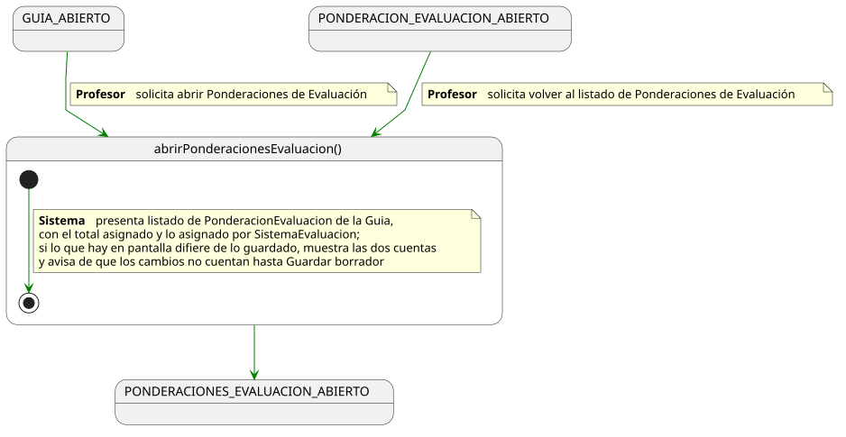
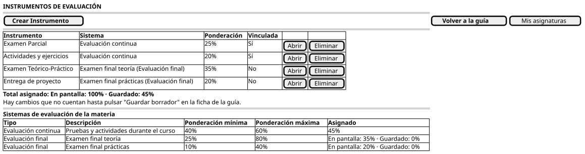
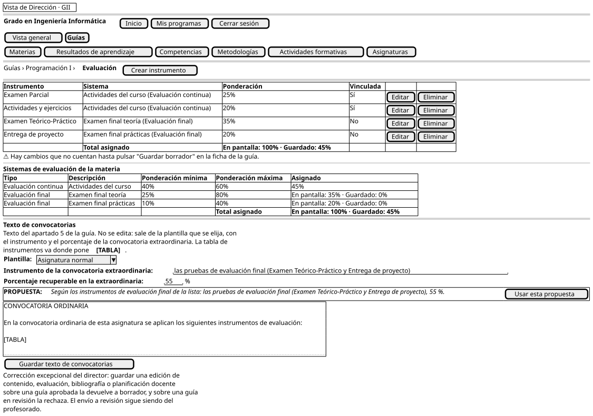

[Modelo del dominio](/RUP/00-modelo-del-dominio/README.md) / [Actores y casos de uso](/RUP/01-requisitos/01-actores-casos-uso/README.md) / [**Detalle**](/RUP/01-requisitos/03-detalle-casos-uso/README.md) / [Análisis](/RUP/02-analisis/casos-uso/abrirPonderacionesEvaluacion/README.md) / [Diseño](/RUP/03-diseño/casos-uso/abrirPonderacionesEvaluacion/README.md) / [Mockups navegables](/docs/PROPUESTA_WIREFRAME/README.md) Subconjunto público de [pyCelda](https://github.com/mmasias/pyCelda) -- incluye modelo de dominio, requisitos, análisis y diseño completos; desarrollo solo para 5 casos de uso elegidos como ejemplo. Sin dashboard de seguimiento.

# pyCelda > abrirPonderacionesEvaluacion()

> |[🏠️](/README.md)|[DdC](/images/RUP/01-requisitos/01-actores-casos-uso/diagramaContextoProfesor.svg)|**Detalle**|[Análisis](/RUP/02-analisis/casos-uso/abrirPonderacionesEvaluacion/README.md)|[Diseño](/RUP/03-diseño/casos-uso/abrirPonderacionesEvaluacion/README.md)|Desarrollo|Pruebas|
> |-|-|-|-|-|-|-|

||
|-|
|
Código fuente: [especificacion.puml](especificacion.puml)
|

|**Profesor**|**DirectorPrograma**|
|-|-|
|||
|
Código fuente: [wireframes.puml](wireframes.puml)
||

## Información del caso de uso

|Atributo|Valor|
|-|-|
|**Actor**|`Profesor`|
|**Objetivo**|Consultar el listado de `PonderacionEvaluacion` de una `Guia`|
|**Tipo**|Primario, esencial|
|**Nivel**|Subfunción|

Caso de uso reutilizado por `DirectorPrograma`, misma ficha -- ver [modelo del dominio](/RUP/00-modelo-del-dominio/README.md) (`DirectorPrograma --|> Profesor`).

**Dos entradas, un solo retorno**, mismo patrón que [`abrirAsignaturaPrograma()`](../abrirAsignaturaPrograma/README.md): desde `GUIA_ABIERTO` (primera apertura) y desde `PONDERACION_EVALUACION_ABIERTO` (vuelta desde el detalle, reutilizando el mismo verbo plural en vez de inventar un `volverAPonderaciones()`) -- ambas presentan exactamente lo mismo, el listado completo. La salida hacia `GUIA_ABIERTO` reutiliza a su vez [`abrirGuia()`](../abrirGuia/README.md), ya cerrado en L7.

Primer listado del catálogo con columna de `SistemaEvaluacion` -- necesaria porque una `PonderacionEvaluacion` no tiene sentido sin saber a qué sistema de evaluación pertenece (ver [`crearPonderacionEvaluacion()`](../crearPonderacionEvaluacion/README.md)). Datos reales de `GII__IYA003` ya usados en [`enviarGuiaARevision()`](../enviarGuiaARevision/README.md)/[`abrirGuia()`](../abrirGuia/README.md): las tres primeras (Examen Parcial 25%, Actividades y ejercicios 20%, Interés y participación 5%) pertenecen a `Evaluación continua`, la cuarta (Examen Teórico-Práctico 50%) a `Evaluación final` -- reparto reconstruido a partir de los rangos reales de la Materia (ver discussion [#38](https://github.com/mmasias/pyCelda/discussions/38)), no aportado como tal en el seed.

**Medidor de completitud** (discussion [#206](https://github.com/mmasias/pyCelda/discussions/206), ajuste B). El listado hace visibles, mientras el `Profesor` edita, las dos condiciones de ponderación que hoy solo se descubren al recibir el rechazo de [`enviarGuiaARevision()`](../enviarGuiaARevision/README.md) (`Guia.puede_enviarse_a_revision()`): "Total asignado" en el pie de la tabla de instrumentos, bajo la columna Ponderación (en rojo si no suma 100%; el mismo total se repite en el pie de la tabla de sistemas, bajo Asignado), y una columna "Asignado" en la tabla de sistemas de evaluación de la materia, con cada subtotal contra su `[ponderaciónMínima, ponderaciónMáxima]` (resaltado si cae fuera). Se cuentan todas las filas visibles -- vinculadas y pendientes de vincular, las que se enviarán en `ids_ponderaciones_final` -- descontando las excluidas de la lista de trabajo local. Es presentación: no cambia el flujo ni la especificación, solo el `wireframe`. El mismo medidor se replica en la sección "Evaluación" de [`abrirGuia()`](../abrirGuia/README.md). El equivalente para la planificación docente ("N / M sesiones") se aborda en el ajuste A de la misma discussion.

## Notas de diseño y trazabilidad

- **Variante de DirectorPrograma y etiqueta de vista** (issues [#841](https://github.com/mmasias/pyCelda/issues/841), [#846](https://github.com/mmasias/pyCelda/issues/846)): el director llega a esta pantalla desde la guía abierta en su programa (ruta con prefijo `/programas/:programaId`), con la cabecera del programa, su franja de pestañas con Guías marcada y la miga "Guías › asignatura › Evaluación". Arriba, por encima de la cabecera, lleva la etiqueta "Vista de Dirección · GII"; la variante de Profesor lleva "Vista de Docente". Regla de presentación que Salt no pinta: la etiqueta va fija en la parte superior de la ventana, embebida en la barra naranja del modo académico (que sigue de lado a lado): mismo fondo naranja `#f6871f`, texto negro, unos 22px de alto (sobresale por debajo de la barra de 12px), visible también al hacer scroll, con su borde izquierdo alineado con el del título de la cabecera a cualquier ancho de ventana. "Vista de Dirección · <sigla>" sale en toda pantalla que solo ve un DirectorPrograma, tenga o no papel de profesor (sin sigla mientras la pantalla no la tiene); "Vista de Docente" sale solo a quien es a la vez profesor y director de algún programa, en la guía y sus subpantallas abiertas como profesor y en Mi perfil; un profesor que no dirige nada no ve etiqueta, e Inicio, los logins y Admin no la llevan. Sustituye al fondo amarillo muy suave y a la etiqueta sobre el título de #841, retirados. El listado y el medidor son los mismos en las dos variantes. Mecanismo único por vista en el árbol de rutas (layouts `RutasDirector` y `RutasDocente` en `App.tsx`); criterio para el resto de pantallas en `docs/MANUAL_ESTILO.md` (fuera del subconjunto público).
- Columna "Sistema": muestra "Descripción (Tipo)" cuando la Materia tiene dos sistemas del mismo tipo, y solo "Tipo" si la descripción está vacía o coincide (issue [#285](https://github.com/mmasias/pyCelda/issues/285)). Con código de la memoria (fase F2 de [#768](https://github.com/mmasias/pyCelda/issues/768)), la etiqueta es "Código Denominación" ("SE1 Pruebas teóricas finales") y los sistemas se ordenan por código (E9 antes que E10); la regla vive en `SistemaEvaluacion.etiqueta()` y en `etiquetaSistemaEvaluacion()` del frontend. En la segunda tabla, la columna Descripción antepone el código; en el desplegable para elegir sistema de crear y editar un instrumento, cada opción es "Código Denominación -- Tipo (máx. N%)" o, sin código, "Tipo -- Descripción (máx. N%)". "Total asignado" va en cuerpo 0.875rem (issue [#285](https://github.com/mmasias/pyCelda/issues/285)). La segunda tabla ya distingue por su columna Descripción propia (issue [#279](https://github.com/mmasias/pyCelda/issues/279)) y no lleva el paréntesis.

- Wireframe alineado con la pantalla construida (#857): cabecera de subpantalla en las dos variantes (Profesor: "Guía docente" con Inicio, Mis programas, Mi perfil y Cerrar sesión, y la fila de miga "GII · Programación I › Evaluación" con "Crear instrumento" a la derecha; DirectorPrograma: el nombre del programa como título, la franja de pestañas en dos filas con Guías marcada y la miga "Guías › Programación I › Evaluación"); sin los botones "Volver a la guía" ni "Mis asignaturas", que ya no existen (la miga vuelve a la guía). Botones de fila "Editar" y "Eliminar" (iconos de lápiz y papelera en la aplicación), no "Abrir". "Total asignado" en el pie de cada tabla: bajo Ponderación en la de instrumentos y bajo Asignado en la de sistemas. Aviso de cambios sin guardar con su "⚠". Etiquetas de sistema según la regla de la columna "Sistema" (descripción y tipo entre paréntesis cuando difieren). Se añade la sección "Texto de convocatorias" que va al final de la misma pantalla ([`editarTextoSistemaEvaluacion()`](../editarTextoSistemaEvaluacion/README.md)), con el texto resultante abreviado, y en la variante de DirectorPrograma la nota de corrección excepcional del director que la pantalla muestra al pie. La etiqueta "Vista de Docente" solo la ve quien además dirige algún programa (ver la nota de la variante de DirectorPrograma).

- En pantalla frente a guardado (issue [#842](https://github.com/mmasias/pyCelda/issues/842)): el medidor contaba lo que hay en pantalla (vinculadas + pendientes - marcadas para eliminar en `sessionStorage`), pero `Guia.bloqueo_ponderaciones()` -- resumen de la ficha y 422 de `enviarGuiaARevision()` -- cuenta solo las vinculadas. Una profesora veía 100% aquí y "suma total incorrecta" en la ficha. Sin cambiar el modelo "vinculada hasta Guardar borrador": cuando las dos cuentas difieren, "Total asignado" muestra "En pantalla: X% · Guardado: Y%" (cada cifra en rojo si no es 100%) y debajo un aviso en ámbar: hay cambios que no cuentan hasta pulsar "Guardar borrador" en la ficha de la guía. En la columna "Asignado" de los sistemas, las dos cifras solo si el resultado de rango cambia entre una cuenta y otra (si las dos están dentro, o las dos fuera, se ve como antes). Cuando coinciden, como antes. "Guardado" es la suma de las filas con `vinculada = true` tal como vienen del backend, incluidas las marcadas para eliminar (la marca no ha llegado a la base de datos); no se reimplementa la regla (`frontend/src/enPantallaGuardado.ts`). El wireframe dibuja el caso con dos instrumentos sin vincular (los de "Vinculada: No"). El color ámbar del aviso no lo pinta Salt. El medidor desdoblado y el aviso son los mismos en las dos variantes del wireframe (`Profesor` y `DirectorPrograma`).

- Referencias bibliográficas y planificación docente (issue [#842](https://github.com/mmasias/pyCelda/issues/842), punto 4): la pantalla de referencias no tiene contador ni medidor (solo la columna "Vinculada"), así que no hay nada que separar. La de planificación docente sí: su medidor de sesiones contaba las visibles (vinculadas + pendientes); ahora muestra "En pantalla: N sesiones · Guardado: M sesiones" con el mismo aviso cuando difieren (componente `MedidorPlanificacionDocente`, también en la ficha de la guía).

## Referencias

- [Diagrama de contexto de Profesor](/RUP/01-requisitos/01-actores-casos-uso/diagramaContextoProfesor.puml) -- `GUIA_ABIERTO --> PONDERACIONES_EVALUACION_ABIERTO : abrirPonderacionesEvaluacion()`, `PONDERACION_EVALUACION_ABIERTO --> PONDERACIONES_EVALUACION_ABIERTO : abrirPonderacionesEvaluacion()`
- [actoresCasosUsoProfesor.puml](/RUP/01-requisitos/01-actores-casos-uso/actoresCasosUsoProfesor.puml) -- catálogo de casos de uso de `Profesor` sobre `PonderacionEvaluacion`
- [Modelo del dominio](/RUP/00-modelo-del-dominio/modeloDominio.puml) -- `Guia *-d- PonderacionEvaluacion`, `PonderacionEvaluacion -> SistemaEvaluacion`
- [Discussion #38](https://github.com/mmasias/pyCelda/discussions/38) -- cierre de la validación de rango, origen del reparto por `SistemaEvaluacion` mostrado aquí
