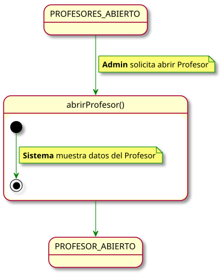
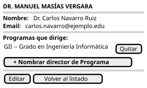

[Modelo del dominio](/RUP/00-modelo-del-dominio/README.md) / [Actores y casos de uso](/RUP/01-requisitos/01-actores-casos-uso/README.md) / [**Detalle**](/RUP/01-requisitos/03-detalle-casos-uso/README.md) / [Análisis](/RUP/02-analisis/casos-uso/abrirProfesor/README.md) / [Diseño](/RUP/03-diseño/casos-uso/abrirProfesor/README.md) / [Mockups navegables](/docs/PROPUESTA_WIREFRAME/README.md) Subconjunto público de [pyCelda](https://github.com/mmasias/pyCelda) -- incluye modelo de dominio, requisitos, análisis y diseño completos; desarrollo solo para 5 casos de uso elegidos como ejemplo. Sin dashboard de seguimiento.

# pyCelda > abrirProfesor()

> |[🏠️](/README.md)|[DdC](/images/RUP/01-requisitos/01-actores-casos-uso/diagramaContextoAdmin.svg)|**Detalle**|[Análisis](/RUP/02-analisis/casos-uso/abrirProfesor/README.md)|[Diseño](/RUP/03-diseño/casos-uso/abrirProfesor/README.md)|Desarrollo|Pruebas|
> |-|-|-|-|-|-|-|

||
|-|
|
Código fuente: [especificacion.puml](especificacion.puml)
|

||
|-|
|
Código fuente: [wireframes.puml](wireframes.puml)
|

## Información del caso de uso

|Atributo|Valor|
|-|-|
|**Actor**|`Admin`|
|**Objetivo**|Consultar el detalle de un `Profesor` concreto|
|**Tipo**|Primario, esencial|
|**Nivel**|Subfunción|

`PROFESOR_ABIERTO` también aloja `definirDirectorPrograma()`/`quitarDirectorPrograma()` (self-loop, ver diagrama de contexto) -- casos de uso con especificación propia; sus botones ("Nombrar director de programa" y "Quitar" por programa) aparecen en esta misma pantalla.

## Notas de diseño y trazabilidad

- Wireframe alineado con la pantalla construida (#872): cabecera "Profesores" con miga "Profesores › <profesor>" y botón "Editar" a su derecha (sin "Volver al listado"); "Programas que dirige" como tabla con "Quitar" por fila y "Nombrar director de programa" junto al título de la sección; añadidas las secciones "Asignaturas asignadas" y "Perfil académico". La foto del perfil, que solo aparece si el profesor la informó, no se dibuja.

## Referencias

- [Diagrama de contexto de Admin](/RUP/01-requisitos/01-actores-casos-uso/diagramaContextoAdmin.puml) -- `PROFESORES_ABIERTO --> PROFESOR_ABIERTO : abrirProfesor()`
- [actoresCasosUsoAdminCatalogos.puml](/RUP/01-requisitos/01-actores-casos-uso/actoresCasosUsoAdminCatalogos.puml) -- catálogo de casos de uso de `Admin` sobre `Profesor`
- Datos reales: `backend/app/data/seed/profesores.json` (repo privado)
