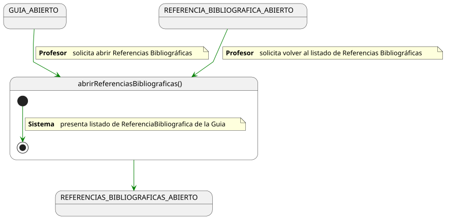
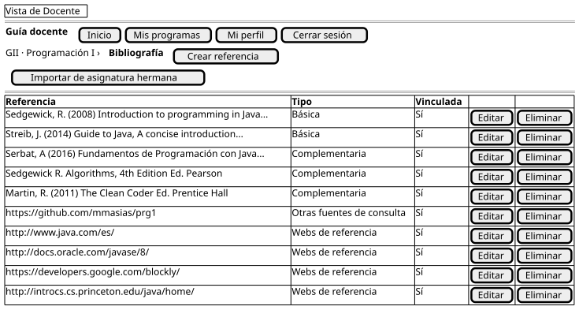

[Modelo del dominio](/RUP/00-modelo-del-dominio/README.md) / [Actores y casos de uso](/RUP/01-requisitos/01-actores-casos-uso/README.md) / [**Detalle**](/RUP/01-requisitos/03-detalle-casos-uso/README.md) / [Análisis](/RUP/02-analisis/casos-uso/abrirReferenciasBibliograficas/README.md) / [Diseño](/RUP/03-diseño/casos-uso/abrirReferenciasBibliograficas/README.md) / [Mockups navegables](/docs/PROPUESTA_WIREFRAME/README.md) Subconjunto público de [pyCelda](https://github.com/mmasias/pyCelda) -- incluye modelo de dominio, requisitos, análisis y diseño completos; desarrollo solo para 5 casos de uso elegidos como ejemplo. Sin dashboard de seguimiento.

# pyCelda > abrirReferenciasBibliograficas()

> |[🏠️](/README.md)|[DdC](/images/RUP/01-requisitos/01-actores-casos-uso/diagramaContextoProfesor.svg)|**Detalle**|[Análisis](/RUP/02-analisis/casos-uso/abrirReferenciasBibliograficas/README.md)|[Diseño](/RUP/03-diseño/casos-uso/abrirReferenciasBibliograficas/README.md)|Desarrollo|Pruebas|
> |-|-|-|-|-|-|-|

||
|-|
|
Código fuente: [especificacion.puml](especificacion.puml)
|

||
|-|
|
Código fuente: [wireframes.puml](wireframes.puml)
|

## Información del caso de uso

|Atributo|Valor|
|-|-|
|**Actor**|`Profesor`|
|**Objetivo**|Consultar el listado de `ReferenciaBibliografica` de una `Guia`|
|**Tipo**|Primario, esencial|
|**Nivel**|Subfunción|

Caso de uso reutilizado por `DirectorPrograma`, misma ficha -- ver [modelo del dominio](/RUP/00-modelo-del-dominio/README.md) (`DirectorPrograma --|> Profesor`).

**Dos entradas, un solo retorno**, mismo patrón que [`abrirPonderacionesEvaluacion()`](../abrirPonderacionesEvaluacion/README.md): desde `GUIA_ABIERTO` y desde `REFERENCIA_BIBLIOGRAFICA_ABIERTO` (vuelta desde el detalle, mismo verbo plural reutilizado). La salida hacia `GUIA_ABIERTO` reutiliza [`abrirGuia()`](../abrirGuia/README.md).

Diez referencias reales de `GII__IYA003`, aportadas por el usuario en la discussion [#39](https://github.com/mmasias/pyCelda/discussions/39) (no estaban en el seed, a diferencia de `PonderacionEvaluacion`): dos `Basica`, tres `Complementaria`, cuatro `WebsReferencia`, una `OtrasFuentes` -- confirma que el enum de cuatro categorías del modelo de dominio cierra bien con el corpus real, incluida la nomenclatura exacta de la cuarta sección ("OTRAS FUENTES DE CONSULTA" en la guía real). El wireframe muestra el `tipo` con su forma legible ("Básica", "Complementaria", "Webs de referencia", "Otras fuentes de consulta"), no el literal del enum -- corregido, mismas cuatro secciones que el corpus real. `referencia` se muestra tal cual la aportó el usuario, sin normalizar (ISBN ausente, año dentro o fuera de la referencia, URL directa según el caso) -- mismo criterio documentado en el [modelo del dominio](/RUP/00-modelo-del-dominio/README.md).

**Retocado al construir el issue [#184](https://github.com/mmasias/pyCelda/issues/184)**: el wireframe gana el botón `[Importar de asignatura hermana]`, en su propia fila bajo la miga y alineado a la derecha (`[Crear referencia]` va en la fila de la miga) -- dispara [`importarBibliografiaDeGuiaHermana()`](../importarBibliografiaDeGuiaHermana/README.md), self-loop sobre `REFERENCIAS_BIBLIOGRAFICAS_ABIERTO` (reemplaza al completo la bibliografía con la de una `Guia` importable de una `AsignaturaPrograma` hermana: `Aprobada`, o `EnRevision` que el `Profesor` también imparte desde el issue [#740](https://github.com/mmasias/pyCelda/issues/740)). El botón se ofrece condicionalmente: ausente si ninguna hermana tiene guía importable. El aviso del recuento a reemplazar tiene aquí las N referencias a la vista -- por eso el caso de uso vive en esta pantalla y no en [`abrirGuia()`](../abrirGuia/README.md).

## Notas de diseño y trazabilidad

- Wireframe alineado con la pantalla construida (#857): etiqueta `Vista de Docente` arriba (solo la ve quien además dirige un programa); cabecera `Guía docente` con `[Inicio] [Mis programas] [Mi perfil] [Cerrar sesión]`; fila de miga `GII · Programación I › Bibliografía` con `[Crear referencia]` a la derecha y, debajo, `[Importar de asignatura hermana]` en su propia fila (solo si hay alguna guía hermana importable); columnas `Referencia | Tipo | Vinculada` y los botones de icono de cada fila (lápiz, papelera) escritos con su nombre, `[Editar]` y `[Eliminar]`; se retiran los botones `[Volver a la guía]` y `[Mis asignaturas]` (la miga vuelve a la guía e `[Inicio]` a la lista de guías). Las filas se ordenan por la etiqueta legible del tipo en orden alfabético (`localeCompare`): Básica, Complementaria, Otras fuentes de consulta, Webs de referencia; dentro de un mismo tipo, en orden alfabético (ver la nota siguiente).
- **Orden dentro de cada sección** (issues [#876](https://github.com/mmasias/pyCelda/issues/876), [#878](https://github.com/mmasias/pyCelda/issues/878) y [#880](https://github.com/mmasias/pyCelda/issues/880)), regla de presentación: dentro de cada tipo, las referencias salen en orden alfabético automático por su texto, como en las normas de citación habituales (APA y similares, por autor). No distingue mayúsculas, tildes ni diacríticos; la "ñ" va tras la "n"; las letras sin descomposición se equiparan a su letra base ("ø" como "o", "ł" como "l", "æ" como "ae", "œ" como "oe"...; la "þ" va tras la "z"). Los caracteres iniciales que no son letra ni dígito (comillas, corchetes, guiones, espacios) no cuentan; dentro del texto, cada tramo de espacios y signos (comas, puntos, "/", ":", símbolos como "™") cuenta como un único separador que va antes que cualquier letra o dígito ("nada precede a algo": Brown antes que Browning, Martin antes que Martínez). Las URL se ordenan por el nombre del sitio (issue [#880](https://github.com/mmasias/pyCelda/issues/880)): tras los caracteres iniciales que no cuentan, un `http://` o `https://` al principio, y a continuación un `www.` (también `www.` sin protocolo), no cuentan, sin distinguir mayúsculas; una URL en mitad del texto sí cuenta entera. Solo afecta al orden: el texto mostrado y guardado no cambia. Desempate por el texto exacto y, si coincide, por orden de alta. No hay orden manual. Misma regla en la ficha de la guía, la pantalla de bibliografía, la previsualización y el PDF (`compararReferenciasBibliograficas()` en `frontend/src/referenciaBibliografica.ts`, `clave_orden_referencia()` en `backend/app/models/referencia_bibliografica.py`). Los datos de ejemplo del wireframe siguen ese orden.
- En la pantalla construida no hay detalle de solo lectura de una referencia: el lápiz de la fila abre directamente el formulario de [`editarReferenciaBibliografica()`](../editarReferenciaBibliografica/README.md), y tanto ese formulario como el de [`crearReferenciaBibliografica()`](../crearReferenciaBibliografica/README.md) vuelven a este listado al pulsar **Guardar** o **Cancelar**. La segunda entrada que nombra el diagrama de contexto (`REFERENCIA_BIBLIOGRAFICA_ABIERTO`) corresponde, por tanto, a esos formularios.
- Si la guía está `Aprobada`, bajo la miga aparece el aviso "⚠ Esta guía está aprobada: si guardas un cambio, volverá a borrador y habrá que enviarla de nuevo a revisión."; en la vista de Dirección, con la guía `EnRevision`, el aviso dice que guardar como corrección del director la dejará rechazada. El wireframe dibuja una guía en `Borrador`, sin aviso.
- La misma pantalla se sirve también en la vista de Dirección (prefijo `/programas/:programaId`), con la cabecera del programa, la franja de pestañas con **Guías** marcada y la miga `Guías › Programación I › Bibliografía`; este caso no tiene variante de wireframe propia para ella.

## Referencias

- [Diagrama de contexto de Profesor](/RUP/01-requisitos/01-actores-casos-uso/diagramaContextoProfesor.puml) -- `GUIA_ABIERTO --> REFERENCIAS_BIBLIOGRAFICAS_ABIERTO : abrirReferenciasBibliograficas()`, `REFERENCIA_BIBLIOGRAFICA_ABIERTO --> REFERENCIAS_BIBLIOGRAFICAS_ABIERTO : abrirReferenciasBibliograficas()`
- [actoresCasosUsoProfesor.puml](/RUP/01-requisitos/01-actores-casos-uso/actoresCasosUsoProfesor.puml) -- catálogo de casos de uso de `Profesor` sobre `ReferenciaBibliografica`
- [Modelo del dominio](/RUP/00-modelo-del-dominio/modeloDominio.puml) -- `Guia *-- ReferenciaBibliografica`, `tipo` enum cerrado de 4 valores
- [Discussion #39](https://github.com/mmasias/pyCelda/discussions/39) -- origen de los datos reales usados en este wireframe
- [`importarBibliografiaDeGuiaHermana()`](../importarBibliografiaDeGuiaHermana/README.md) -- caso de uso disparado desde esta pantalla (issue [#184](https://github.com/mmasias/pyCelda/issues/184))
