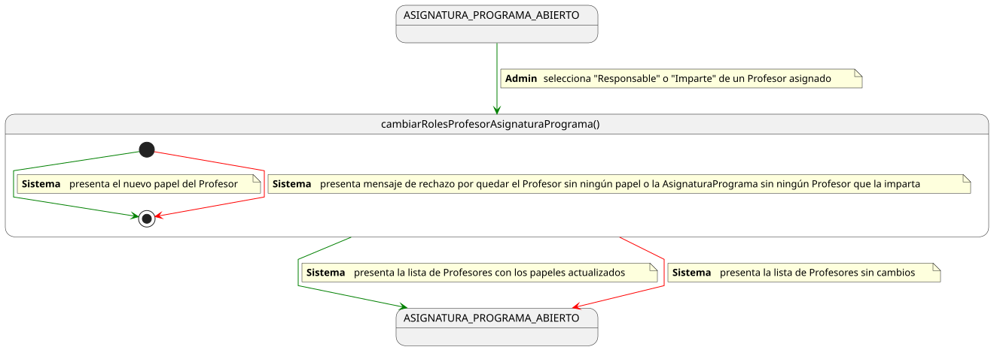
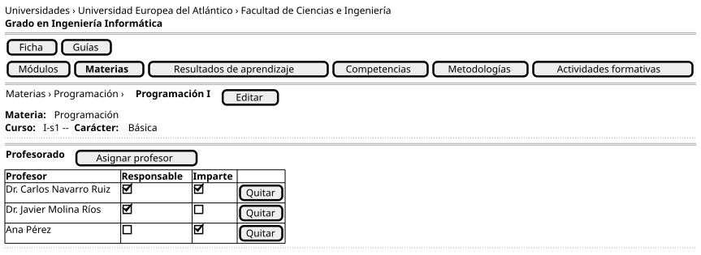

[Modelo del dominio](/RUP/00-modelo-del-dominio/README.md) / [Actores y casos de uso](/RUP/01-requisitos/01-actores-casos-uso/README.md) / [**Detalle**](/RUP/01-requisitos/03-detalle-casos-uso/README.md) / [Análisis](/RUP/02-analisis/casos-uso/cambiarRolesProfesorAsignaturaPrograma/README.md) / [Diseño](/RUP/03-diseño/casos-uso/cambiarRolesProfesorAsignaturaPrograma/README.md) / [Mockups navegables](/docs/PROPUESTA_WIREFRAME/README.md) Subconjunto público de [pyCelda](https://github.com/mmasias/pyCelda) -- incluye modelo de dominio, requisitos, análisis y diseño completos; desarrollo solo para 5 casos de uso elegidos como ejemplo. Sin dashboard de seguimiento.

# pyCelda > cambiarRolesProfesorAsignaturaPrograma()

> |[🏠️](/README.md)|[DdC](/images/RUP/01-requisitos/01-actores-casos-uso/diagramaContextoAdmin.svg)|**Detalle**|[Análisis](/RUP/02-analisis/casos-uso/cambiarRolesProfesorAsignaturaPrograma/README.md)|[Diseño](/RUP/03-diseño/casos-uso/cambiarRolesProfesorAsignaturaPrograma/README.md)|Desarrollo|Pruebas|
> |-|-|-|-|-|-|-|

||
|-|
|
Código fuente: [especificacion.puml](especificacion.puml)
|

||
|-|
|
Código fuente: [wireframes.puml](wireframes.puml)
|

## Información del caso de uso

|Atributo|Valor|
|-|-|
|**Actor**|`Admin`|
|**Objetivo**|Cambiar el papel de un `Profesor` ya asignado a una `AsignaturaPrograma`: responsable, imparte o ambas cosas|
|**Tipo**|Primario, esencial|
|**Nivel**|Objetivo de usuario|

Un `Profesor` asignado a una `AsignaturaPrograma` puede ser **responsable** de ella, **impartirla** o ambas cosas. Las dos marcas se ven y se editan en la propia lista de profesorado de la `AsignaturaPrograma` (`ASIGNATURA_PROGRAMA_ABIERTO`): marcar o desmarcar una casilla es el caso de uso entero, sin pantalla propia.

**Reglas:**

- Cada `Profesor` asignado conserva al menos un papel: desmarcar el único que le queda no es un cambio de papel, es una desasignación (`desasignarProfesorAsignaturaPrograma()`).
- Una `AsignaturaPrograma` con profesorado tiene siempre al menos un `Profesor` que la imparte. El cambio que la dejaría solo con responsables que no imparten se rechaza.
- Los dos papeles editan la guía por igual: el papel no cambia permisos.
- Si cambia de verdad quién imparte y la `Guia` activa de esa `AsignaturaPrograma` está `Aprobada`, pasa a `EnRevision`, igual que al asignar o desasignar a quien imparte. Si solo cambia el papel de responsable, la `Guia` no cambia de estado: el PDF solo lista a quien imparte. Volver a marcar lo que ya estaba no dispara nada.

## Notas de diseño y trazabilidad

- Origen: issue [#824](https://github.com/mmasias/pyCelda/issues/824) (decisión de Manuel, 2026-11-17) e issue de implementación [#825](https://github.com/mmasias/pyCelda/issues/825). PULSO necesita distinguir la lista de responsables de la de quienes imparten.
- Las marcas viven en `asignaturas_programa_profesores` (`imparte`, `es_responsable`, booleanos) y se copian a `guias_profesores` en cada sincronización de la `Guia` (aprobación y alta en `activarCursoAcademico()`).
- Rechazos: `422` si las dos marcas quedan a `false`; `409` si la `AsignaturaPrograma` quedaría con profesorado y sin nadie que imparta. El frontend no envía la petición con las dos casillas desmarcadas.
- Efecto sobre la `Guia` activa: el mismo helper que asignar/desasignar (issue [#254](https://github.com/mmasias/pyCelda/issues/254)), `Aprobada -> EnRevision` con fila de `HistorialCambio` de autor centinela, solo si cambia la marca `imparte`.
- Solo un cambio en **quién imparte** cambia el estado de la `Guia` (issue [#827](https://github.com/mmasias/pyCelda/issues/827), decisión de Manuel, 2026-11-17): es lo único que cambia el PDF. Asignar a alguien solo como responsable, desasignar a quien solo era responsable o cambiar solo el papel de responsable no cambia el estado de la `Guia` activa: se actualiza directamente su copia `Guia -- Profesor` (solo la fila de ese `Profesor`), para que no quede atrasada respecto a la asignación vigente cuando el curso se cierre. Cualquier cambio en quién imparte sigue el mecanismo de #254 (`Aprobada -> EnRevision`). La transición a En revisión queda implícita en la especificación (convención de verbos: el sistema presenta, no computa).
- En el PDF de la guía (`DOCENTE`/`EMAIL`) y en el de la planificación docente solo aparece quien imparte; la vista de la guía en la aplicación muestra los dos papeles.
- Sin estado nuevo en el diagrama de contexto: self-loop sobre `ASIGNATURA_PROGRAMA_ABIERTO`, como asignar y desasignar.

## Referencias

- [Diagrama de contexto de Admin](/RUP/01-requisitos/01-actores-casos-uso/diagramaContextoAdmin.puml) -- `ASIGNATURA_PROGRAMA_ABIERTO --> ASIGNATURA_PROGRAMA_ABIERTO : cambiarRolesProfesorAsignaturaPrograma()`
- [actoresCasosUsoAdminOperativa.puml](/RUP/01-requisitos/01-actores-casos-uso/actoresCasosUsoAdminOperativa.puml) -- catálogo de casos de uso de `Admin` sobre `AsignaturaPrograma`
- [`asignarProfesorAAsignaturaPrograma()`](/RUP/01-requisitos/03-detalle-casos-uso/asignarProfesorAAsignaturaPrograma/README.md) -- alta de la asignación, con los dos papeles
- [`desasignarProfesorAsignaturaPrograma()`](/RUP/01-requisitos/03-detalle-casos-uso/desasignarProfesorAsignaturaPrograma/README.md) -- baja de la asignación, misma regla "al menos uno imparte"
