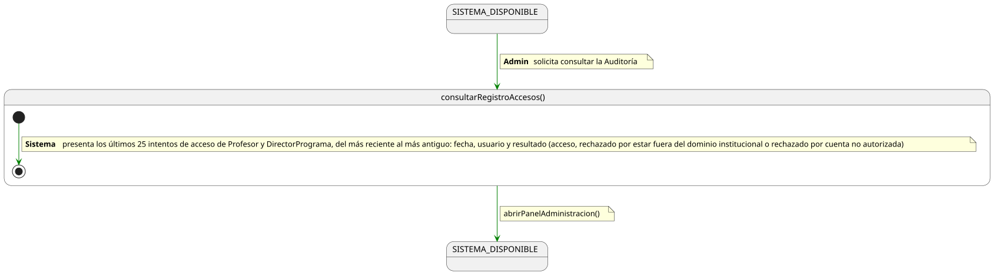
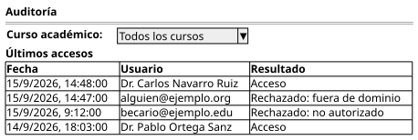

[Modelo del dominio](/RUP/00-modelo-del-dominio/README.md) / [Actores y casos de uso](/RUP/01-requisitos/01-actores-casos-uso/README.md) / [**Detalle**](/RUP/01-requisitos/03-detalle-casos-uso/README.md) / [Análisis](/RUP/02-analisis/casos-uso/consultarRegistroAccesos/README.md) / [Diseño](/RUP/03-diseño/casos-uso/consultarRegistroAccesos/README.md) / [Mockups navegables](/docs/PROPUESTA_WIREFRAME/README.md) Subconjunto público de [pyCelda](https://github.com/mmasias/pyCelda) -- incluye modelo de dominio, requisitos, análisis y diseño completos; desarrollo solo para 5 casos de uso elegidos como ejemplo. Sin dashboard de seguimiento.

# pyCelda > consultarRegistroAccesos()

> |[🏠️](/README.md)|[DdC](/images/RUP/01-requisitos/01-actores-casos-uso/diagramaContextoAdmin.svg)|**Detalle**|[Análisis](/RUP/02-analisis/casos-uso/consultarRegistroAccesos/README.md)|[Diseño](/RUP/03-diseño/casos-uso/consultarRegistroAccesos/README.md)|Desarrollo|Pruebas|
> |-|-|-|-|-|-|-|

||
|-|
|
Código fuente: [especificacion.puml](especificacion.puml)
|

|Bloque "Últimos accesos" de la Auditoría|
|:-:|
||
|
Código fuente: [wireframes.puml](wireframes.puml)
|

## Información del caso de uso

|Atributo|Valor|
|-|-|
|**Actor**|`Admin`|
|**Objetivo**|Auditar los últimos 25 intentos de inicio de sesión de `Profesor`/`DirectorPrograma`, con éxito o rechazados, y el motivo de cada rechazo|
|**Tipo**|Primario, de apoyo (soporte a la operación, no a la enseñanza)|
|**Nivel**|Objetivo de usuario|

**Caso de uso nuevo, de solo lectura**: mismo verbo y mismo molde que [`consultarHistorialCambios()`](../consultarHistorialCambios/README.md). Lee lo que escribe [`iniciarSesion()`](../iniciarSesion/README.md) en cada intento de acceso académico; este caso de uso nunca escribe.

**Misma pantalla que `consultarHistorialCambios()`**: el bloque "Últimos accesos" vive en la pantalla de Auditoría y se carga a la vez que el historial de cambios. No hay estado nuevo en el diagrama de contexto: entra y sale por `HISTORIAL_CAMBIOS_ABIERTO`.

**Sin `<<choice>>`**: igual que `consultarHistorialCambios()`, ninguna precondición puede rechazar esta lectura -- un registro vacío es un estado válido (tabla vacía), no un error.

## Notas de diseño y trazabilidad

- Origen: issue [#820](https://github.com/mmasias/pyCelda/issues/820) -- registro de los últimos 25 inicios de sesión, con éxito y rechazados, visible en Auditoría.
- Alcance del registro: solo el acceso académico (`Profesor`/`DirectorPrograma`). Los inicios de sesión de `Admin` no se registran, ni con éxito ni rechazados -- el `Admin` audita a los demás, no a sí mismo.
- Límite fijo de 25 filas, orden por fecha descendente. Sin filtros, sin paginación y sin vista por usuario (a diferencia del índice de autores de `consultarHistorialCambios()`).
- Columna Usuario: el nombre del `Profesor` (o del `DirectorPrograma`, cruzado por email contra `Profesor`) cuando el email está en el catálogo; si no -- caso típico de un rechazo por cuenta no autorizada o fuera de dominio --, el email tal cual.
- Columna Resultado: "Acceso", "Rechazado: fuera de dominio" o "Rechazado: no autorizado".
- La pantalla de Auditoría muestra el bloque de este caso de uso junto al feed y al índice de autores de `consultarHistorialCambios()`; el wireframe de esta ficha solo dibuja el bloque nuevo.

## Referencias

- [Diagrama de contexto de Admin](/RUP/01-requisitos/01-actores-casos-uso/diagramaContextoAdmin.puml) -- `SISTEMA_DISPONIBLE --> HISTORIAL_CAMBIOS_ABIERTO : consultarRegistroAccesos()`, vuelta con `abrirPanelAdministracion()`
- [actoresCasosUsoAdminOperativa.puml](/RUP/01-requisitos/01-actores-casos-uso/actoresCasosUsoAdminOperativa.puml) -- package "Auditoría", `Admin -- consultarRegistroAccesos`
- [`iniciarSesion()`](../iniciarSesion/README.md) -- escribe el registro que aquí se lee
- [`consultarHistorialCambios()`](../consultarHistorialCambios/README.md) -- caso de uso hermano en la misma pantalla
- [`abrirPanelAdministracion()`](../abrirPanelAdministracion/README.md) -- origen y destino de la navegación
