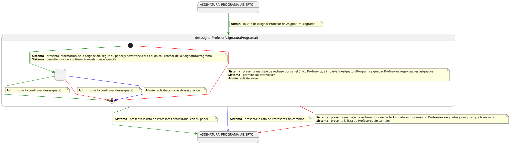
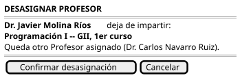
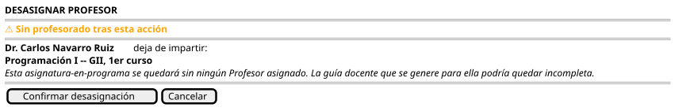
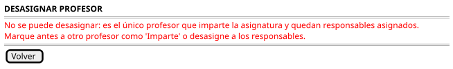

[Modelo del dominio](/RUP/00-modelo-del-dominio/README.md) / [Actores y casos de uso](/RUP/01-requisitos/01-actores-casos-uso/README.md) / [**Detalle**](/RUP/01-requisitos/03-detalle-casos-uso/README.md) / [Análisis](/RUP/02-analisis/casos-uso/desasignarProfesorAsignaturaPrograma/README.md) / [Diseño](/RUP/03-diseño/casos-uso/desasignarProfesorAsignaturaPrograma/README.md) / [Mockups navegables](/docs/PROPUESTA_WIREFRAME/README.md) Subconjunto público de [pyCelda](https://github.com/mmasias/pyCelda) -- incluye modelo de dominio, requisitos, análisis y diseño completos; desarrollo solo para 5 casos de uso elegidos como ejemplo. Sin dashboard de seguimiento.

# pyCelda > desasignarProfesorAsignaturaPrograma()

> |[🏠️](/README.md)|[DdC](/images/RUP/01-requisitos/01-actores-casos-uso/diagramaContextoAdmin.svg)|**Detalle**|[Análisis](/RUP/02-analisis/casos-uso/desasignarProfesorAsignaturaPrograma/README.md)|[Diseño](/RUP/03-diseño/casos-uso/desasignarProfesorAsignaturaPrograma/README.md)|Desarrollo|Pruebas|
> |-|-|-|-|-|-|-|

||
|-|
|
Código fuente: [especificacion.puml](especificacion.puml)
|

|Normal (queda otro Profesor)|Advertencia (se queda sin ninguno)|Rechazo (único que imparte, quedan responsables)|
|:-:|:-:|:-:|
||||
|||
Código fuente: [wireframes.puml](wireframes.puml)
|

## Información del caso de uso

|Atributo|Valor|
|-|-|
|**Actor**|`Admin`|
|**Objetivo**|Desasignar un `Profesor` de una `AsignaturaPrograma`|
|**Tipo**|Primario, esencial|
|**Nivel**|Objetivo de usuario|

**Sin `<<choice>>` bloqueante, a diferencia de `quitarDirectorPrograma()`/`desasociarMetodologiaDocenteMateria()`/`desasociarResultadoAprendizajeAMateria()`**: `AsignaturaPrograma` es el último escalón de la cascada de reparto -- no hay un nivel estructural inferior que dependa de este profesorado para bloquear la desasignación. Tampoco hay invariante de mínimo (a diferencia de `Programa`-`DirectorPrograma`, que exige al menos un director).

Confirmación con advertencia condicional, no bloqueo: si el `Profesor` que se desasigna es el único de esa `AsignaturaPrograma`, el sistema lo advierte -- la guía docente que se genere sobre ella podría quedar incompleta -- pero permite confirmar igual, para cubrir el caso real de mantenimiento en que se están reconstruyendo las asignaciones. Cierre en la discussion [#33](https://github.com/mmasias/pyCelda/discussions/33), que también apunta como pendiente futuro (fuera de alcance de L6, depende de `Guia`/`PonderacionEvaluacion`) una validación de completitud antes de `generarGuiasPDF()`.

**Efecto colateral sobre el ciclo de vida de `Guia` (issue [#254](https://github.com/mmasias/pyCelda/issues/254))**: mismo que `asignarProfesorAAsignaturaPrograma()`. Este caso de uso nunca tocó `Guia -- Profesor` y sigue sin tocarlo. Lo nuevo: si el `Profesor` desasignado **impartía**, la desasignación cambia la plantilla y la `Guia` activa está `Aprobada`, pasa a `EnRevision` + fila de `HistorialCambio` (`autor` centinela `0`, `comentario="En revisión por cambio en los profesores que la imparten"`) para que el `DirectorPrograma` re-apruebe; al re-aprobar, `Guia -- Profesor` se re-deriva de la plantilla y el profesor desasignado sale de la copia. En cualquier otro estado de la `Guia`, nada más. Si solo era **responsable** (issue [#827](https://github.com/mmasias/pyCelda/issues/827)), el PDF no cambia: la `Guia` activa no cambia de estado y su fila sale directamente de la copia `Guia -- Profesor`. Ver el detalle del mecanismo en [`asignarProfesorAAsignaturaPrograma()`](/RUP/01-requisitos/03-detalle-casos-uso/asignarProfesorAAsignaturaPrograma/README.md) y el [modelo del dominio](/RUP/00-modelo-del-dominio/README.md).

**Regla "al menos uno imparte" (issue [#824](https://github.com/mmasias/pyCelda/issues/824))**: quedarse sin profesorado sigue siendo válido (con la advertencia de siempre), pero no quedarse solo con responsables que no la imparten. Si el `Profesor` que se desasigna es el único que imparte y quedan otros asignados, el sistema rechaza la desasignación **antes de pedir confirmación** (mismo criterio que el `<<choice>>` al inicio de `eliminarX()`: no se pregunta "¿seguro?" para bloquear después): antes hay que marcar a otro como "Imparte" ([`cambiarRolesProfesorAsignaturaPrograma()`](/RUP/01-requisitos/03-detalle-casos-uso/cambiarRolesProfesorAsignaturaPrograma/README.md)) o desasignar a los responsables. La confirmación nombra el papel: "deja de impartir" si la imparte (los wireframes normal y advertencia), "deja de estar asignado/a" si solo es responsable (misma pantalla, solo cambia ese texto).

## Notas de diseño y trazabilidad

- Regla "al menos uno imparte": `409` en el `DELETE` (issue [#824](https://github.com/mmasias/pyCelda/issues/824), implementación en [#825](https://github.com/mmasias/pyCelda/issues/825)). Matiza "tampoco hay invariante de mínimo" de la descripción: sigue sin haber mínimo de profesorado, pero sí de quien imparte cuando hay profesorado.
- Rechazo antes de la confirmación (issue [#827](https://github.com/mmasias/pyCelda/issues/827)): la pantalla (`DesasignarProfesorAsignaturaPrograma.tsx`) calcula la regla con el profesorado cargado y, si se incumple, muestra el motivo y un único botón "Volver". El `409` del backend se sigue mostrando por si el estado cambia entre la carga y el envío: es la rama roja tras confirmar.

- Solo un cambio en **quién imparte** cambia el estado de la `Guia` (issue [#827](https://github.com/mmasias/pyCelda/issues/827), decisión de Manuel, 2026-11-17): es lo único que cambia el PDF. Asignar a alguien solo como responsable, desasignar a quien solo era responsable o cambiar solo el papel de responsable no cambia el estado de la `Guia` activa: se actualiza directamente su copia `Guia -- Profesor` (solo la fila de ese `Profesor`), para que no quede atrasada respecto a la asignación vigente cuando el curso se cierre. Cualquier cambio en quién imparte sigue el mecanismo de #254 (`Aprobada -> EnRevision`). La transición a En revisión queda implícita en la especificación (convención de verbos: el sistema presenta, no computa).

## Referencias

- [Diagrama de contexto de Admin](/RUP/01-requisitos/01-actores-casos-uso/diagramaContextoAdmin.puml) -- `ASIGNATURA_PROGRAMA_ABIERTO --> ASIGNATURA_PROGRAMA_ABIERTO : desasignarProfesorAsignaturaPrograma()`
- [actoresCasosUsoAdminOperativa.puml](/RUP/01-requisitos/01-actores-casos-uso/actoresCasosUsoAdminOperativa.puml) -- catálogo de casos de uso de `Admin` sobre `AsignaturaPrograma`
- [Modelo del dominio](/RUP/00-modelo-del-dominio/modeloDominio.puml) -- `AsignaturaPrograma -- Profesor`; README, `Guia -- Profesor` re-derivada al aprobar (issue #254)
- [Issue #254](https://github.com/mmasias/pyCelda/issues/254) / [discussion #255](https://github.com/mmasias/pyCelda/discussions/255) -- efecto colateral `Aprobada -> EnRevision` al cambiar la plantilla
- [Discussion #33](https://github.com/mmasias/pyCelda/discussions/33) -- cierre del `<<choice>>` (sin bloqueo, con advertencia condicional) y retiro de `editarAsignacionProfesorAsignaturaPrograma()` del catálogo
- [`asignarProfesorAAsignaturaPrograma()`](/RUP/01-requisitos/03-detalle-casos-uso/asignarProfesorAAsignaturaPrograma/README.md) -- caso de uso complementario (alta de la asignación)
