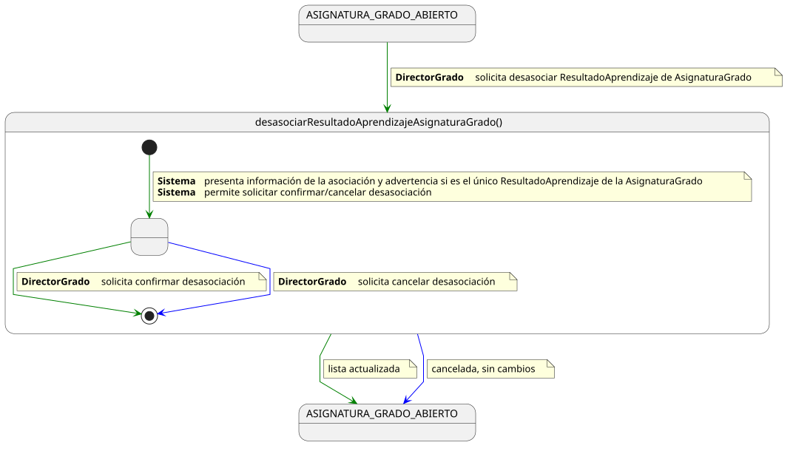
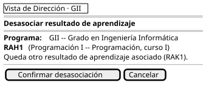
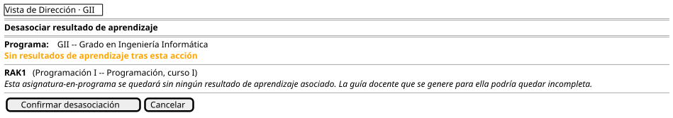

[Modelo del dominio](/RUP/00-modelo-del-dominio/README.md) / [Actores y casos de uso](/RUP/01-requisitos/01-actores-casos-uso/README.md) / [**Detalle**](/RUP/01-requisitos/03-detalle-casos-uso/README.md) / [Análisis](/RUP/02-analisis/casos-uso/desasociarResultadoAprendizajeAsignaturaPrograma/README.md) / [Diseño](/RUP/03-diseño/casos-uso/desasociarResultadoAprendizajeAsignaturaPrograma/README.md) / [Mockups navegables](/docs/PROPUESTA_WIREFRAME/README.md) Subconjunto público de [pyCelda](https://github.com/mmasias/pyCelda) -- incluye modelo de dominio, requisitos, análisis y diseño completos; desarrollo solo para 5 casos de uso elegidos como ejemplo. Sin dashboard de seguimiento.

# pyCelda > desasociarResultadoAprendizajeAsignaturaPrograma()

> |[🏠️](/README.md)|[DdC](/images/RUP/01-requisitos/01-actores-casos-uso/diagramaContextoDirectorPrograma.svg)|**Detalle**|[Análisis](/RUP/02-analisis/casos-uso/desasociarResultadoAprendizajeAsignaturaPrograma/README.md)|[Diseño](/RUP/03-diseño/casos-uso/desasociarResultadoAprendizajeAsignaturaPrograma/README.md)|Desarrollo|Pruebas|
> |-|-|-|-|-|-|-|

||
|-|
|
Código fuente: [especificacion.puml](especificacion.puml)
|

|Normal (queda otro RA)|Advertencia (se queda sin ninguno)|
|:-:|:-:|
|||
||
Código fuente: [wireframes.puml](wireframes.puml)
|

## Información del caso de uso

|Atributo|Valor|
|-|-|
|**Actor**|`DirectorPrograma`, `Admin` (issue [#599](https://github.com/mmasias/pyCelda/issues/599))|
|**Objetivo**|Desasociar un `ResultadoAprendizaje` de una `AsignaturaPrograma`|
|**Tipo**|Primario, esencial|
|**Nivel**|Objetivo de usuario|

**Sin `<<choice>>` bloqueante, a diferencia de `desasociarResultadoAprendizajeAMateria()`**: en `Materia`, la desasociación se bloquea si alguna `AsignaturaPrograma` ya usa ese `ResultadoAprendizaje` (nivel inferior de la cascada). Aquí `AsignaturaPrograma` es el último escalón -- no hay un nivel estructural inferior que dependa de este reparto para bloquear la desasociación, y `Guia` no deriva en vivo de él (los RA se heredan al generar el PDF, fijados en fase estructural, no editables desde la propia `Guia`). Tampoco hay invariante de mínimo en el modelo de dominio.

Confirmación con advertencia condicional, no bloqueo: si el `ResultadoAprendizaje` que se desasocia es el único de esa `AsignaturaPrograma`, el sistema lo advierte -- la guía docente que se genere sobre ella podría quedar incompleta -- pero permite confirmar igual, mismo criterio y misma discussion de cierre que [`desasignarProfesorAsignaturaPrograma()`](/RUP/01-requisitos/03-detalle-casos-uso/desasignarProfesorAsignaturaPrograma/README.md). RAK1/RAH1 para normal/advertencia son ilustrativos: la asignación real RA-`AsignaturaPrograma` no está en el seed extraído.

**Actor `Admin` (issue [#599](https://github.com/mmasias/pyCelda/issues/599))**: `Admin` gana esta transición como vía de corrección excepcional, con paridad completa respecto a `DirectorPrograma` -- no sustituye su flujo normal, lo complementa. Misma ficha y mismas reglas, con wireframe propio de Admin (variante `wireframe-admin`); es un self-loop de `ASIGNATURA_PROGRAMA_ABIERTO` también en [diagramaContextoAdmin.puml](/RUP/01-requisitos/01-actores-casos-uso/diagramaContextoAdmin.puml). Sin alcance por programa: `Admin` actúa sobre cualquier `AsignaturaPrograma`.

## Notas de diseño y trazabilidad

- Wireframe alineado con la pantalla construida (#858): barra "Vista de Dirección · GII", título "Desasociar resultado de aprendizaje", línea "Programa: GII -- ...", contexto "(asignatura -- materia, curso I)", textos en minúscula como en pantalla; el aviso naranja no lleva ⚠.
- Wireframe alineado con la pantalla construida (#873): variante `wireframe-admin` de la confirmación normal: igual que la del director pero sin etiqueta de vista y **sin** la línea "Programa: GII -- ..." (la pantalla de Admin no la pinta); la advertencia de Admin tiene la misma diferencia y no se duplica.

## Referencias

- [Diagrama de contexto de DirectorPrograma](/RUP/01-requisitos/01-actores-casos-uso/diagramaContextoDirectorPrograma.puml) -- `ASIGNATURA_PROGRAMA_ABIERTO --> ASIGNATURA_PROGRAMA_ABIERTO : desasociarResultadoAprendizajeAsignaturaPrograma()`
- [actoresCasosUsoDirectorPrograma.puml](/RUP/01-requisitos/01-actores-casos-uso/actoresCasosUsoDirectorPrograma.puml) -- catálogo de casos de uso de `DirectorPrograma` sobre `AsignaturaPrograma`
- [Modelo del dominio](/RUP/00-modelo-del-dominio/modeloDominio.puml) -- `AsignaturaPrograma o- ResultadoAprendizaje`
- [Discussion #33](https://github.com/mmasias/pyCelda/discussions/33) -- cierre del `<<choice>>` (sin bloqueo, con advertencia condicional) y retiro de `editarAsociacionResultadoAprendizajeAsignaturaPrograma()` del catálogo
- [`asociarResultadoAprendizajeAAsignaturaPrograma()`](/RUP/01-requisitos/03-detalle-casos-uso/asociarResultadoAprendizajeAAsignaturaPrograma/README.md) -- caso de uso complementario (alta de la asociación)
