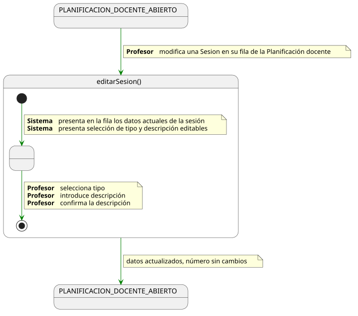
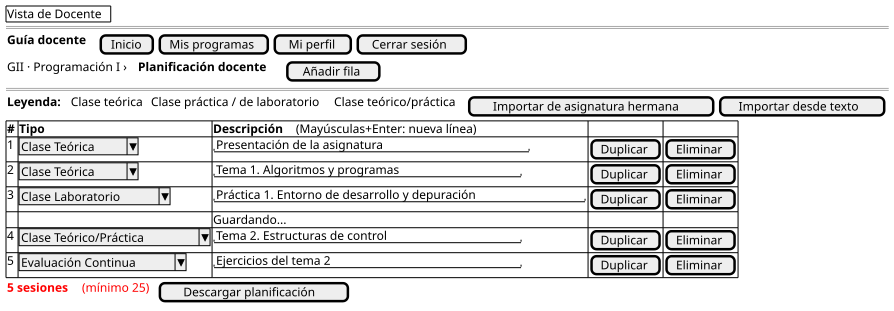

[Modelo del dominio](/RUP/00-modelo-del-dominio/README.md) / [Actores y casos de uso](/RUP/01-requisitos/01-actores-casos-uso/README.md) / [**Detalle**](/RUP/01-requisitos/03-detalle-casos-uso/README.md) / [Análisis](/RUP/02-analisis/casos-uso/editarSesion/README.md) / [Diseño](/RUP/03-diseño/casos-uso/editarSesion/README.md) / [Mockups navegables](/docs/PROPUESTA_WIREFRAME/README.md) Subconjunto público de [pyCelda](https://github.com/mmasias/pyCelda) -- incluye modelo de dominio, requisitos, análisis y diseño completos; desarrollo solo para 5 casos de uso elegidos como ejemplo. Sin dashboard de seguimiento.

# pyCelda > editarSesion()

> |[🏠️](/README.md)|[DdC](/images/RUP/01-requisitos/01-actores-casos-uso/diagramaContextoProfesor.svg)|**Detalle**|[Análisis](/RUP/02-analisis/casos-uso/editarSesion/README.md)|[Diseño](/RUP/03-diseño/casos-uso/editarSesion/README.md)|Desarrollo|Pruebas|
> |-|-|-|-|-|-|-|

||
|-|
|
Código fuente: [especificacion.puml](especificacion.puml)
|

||
|-|
|
Código fuente: [wireframes.puml](wireframes.puml)
|

## Información del caso de uso

|Atributo|Valor|
|-|-|
|**Actor**|`Profesor`; `DirectorPrograma` como corrección excepcional de la `Guia`|
|**Objetivo**|Editar `tipo` y `descripcion` de una `Sesion` de la `PlanificacionDocente`; el `numero` no es editable (correlativo automático)|
|**Tipo**|Secundario|
|**Nivel**|Subfunción|

**`DirectorPrograma` como corrección excepcional.** Además del `Profesor`, el `DirectorPrograma` del `Programa` de la `Guia` puede ejecutar este caso de uso sobre ella, como corrección directa. Regla de transición: `Aprobada -> Borrador` (`revocarAprobacion()`) y `EnRevision -> Rechazada` (`rechazar()`); `Borrador` y `Rechazada` se mantienen. Cada transición real registra un `HistorialCambio` con `campo="estado"`, autor el Director y comentario "corrección directa del Director". Un `DirectorPrograma` que no dirige el `Programa` de la `Guia` recibe `404`. El Director no gana `enviarGuiaARevision()`: el envío a revisión sigue siendo del `Profesor`. Si el mismo email resuelve a `Profesor` que imparte la asignatura y a `DirectorPrograma`, gana la rama `Profesor` (sin transición de estado). La fila de `HistorialCambio` de `planificacion_docente` de esta edición lleva como autor al Director.

**Sin `<<choice>>`, mismo motivo que [`crearSesion()`](../crearSesion/README.md)**: sin enlace estructural a `SistemaEvaluacion`/`PonderacionEvaluacion` (decisión 4 de discussion [#140](https://github.com/mmasias/pyCelda/discussions/140)), no hay regla de negocio que pueda rechazar la edición.

`numero` no es editable -- la tabla muestra la posición de la fila; es correlativo automático, sin caso de uso de reordenar (decisión 6 de discussion #140); solo `tipo` (desplegable con las 6 opciones del enum) y `descripcion` son editables.

**Guardado inmediato por fila** (corrige la antigua nota "Datos en memoria", que no describía lo construido): el cambio se escribe al instante, al cambiar el tipo o al confirmar la descripción (Enter o salir del campo). Si la `Sesion` ya estaba vinculada, la escritura aplica la regla de estado de Guardar borrador (una `Guia` `Aprobada` vuelve a `Borrador`); si no lo está, solo cuenta cuando [`guardarBorradorGuia()`](../guardarBorradorGuia/README.md) la vincula. Salir de un campo sin haber cambiado nada no es una edición: no cambia el estado ni deja rastro.

**Desarrollo** (Bloque 2 de la discussion [#206](https://github.com/mmasias/pyCelda/discussions/206)): igual que [`crearSesion()`](../crearSesion/README.md), la `Sesion` sigue el patrón `vinculada`. `editarSesion()` escribe el cambio al instante; [`guardarBorradorGuia()`](../guardarBorradorGuia/README.md) es quien confirma la vinculación o retira la `Sesion` que el profesor haya quitado de la lista de trabajo. La sincronización de sesiones en `guardarBorradorGuia` y su inclusión en el `409` de `enviarGuiaARevision` se añadieron en #206.

**Tope de longitud de la `descripcion`** (issue [#669](https://github.com/mmasias/pyCelda/issues/669)): la descripción de la `Sesion` admite como máximo 500 caracteres (`LIMITE_DESCRIPCION_SESION`). Si se supera, el backend responde `422` con `La descripción de la sesión supera el límite de 500 caracteres`, antes de tocar nada. Es una barrera de entrada, no una precondición del dominio: no abre rama en el diagrama de estados ni un `<<choice>>` en la especificación (misma naturaleza que el tope de `Guia.contenido` en [`guardarBorradorGuia()`](../guardarBorradorGuia/README.md)). El campo de texto del cliente lleva `maxlength` 500, sin contador visible.

## Notas de diseño y trazabilidad

- Wireframe alineado con la pantalla construida (#857): la variante `editarSesion-wireframe-formulario` (pantalla "EDITAR SESIÓN 3" con botón Guardar) se retira porque esa pantalla ya no existe; la sustituye `editarSesion-wireframe`, que dibuja la edición en la propia tabla de [`abrirPlanificacionDocente()`](../abrirPlanificacionDocente/README.md): cada fila guardada tiene el desplegable de tipo y el campo de descripción editables, y bajo la fila que se está guardando aparece "Guardando..." (si falla, "Error: ..." con **Reintentar**). El flujo de la especificación cambia en consecuencia: no hay que solicitar editar ni guardar; el `Profesor` cambia el tipo o la descripción en la fila y confirma (Enter o salir del campo).
- Regla de presentación: los botones llevan icono en la aplicación (📑 Duplicar, 🗑️ en Eliminar, ➕ Añadir fila); el wireframe los escribe con su nombre. Los colores de fila son los de [`abrirPlanificacionDocente()`](../abrirPlanificacionDocente/README.md).

## Referencias

- [Diagrama de contexto de Profesor](/RUP/01-requisitos/01-actores-casos-uso/diagramaContextoProfesor.puml) -- `PLANIFICACION_DOCENTE_ABIERTO --> PLANIFICACION_DOCENTE_ABIERTO : editarSesion()`
- [actoresCasosUsoProfesor.puml](/RUP/01-requisitos/01-actores-casos-uso/actoresCasosUsoProfesor.puml) -- catálogo de casos de uso de `Profesor` sobre `PlanificacionDocente`
- [Modelo del dominio](/RUP/00-modelo-del-dominio/modeloDominio.puml) -- `Sesion{numero, tipo, descripcion}`
- [Discussion #140](https://github.com/mmasias/pyCelda/discussions/140) -- cierre de las 8 decisiones de diseño de la Planificación docente
