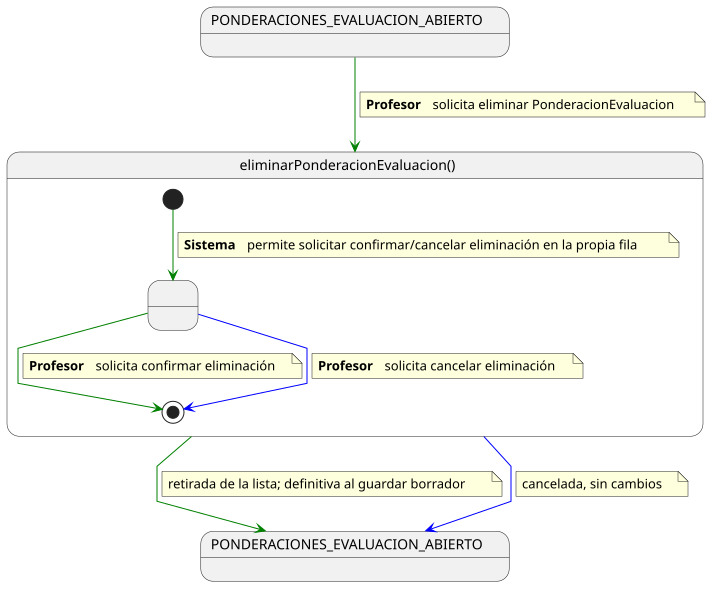
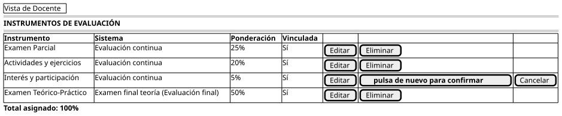

[Modelo del dominio](/RUP/00-modelo-del-dominio/README.md) / [Actores y casos de uso](/RUP/01-requisitos/01-actores-casos-uso/README.md) / [**Detalle**](/RUP/01-requisitos/03-detalle-casos-uso/README.md) / [Análisis](/RUP/02-analisis/casos-uso/eliminarPonderacionEvaluacion/README.md) / [Diseño](/RUP/03-diseño/casos-uso/eliminarPonderacionEvaluacion/README.md) / [Mockups navegables](/docs/PROPUESTA_WIREFRAME/README.md) Subconjunto público de [pyCelda](https://github.com/mmasias/pyCelda) -- incluye modelo de dominio, requisitos, análisis y diseño completos; desarrollo solo para 5 casos de uso elegidos como ejemplo. Sin dashboard de seguimiento.

# pyCelda > eliminarPonderacionEvaluacion()

> |[🏠️](/README.md)|[DdC](/images/RUP/01-requisitos/01-actores-casos-uso/diagramaContextoProfesor.svg)|**Detalle**|[Análisis](/RUP/02-analisis/casos-uso/eliminarPonderacionEvaluacion/README.md)|[Diseño](/RUP/03-diseño/casos-uso/eliminarPonderacionEvaluacion/README.md)|Desarrollo|Pruebas|
> |-|-|-|-|-|-|-|

||
|-|
|
Código fuente: [especificacion.puml](especificacion.puml)
|

||
|-|
|
Código fuente: [wireframes.puml](wireframes.puml)
|

## Información del caso de uso

|Atributo|Valor|
|-|-|
|**Actor**|`Profesor`; `DirectorPrograma` como corrección excepcional de la `Guia`|
|**Objetivo**|Eliminar un `PonderacionEvaluacion` de una `Guia`|
|**Tipo**|Primario, esencial|
|**Nivel**|Objetivo de usuario|

**`DirectorPrograma` como corrección excepcional.** Este caso de uso no tiene endpoint propio: la eliminación queda excluida de la lista de trabajo y se persiste al guardar con [`guardarBorradorGuia()`](../guardarBorradorGuia/README.md), que desvincula (borra) la fila. Como `guardarBorradorGuia()` admite al `DirectorPrograma` sobre las `Guia` de los `Programa` que dirige, el Director también puede eliminar desde las pantallas de gestión, y es ese guardado el que dispara la transición. Regla de transición: `Aprobada -> Borrador` (`revocarAprobacion()`) y `EnRevision -> Rechazada` (`rechazar()`); `Borrador` y `Rechazada` se mantienen. Cada transición real registra un `HistorialCambio` con `campo="estado"`, autor el Director y comentario "corrección directa del Director". Un `DirectorPrograma` que no dirige el `Programa` de la `Guia` recibe `404`. El Director no gana `enviarGuiaARevision()`: el envío a revisión sigue siendo del `Profesor`. Si el mismo email resuelve a `Profesor` que imparte la asignatura y a `DirectorPrograma`, gana la rama `Profesor` (sin transición de estado).

**Sin `<<choice>>` bloqueante, a diferencia de la mayoría de `eliminarX()` del catálogo**: nada depende estructuralmente de una `PonderacionEvaluacion` (no es padre de ninguna otra entidad, a diferencia de `Materia`/`ResultadoAprendizaje`), así que no hay nada que bloquear -- confirmación simple, mismo patrón sin `<<choice>>` que los `desasignar`/`desasociar` de L6/L7. Que la suma deje de dar 100% o que la suma de un `SistemaEvaluacion` caiga fuera de rango tras el borrado no se avisa aquí: ambas validaciones ya están cubiertas en otro punto del flujo -- la primera en [`enviarGuiaARevision()`](../enviarGuiaARevision/README.md) (ya cerrado), la segunda en el próximo `crearPonderacionEvaluacion()`/`editarPonderacionEvaluacion()` que se intente sobre ese mismo `SistemaEvaluacion`.

Solicitada desde el listado ([`abrirPonderacionesEvaluacion()`](../abrirPonderacionesEvaluacion/README.md)), no desde el detalle -- mismo patrón que [`eliminarResultadoAprendizaje()`](../eliminarResultadoAprendizaje/README.md).

**Datos en memoria**: la eliminación no se persiste hasta [`guardarBorradorGuia()`](../guardarBorradorGuia/README.md) o [`enviarGuiaARevision()`](../enviarGuiaARevision/README.md) -- ver [catálogo de actores y casos de uso](/RUP/01-requisitos/01-actores-casos-uso/README.md).

**Confirmación en la propia fila, sin pantalla aparte** (issue [#855](https://github.com/mmasias/pyCelda/issues/855), hallado en la revisión de #853): la aplicación no abre una pantalla de confirmación. Al pulsar la papelera de una fila, ese mismo botón pasa a "🗑️ pulsa de nuevo para confirmar" y aparece a su lado **Cancelar** (`PonderacionesEvaluacion.tsx`, `idAConfirmar`); la segunda pulsación confirma y **Cancelar** deja la fila como estaba. Al confirmar, la fila desaparece de la lista de instrumentos de evaluación, pero es solo una marca en el navegador: el borrado se hace definitivo al pulsar **Guardar borrador** en la ficha de la guía ([`guardarBorradorGuia()`](../guardarBorradorGuia/README.md)), y si se cierra el navegador sin guardar, la fila sigue existiendo la próxima vez que se entra. El wireframe dibuja el listado con una fila en ese estado de confirmación. En el wireframe, los botones de icono de la aplicación (lápiz, papelera) se escriben con su nombre.

## Notas de diseño y trazabilidad

- Wireframe alineado con la pantalla construida (#857): cabecera de subpantalla de la variante de Profesor ("Guía docente" con Inicio, Mis programas, Mi perfil y Cerrar sesión, y la fila de miga "GII · Programación I › Evaluación" con "Crear instrumento"), en lugar del rótulo "INSTRUMENTOS DE EVALUACIÓN"; "Total asignado" en el pie de la tabla, bajo Ponderación; etiquetas de sistema con la misma regla que [`abrirPonderacionesEvaluacion()`](../abrirPonderacionesEvaluacion/README.md). Dibuja solo la parte superior de la pantalla de evaluación (la tabla de instrumentos); la tabla de sistemas y el texto de convocatorias, debajo, están en el wireframe de `abrirPonderacionesEvaluacion()`. La fila pendiente de confirmar sigue contando en el total hasta la segunda pulsación. El DirectorPrograma ve la misma confirmación en la fila, con la cabecera de su programa (variante de Dirección de `abrirPonderacionesEvaluacion()`). La marca de "eliminada" se guarda en el almacenamiento de la pestaña del navegador: sobrevive a recargar la página, no a cerrar la pestaña.

## Referencias

- [Diagrama de contexto de Profesor](/RUP/01-requisitos/01-actores-casos-uso/diagramaContextoProfesor.puml) -- `PONDERACIONES_EVALUACION_ABIERTO --> PONDERACIONES_EVALUACION_ABIERTO : eliminarPonderacionEvaluacion()`
- [actoresCasosUsoProfesor.puml](/RUP/01-requisitos/01-actores-casos-uso/actoresCasosUsoProfesor.puml) -- catálogo de casos de uso de `Profesor` sobre `PonderacionEvaluacion`
- [Modelo del dominio](/RUP/00-modelo-del-dominio/modeloDominio.puml) -- `Guia *-d- PonderacionEvaluacion`, sin entidad que dependa de ella
