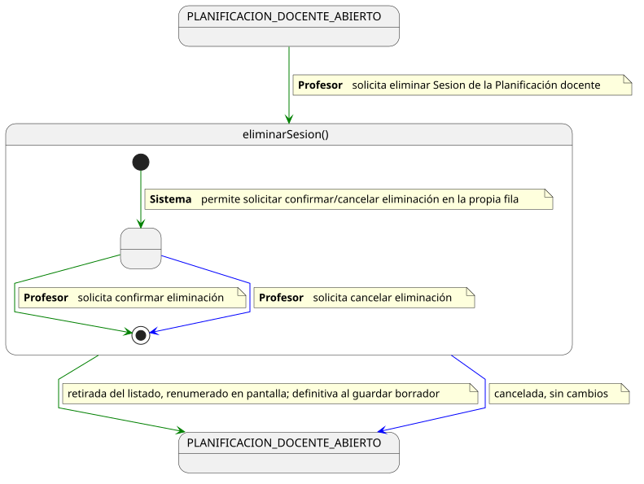
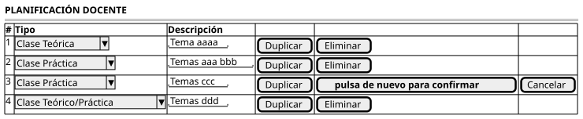

[Modelo del dominio](/RUP/00-modelo-del-dominio/README.md) / [Actores y casos de uso](/RUP/01-requisitos/01-actores-casos-uso/README.md) / [**Detalle**](/RUP/01-requisitos/03-detalle-casos-uso/README.md) / [Análisis](/RUP/02-analisis/casos-uso/eliminarSesion/README.md) / [Diseño](/RUP/03-diseño/casos-uso/eliminarSesion/README.md) / [Mockups navegables](/docs/PROPUESTA_WIREFRAME/README.md) Subconjunto público de [pyCelda](https://github.com/mmasias/pyCelda) -- incluye modelo de dominio, requisitos, análisis y diseño completos; desarrollo solo para 5 casos de uso elegidos como ejemplo. Sin dashboard de seguimiento.

# pyCelda > eliminarSesion()

> |[🏠️](/README.md)|[DdC](/images/RUP/01-requisitos/01-actores-casos-uso/diagramaContextoProfesor.svg)|**Detalle**|[Análisis](/RUP/02-analisis/casos-uso/eliminarSesion/README.md)|[Diseño](/RUP/03-diseño/casos-uso/eliminarSesion/README.md)|Desarrollo|Pruebas|
> |-|-|-|-|-|-|-|

||
|-|
|
Código fuente: [especificacion.puml](especificacion.puml)
|

||
|-|
|
Código fuente: [wireframes.puml](wireframes.puml)
|

## Información del caso de uso

|Atributo|Valor|
|-|-|
|**Actor**|`Profesor`; `DirectorPrograma` como corrección excepcional de la `Guia`|
|**Objetivo**|Eliminar una `Sesion` de la `PlanificacionDocente`; el listado se renumera visualmente para no dejar huecos|
|**Tipo**|Primario|
|**Nivel**|Usuario|

**`DirectorPrograma` como corrección excepcional.** Este caso de uso no tiene endpoint propio: la eliminación queda excluida de la lista de trabajo y se persiste al guardar con [`guardarBorradorGuia()`](../guardarBorradorGuia/README.md), que desvincula (borra) la fila. Como `guardarBorradorGuia()` admite al `DirectorPrograma` sobre las `Guia` de los `Programa` que dirige, el Director también puede eliminar desde las pantallas de gestión, y es ese guardado el que dispara la transición. Regla de transición: `Aprobada -> Borrador` (`revocarAprobacion()`) y `EnRevision -> Rechazada` (`rechazar()`); `Borrador` y `Rechazada` se mantienen. Cada transición real registra un `HistorialCambio` con `campo="estado"`, autor el Director y comentario "corrección directa del Director". Un `DirectorPrograma` que no dirige el `Programa` de la `Guia` recibe `404`. El Director no gana `enviarGuiaARevision()`: el envío a revisión sigue siendo del `Profesor`. Si el mismo email resuelve a `Profesor` que imparte la asignatura y a `DirectorPrograma`, gana la rama `Profesor` (sin transición de estado).

**Renumeración visual, sin tocar `numero` persistido** (alineado con lo construido, Bloque 2 de la discussion [#206](https://github.com/mmasias/pyCelda/discussions/206); la decisión de Manuel sobre "renumerar para no dejar huecos" se materializó en presentación): al eliminar una `Sesion` intermedia, el listado no deja huecos porque la numeración que ve el profesor es **posicional** (el orden de la lista, no `Sesion.numero`). `Sesion.numero` persistido conserva el valor de alta y puede quedar con huecos, sin efecto observable -- el orden se mantiene y `siguiente_numero` es `max + 1`. No hay caso de uso de reordenar (decisión 6 de discussion [#140](https://github.com/mmasias/pyCelda/discussions/140)).

Contraste con [`importarPlanificacionDocenteDeGuiaHermana()`](../importarPlanificacionDocenteDeGuiaHermana/README.md) (issue [#184](https://github.com/mmasias/pyCelda/issues/184)): allí la renumeración `1..N` **sí** toca `Sesion.numero` persistido, porque las filas son nuevas (copiadas de la guía hermana) y su valor de alta es esa secuencia -- no es un reajuste retroactivo de filas ya existentes como aquí.

Solicitada desde el listado ([`abrirPlanificacionDocente()`](../abrirPlanificacionDocente/README.md)), con confirmación explícita en la propia fila antes de eliminar -- mismo patrón de dos ramas (confirmar/cancelar) que el resto de `eliminarX()` del catálogo con confirmación simple, sin `<<choice>>` bloqueante: nada depende estructuralmente de una `Sesion`.

**Datos en memoria**: la eliminación no se persiste hasta [`guardarBorradorGuia()`](../guardarBorradorGuia/README.md) o [`enviarGuiaARevision()`](../enviarGuiaARevision/README.md) -- ver [catálogo de actores y casos de uso](/RUP/01-requisitos/01-actores-casos-uso/README.md).

**Confirmación en la propia fila, sin pantalla aparte** (issue [#855](https://github.com/mmasias/pyCelda/issues/855), hallado en la revisión de #853): la aplicación no abre una pantalla de confirmación. Al pulsar la papelera de una fila, ese mismo botón pasa a "🗑️ pulsa de nuevo para confirmar" y aparece a su lado **Cancelar** (`PlanificacionDocente.tsx`, `idAConfirmar`); la segunda pulsación confirma y **Cancelar** deja la fila como estaba. Al confirmar, la fila desaparece de la lista de planificación docente, pero es solo una marca en el navegador: el borrado se hace definitivo al pulsar **Guardar borrador** en la ficha de la guía ([`guardarBorradorGuia()`](../guardarBorradorGuia/README.md)), y si se cierra el navegador sin guardar, la fila sigue existiendo la próxima vez que se entra. El wireframe dibuja el listado con una fila en ese estado de confirmación. En el wireframe, los botones de icono de la aplicación (lápiz, papelera) se escriben con su nombre. La renumeración se ve al confirmar: la sesión desaparece y las siguientes suben un puesto; la confirmación no avisa de ello en texto.

## Referencias

- [Diagrama de contexto de Profesor](/RUP/01-requisitos/01-actores-casos-uso/diagramaContextoProfesor.puml) -- `PLANIFICACION_DOCENTE_ABIERTO --> PLANIFICACION_DOCENTE_ABIERTO : eliminarSesion()`
- [actoresCasosUsoProfesor.puml](/RUP/01-requisitos/01-actores-casos-uso/actoresCasosUsoProfesor.puml) -- catálogo de casos de uso de `Profesor` sobre `PlanificacionDocente`
- [Modelo del dominio](/RUP/00-modelo-del-dominio/modeloDominio.puml) -- `PlanificacionDocente *-- Sesion`, sin entidad que dependa de `Sesion`
- [Discussion #140](https://github.com/mmasias/pyCelda/discussions/140) -- cierre de las 8 decisiones de diseño de la Planificación docente
