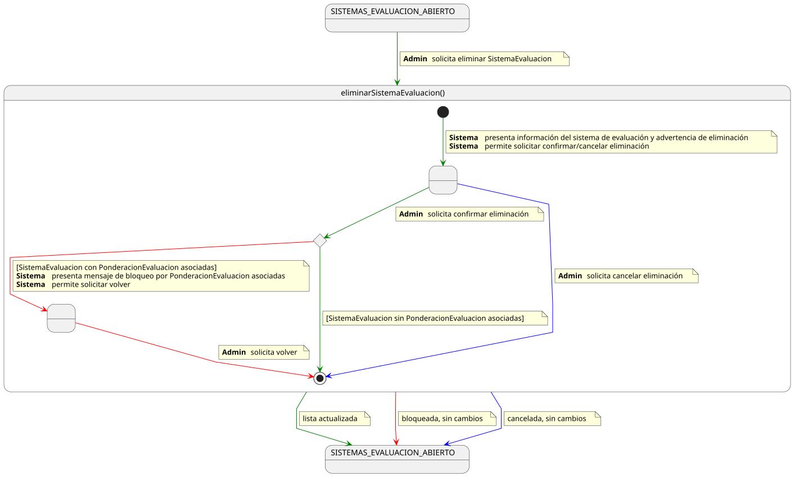
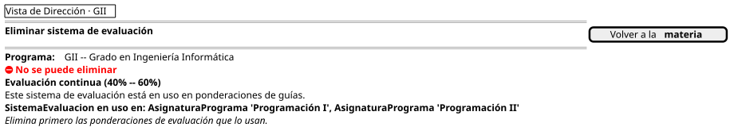
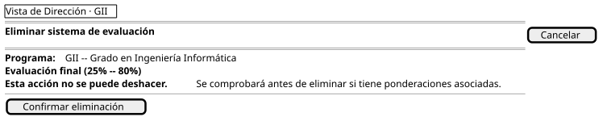

[Modelo del dominio](/RUP/00-modelo-del-dominio/README.md) / [Actores y casos de uso](/RUP/01-requisitos/01-actores-casos-uso/README.md) / [**Detalle**](/RUP/01-requisitos/03-detalle-casos-uso/README.md) / [Análisis](/RUP/02-analisis/casos-uso/eliminarSistemaEvaluacion/README.md) / [Diseño](/RUP/03-diseño/casos-uso/eliminarSistemaEvaluacion/README.md) / [Mockups navegables](/docs/PROPUESTA_WIREFRAME/README.md) Subconjunto público de [pyCelda](https://github.com/mmasias/pyCelda) -- incluye modelo de dominio, requisitos, análisis y diseño completos; desarrollo solo para 5 casos de uso elegidos como ejemplo. Sin dashboard de seguimiento.

# pyCelda > eliminarSistemaEvaluacion()

> |[🏠️](/README.md)|[DdC](/images/RUP/01-requisitos/01-actores-casos-uso/diagramaContextoAdmin.svg)|**Detalle**|[Análisis](/RUP/02-analisis/casos-uso/eliminarSistemaEvaluacion/README.md)|[Diseño](/RUP/03-diseño/casos-uso/eliminarSistemaEvaluacion/README.md)|Desarrollo|Pruebas|
> |-|-|-|-|-|-|-|

||
|-|
|
Código fuente: [especificacion.puml](especificacion.puml)
|

|Bloqueada (en uso)|Confirmación (sin uso)|
|:-:|:-:|
|||
||
Código fuente: [wireframes.puml](wireframes.puml)
|

## Información del caso de uso

|Atributo|Valor|
|-|-|
|**Actor**|`Admin`, `DirectorPrograma` (issue [#755](https://github.com/mmasias/pyCelda/issues/755))|
|**Objetivo**|Eliminar un `SistemaEvaluacion` de una `Materia`, siempre que ninguna `PonderacionEvaluacion` lo use|
|**Tipo**|Primario, esencial|
|**Nivel**|Objetivo de usuario|

Borrado físico bloqueado relacionalmente, mismo patrón que `eliminarFacultad()`/`eliminarMetodologiaDocente()`/`eliminarMateria()`: `SistemaEvaluacion` no tiene `estado` propio -- vive y muere con la `Materia` que lo contiene, así que su borrado es siempre físico. El bloqueo usa `PonderacionEvaluacion` (`PonderacionEvaluacion --> SistemaEvaluacion`), no `AsignaturaPrograma` como `eliminarMateria()`: es la relación real que referencia a `SistemaEvaluacion`, desde la Guía. "Evaluación continua"/"Evaluación final" para bloqueada/confirmación son los dos valores reales de `tipo`; qué `PonderacionEvaluacion` concretas lo usan no está en el seed (`Guia`/`PonderacionEvaluacion` son L7/L8, todavía sin construir).

El mensaje de bloqueo nombra las `AsignaturaPrograma` donde el `SistemaEvaluacion` está en uso (`SistemaEvaluacion en uso en: AsignaturaPrograma 'Programación I', ...`), no cuenta ponderaciones: mismo patrón que `desasociarResultadoAprendizaje()` (issue #581). La comprobación no se hace al entrar: el usuario ve siempre primero la confirmación, y el bloqueo aparece si el servidor rechaza el borrado al confirmar (409).

**Actor `DirectorPrograma` (issue [#755](https://github.com/mmasias/pyCelda/issues/755))**: el `DirectorPrograma` gana esta transición sobre las materias de sus programas, espejo de `Admin`. Mismo formulario y mismas reglas; es un self-loop de `MATERIA_ABIERTO` en [diagramaContextoDirectorPrograma.puml](/RUP/01-requisitos/01-actores-casos-uso/diagramaContextoDirectorPrograma.puml), que vuelve a la ficha de la materia.

## Notas de diseño y trazabilidad

- Wireframe alineado con la pantalla construida (#858), vista del DirectorPrograma (entrada desde la ficha de la materia; vuelve a ella): la pantalla de confirmación sale siempre primero, con el sistema como "tipo (mínima% -- máxima%)" y el aviso "Esta acción no se puede deshacer. Se comprobará antes de eliminar si tiene ponderaciones asociadas."; Cancelar va en la cabecera. El bloqueo no se decide al entrar: aparece solo si, al confirmar, el servidor rechaza el borrado porque hay ponderaciones que usan el sistema. La pantalla bloqueada muestra "⛔ No se puede eliminar", el sistema, "Este sistema de evaluación está en uso en ponderaciones de guías.", el mensaje literal del servidor ("SistemaEvaluacion en uso en: AsignaturaPrograma '...'") y la ayuda "Elimina primero las ponderaciones de evaluación que lo usan.", con "Volver a la materia" en la cabecera. Especificación reordenada en consecuencia (confirmación antes del `<<choice>>`).
- Wireframe alineado con la pantalla construida (#873): la variante de `Admin` (`eliminarSistemaEvaluacion-wireframe-admin`) es la misma confirmación sin etiqueta de vista (Cancelar en la cabecera, sistema, aviso y "Confirmar eliminación" al pie); se entra desde la lista de sistemas de evaluación de la materia y vuelve a ella. La pantalla bloqueada de `Admin` es la de `wireframe-bloqueada` salvo el botón de la cabecera, que dice "Volver a los sistemas de evaluación" (en lugar de "Volver a la materia") y lleva a esa lista; no se dibuja aparte.

## Referencias

- [Diagrama de contexto de Admin](/RUP/01-requisitos/01-actores-casos-uso/diagramaContextoAdmin.puml) -- `SISTEMAS_EVALUACION_ABIERTO --> SISTEMAS_EVALUACION_ABIERTO : eliminarSistemaEvaluacion()`
- [actoresCasosUsoAdminOperativa.puml](/RUP/01-requisitos/01-actores-casos-uso/actoresCasosUsoAdminOperativa.puml) -- catálogo de casos de uso de `Admin` sobre `SistemaEvaluacion`
- [Modelo del dominio](/RUP/00-modelo-del-dominio/modeloDominio.puml) -- `PonderacionEvaluacion -> SistemaEvaluacion` (origen de la regla de bloqueo)
