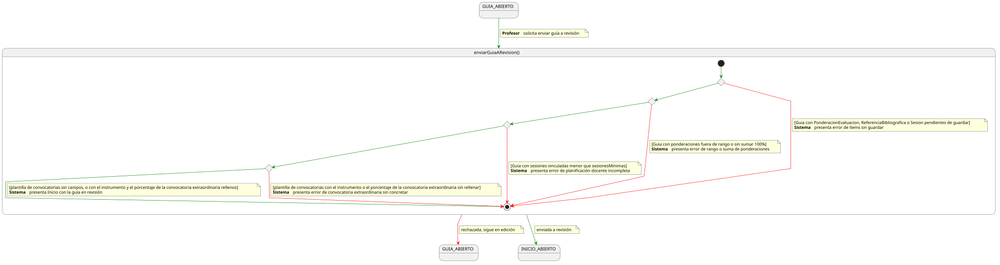
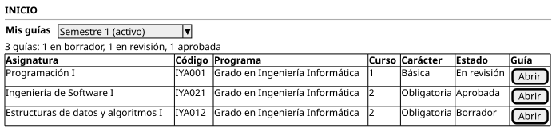
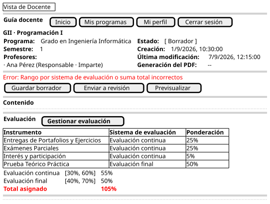
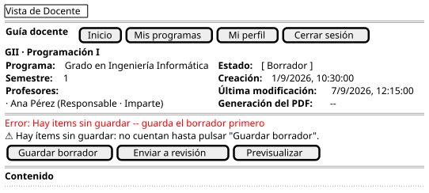
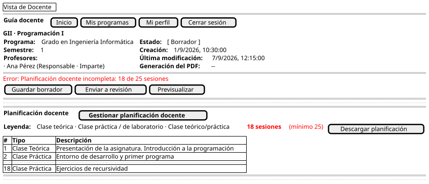
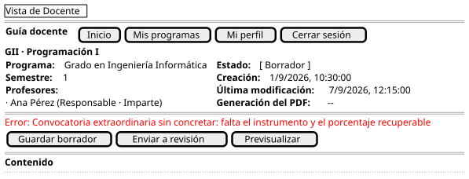

[Modelo del dominio](/RUP/00-modelo-del-dominio/README.md) / [Actores y casos de uso](/RUP/01-requisitos/01-actores-casos-uso/README.md) / [**Detalle**](/RUP/01-requisitos/03-detalle-casos-uso/README.md) / [Análisis](/RUP/02-analisis/casos-uso/enviarGuiaARevision/README.md) / [Diseño](/RUP/03-diseño/casos-uso/enviarGuiaARevision/README.md) / [Mockups navegables](/docs/PROPUESTA_WIREFRAME/README.md) Subconjunto público de [pyCelda](https://github.com/mmasias/pyCelda) -- incluye modelo de dominio, requisitos, análisis y diseño completos; desarrollo solo para 5 casos de uso elegidos como ejemplo. Sin dashboard de seguimiento.

# pyCelda > enviarGuiaARevision()

> |[🏠️](/README.md)|[DdC](/images/RUP/01-requisitos/01-actores-casos-uso/diagramaContextoProfesor.svg)|**Detalle**|[Análisis](/RUP/02-analisis/casos-uso/enviarGuiaARevision/README.md)|[Diseño](/RUP/03-diseño/casos-uso/enviarGuiaARevision/README.md)|[Desarrollo](/RUP/04-desarrollo/casos-uso/enviarGuiaARevision/README.md)|Pruebas|
> |-|-|-|-|-|-|-|

||
|-|
|
Código fuente: [especificacion.puml](especificacion.puml)
|

|Éxito (vuelve a Inicio, guía En revisión)|Error (rango o suma incorrectos)|
|:-:|:-:|
|||
|||
|||
||
Código fuente: [wireframes.puml](wireframes.puml)
|

## Información del caso de uso

|Atributo|Valor|
|-|-|
|**Actor**|`Profesor`|
|**Objetivo**|Enviar la `Guia` de una `AsignaturaPrograma` a revisión del director de programa, exigiendo, en cascada: que no queden ítems sin guardar (`c1`); que las `PonderacionEvaluacion` cumplan el rango por `SistemaEvaluacion` y sumen exactamente 100% (`c2`); que la planificación docente tenga al menos `sesiones_minimas` `Sesion` vinculadas (`c3`); y que la convocatoria extraordinaria esté concretada (`c4`)|
|**Tipo**|Primario, esencial|
|**Nivel**|Objetivo de usuario|

**Ítems sin guardar -- alcance** (Bloque 2 de la discussion [#206](https://github.com/mmasias/pyCelda/discussions/206)): la primera comprobación (`c1`, `409`) cubre las tres colecciones de la sesión de edición de la `Guia` -- `PonderacionEvaluacion`, `ReferenciaBibliografica` **y** `Sesion`. Una `Sesion` creada o editada sin pasar por [`guardarBorradorGuia()`](../guardarBorradorGuia/README.md) bloquea el envío igual que las otras dos. El backend no contaba las sesiones hasta #206, aunque el RUP de [`crearSesion()`](../crearSesion/README.md)/[`editarSesion()`](../editarSesion/README.md) y el frontend ya asumían el patrón.

**Planificación docente mínima** (`c3`, Bloque 3 de la discussion [#206](https://github.com/mmasias/pyCelda/discussions/206)): tras `c1` y `c2`, la `Guia` sólo pasa a `EnRevision` si sus `Sesion` vinculadas son al menos `Guia.sesiones_minimas` (`422`, mensaje "Planificación docente incompleta: N de M sesiones"). Regla agregada de la misma familia que la suma de ponderaciones = 100% -- la responde `Guia.planificacion_docente_completa()` (Fat Model). El umbral es config de la [`AsignaturaPrograma`](../abrirAsignaturaPrograma/README.md) editable por Admin y `DirectorPrograma` (`sesiones_minimas`, por defecto 25, cota 0-100; con 0 `c3` se cumple siempre), que la `Guia` lee en vivo (issue [#808](https://github.com/mmasias/pyCelda/issues/808)): `c3` se valida siempre contra el mínimo vigente de la asignatura, sin copia en la `Guia` que sincronizar (sustituye al snapshot al nacer de la discussion #206 y a su resincronización del issue [#804](https://github.com/mmasias/pyCelda/issues/804)). El medidor "N / M sesiones" en [`abrirPlanificacionDocente()`](../abrirPlanificacionDocente/README.md) y en [`abrirGuia()`](../abrirGuia/README.md) hace visible la regla mientras el `Profesor` edita, sin esperar al rechazo.

**Convocatoria extraordinaria concretada** (`c4`, issue [#791](https://github.com/mmasias/pyCelda/issues/791)): tras `c3`, si la plantilla del texto de convocatorias tiene los dos campos de la convocatoria extraordinaria (asignatura normal, prácticas de laboratorio), los dos tienen que estar rellenos (`422`, "Convocatoria extraordinaria sin concretar: falta el instrumento y el porcentaje recuperable", o solo el que falte). La responde `Guia.bloqueo_convocatoria()`. Se rellenan en [`editarTextoSistemaEvaluacion()`](../editarTextoSistemaEvaluacion/README.md). Sin esta regla, el "pendiente de concretar" llegaba a las guías aprobadas.

**Interacción con la importación entre guías hermanas** (issue [#184](https://github.com/mmasias/pyCelda/issues/184)): al importar bibliografía o planificación docente de una guía hermana, las filas copiadas replican el flag `vinculada` **del origen** fila a fila. Un origen `Aprobado` por el flujo normal tiene todas las filas vinculadas (lo garantiza `c1` de arriba), así que sus copias también -- sin efecto sobre este caso de uso. Pero si el origen llegó a `Aprobada` vía [`escalarGuiaAAprobada()`](../escalarGuiaAAprobada/README.md) (que bypasea `c1`) arrastrando candidatas `vinculada=False`, el destino las hereda y **`c1` bloquea su envío** hasta que el `Profesor` las resuelva -- vincularlas vía [`guardarBorradorGuia()`](../guardarBorradorGuia/README.md) o borrarlas. Consecuencia real y correcta, no un defecto: viene de la escalación del origen, no de "cualquier guía Aprobada". `c3` sigue midiendo contra `Guia.sesiones_minimas` del destino, que la importación no toca: importar la planificación de una hermana con más sesiones no garantiza cumplir el umbral propio si éste es mayor.

**Salida con éxito: Inicio, sin pantalla de confirmación** (issue [#855](https://github.com/mmasias/pyCelda/issues/855), hallado en la revisión de #853): tras un envío aceptado, la aplicación vuelve a **Inicio** (`AbrirGuia.tsx`, `navigate("/inicio")`), donde la guía aparece ya **En revisión** en "Mis guías". No hay pantalla intermedia "Guía enviada a revisión" ni botón "Volver a mis asignaturas": el wireframe de éxito dibuja esa llegada a Inicio, y la transición de salida del diagrama de contexto pasa de `ASIGNATURAS_PROGRAMA_ABIERTO` a `INICIO_ABIERTO` (en el de `Profesor` y en el heredado de `DirectorPrograma`). Antes de enviar, si el temario tiene cambios sin guardar, la aplicación pide confirmación para salir (el envío no incluye el temario sin guardar). **Rechazo: el mensaje sale en la propia ficha** (issue [#857](https://github.com/mmasias/pyCelda/issues/857)): no hay pantalla "No se puede enviar a revisión" ni botón "Volver a la guía". La aplicación se queda en la ficha de la guía y muestra, sobre sus botones y en rojo, "Error: " seguido del motivo que da el sistema: "Hay items sin guardar -- guarda el borrador primero" (`c1`); "Rango por sistema de evaluación o suma total incorrectos", o el sistema concreto que falla ("Falta asignar 5% en ... (mínimo 30%, asignado 25%)", "Sobra ...") (`c2`); "Planificación docente incompleta: 18 de 25 sesiones" (`c3`); "Convocatoria extraordinaria sin concretar: falta el instrumento y el porcentaje recuperable", o solo el que falte (`c4`). Si la sesión ha caducado, en lugar del error aparece el aviso para entrar de nuevo en otra pestaña, sin salir de la guía.

## Notas de diseño y trazabilidad

- Wireframe alineado con la pantalla construida (#857): las cuatro variantes de rechazo (`-error`, `-error-items-sin-guardar`, `-error-planificacion`, `-error-convocatoria`) dejan de ser una pantalla propia "NO SE PUEDE ENVIAR A REVISIÓN" con texto de ayuda y botón "Volver a la guía": dibujan la ficha de la guía (cabecera de la vista de Docente, "GII · Programación I", datos de la guía) con el mensaje real del sistema, "Error: ...", sobre los botones Guardar borrador, Enviar a revisión y Previsualizar, y debajo la sección afectada (Evaluación con el total en rojo; Planificación docente con "18 sesiones (mínimo 25)" en rojo). Los "..." marcan las secciones de la ficha que no se dibujan. En el rechazo por ítems sin guardar se ve también el aviso de la ficha "Hay ítems sin guardar". La variante `-exito` (Inicio) se alinea aparte con [`abrirInicio()`](../abrirInicio/README.md).

## Referencias

- [Diagrama de contexto de Profesor](/RUP/01-requisitos/01-actores-casos-uso/diagramaContextoProfesor.puml) -- `GUIA_ABIERTO --> INICIO_ABIERTO : enviarGuiaARevision()` (éxito) y `GUIA_ABIERTO --> GUIA_ABIERTO : enviarGuiaARevision()` (rechazo, por ítems sin guardar o por validación de ponderaciones -- ambas razones convergen al mismo estado de salida).
- [actoresCasosUsoProfesor.puml](/RUP/01-requisitos/01-actores-casos-uso/actoresCasosUsoProfesor.puml) -- catálogo de casos de uso de `Profesor` sobre `Guia`
- [Modelo del dominio](/RUP/00-modelo-del-dominio/modeloDominio.puml) -- `Guia *-d- PonderacionEvaluacion`, regla de suma 100% documentada en el README
- [Diagrama de estados de Guia](/RUP/00-modelo-del-dominio/estados-entidades/guia.puml) -- `Borrador -> EnRevision` / `Rechazada -> EnRevision`
- **Corregido tras la fase de Análisis** (rebanada vertical del hilo `Guia`, 2026-08-18): la especificación pasa de un `<<choice>>` a dos encadenados -- primero comprueba que no queden ítems pendientes-sin-vincular (creados o editados en las sub-vistas de `PonderacionEvaluacion`/`ReferenciaBibliografica` sin haber pasado por `guardarBorradorGuia()`), y solo entonces valida rango por `SistemaEvaluacion` y suma total = 100%. Ver [`RUP/02-analisis/casos-uso/enviarGuiaARevision/README.md`](/RUP/02-analisis/casos-uso/enviarGuiaARevision/README.md) para el detalle de ambas comprobaciones.
- **Ampliado en el Bloque 3 de la [discussion #206](https://github.com/mmasias/pyCelda/discussions/206)**: se añade `c3` encadenado tras `c2` (planificación docente < `sesiones_minimas`). Con eso los tres motivos de rechazo del dominio quedan modelados como ramas propias -- se cierra la pregunta abierta que Análisis dejaba señalada sobre si Requisitos necesitaba una tercera rama. Se generan además los dos wireframes que faltaban: el rechazo por ítems sin guardar (`c1`, pendiente desde `3ee9d38`) y el rechazo por planificación docente incompleta (`c3`).
