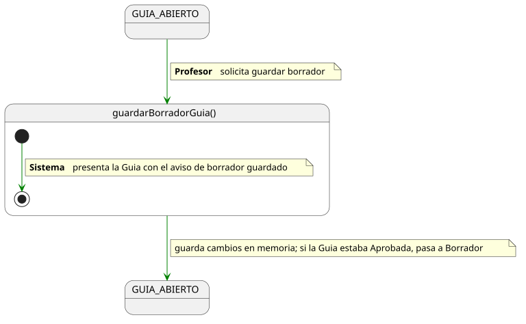
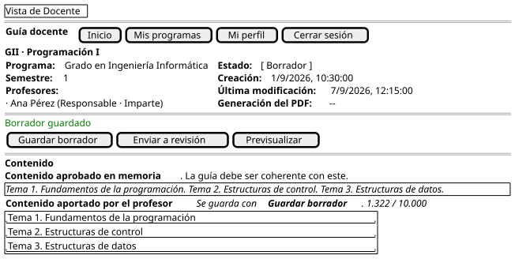
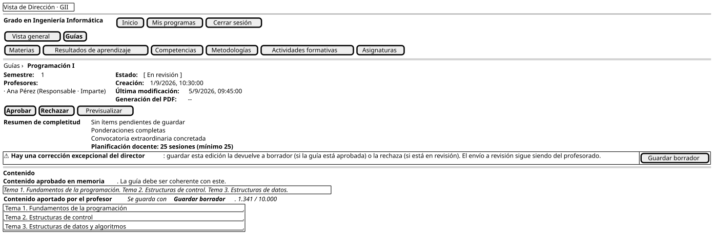
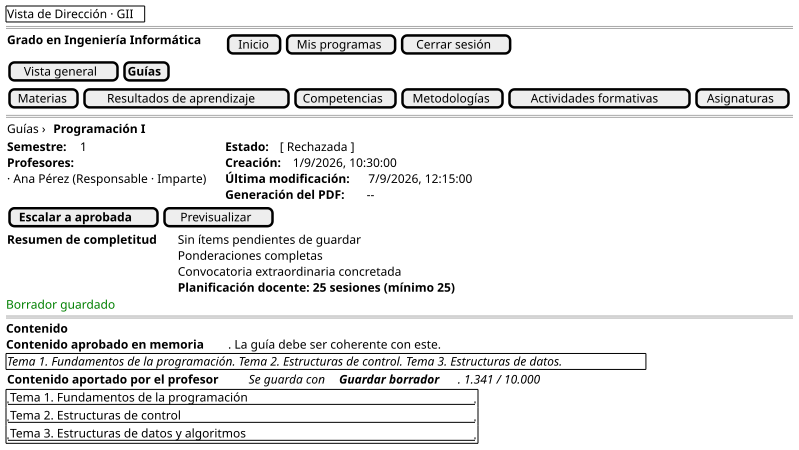

[Modelo del dominio](/RUP/00-modelo-del-dominio/README.md) / [Actores y casos de uso](/RUP/01-requisitos/01-actores-casos-uso/README.md) / [**Detalle**](/RUP/01-requisitos/03-detalle-casos-uso/README.md) / [Análisis](/RUP/02-analisis/casos-uso/guardarBorradorGuia/README.md) / [Diseño](/RUP/03-diseño/casos-uso/guardarBorradorGuia/README.md) / [Mockups navegables](/docs/PROPUESTA_WIREFRAME/README.md) Subconjunto público de [pyCelda](https://github.com/mmasias/pyCelda) -- incluye modelo de dominio, requisitos, análisis y diseño completos; desarrollo solo para 5 casos de uso elegidos como ejemplo. Sin dashboard de seguimiento.

# pyCelda > guardarBorradorGuia()

> |[🏠️](/README.md)|[DdC](/images/RUP/01-requisitos/01-actores-casos-uso/diagramaContextoProfesor.svg)|**Detalle**|[Análisis](/RUP/02-analisis/casos-uso/guardarBorradorGuia/README.md)|[Diseño](/RUP/03-diseño/casos-uso/guardarBorradorGuia/README.md)|Desarrollo|Pruebas|
> |-|-|-|-|-|-|-|

||
|-|
|
Código fuente: [especificacion.puml](especificacion.puml)
|

|Profesor|Dirección: corrección excepcional|Dirección: guardado|
|:-:|:-:|:-:|
||||
|||
Código fuente: [wireframes.puml](wireframes.puml)
|

## Información del caso de uso

|Atributo|Valor|
|-|-|
|**Actor**|`Profesor`; `DirectorPrograma` como corrección excepcional de la `Guia`|
|**Objetivo**|Persistir como `Borrador` los cambios en memoria de la `Guia` abierta|
|**Tipo**|Primario, esencial|
|**Nivel**|Objetivo de usuario|

**`DirectorPrograma` como corrección excepcional.** Además del `Profesor`, el `DirectorPrograma` del `Programa` de la `Guia` puede guardar su contenido desde la pantalla de revisión de [`abrirGuia()`](../abrirGuia/README.md). Regla de transición: `Aprobada -> Borrador` (`revocarAprobacion()`) y `EnRevision -> Rechazada` (`rechazar()`); `Borrador` y `Rechazada` se mantienen. Cada transición real registra un `HistorialCambio` con `campo="estado"`, autor el Director y comentario "corrección directa del Director". Un `DirectorPrograma` que no dirige el `Programa` de la `Guia` recibe `404`. El Director no gana `enviarGuiaARevision()`: el envío a revisión sigue siendo del `Profesor`. Si el mismo email resuelve a `Profesor` que imparte la asignatura y a `DirectorPrograma`, gana la rama `Profesor` (sin transición de estado). Aplica a las tres colecciones y al `contenido` (temario): el Director guarda con el mismo `PUT` que el `Profesor`, y las filas de `HistorialCambio` de `ponderaciones_evaluacion`, `referencias_bibliograficas` y `contenido` llevan como autor al Director. La transición se aplica antes de escribir, de modo que sobre una `Guia` `Aprobada` la fila de estado la registra la regla del Director (el degradado propio del `Profesor` por `confirmar_guardado()` no genera fila de estado).

**Self-loop sobre `GUIA_ABIERTO`, no un `<<choice>>`**: a diferencia de `enviarGuiaARevision()` (que sí valida la suma de `PonderacionEvaluacion` antes de aceptar), guardar como borrador no tiene ninguna precondición de dominio que pueda rechazarlo -- salvo el tope de longitud del `contenido` (ver abajo), que es una barrera de entrada, no una regla del statechart; la especificación sigue sin rama roja.

**Persiste también el `contenido` (temario) de la `Guia`** (discussion [#191](https://github.com/mmasias/pyCelda/discussions/191), retroceso a Modelo/Requisitos): `contenido` pasa a ser un campo editable más del formulario de [`abrirGuia()`](../abrirGuia/README.md) (`textarea` en lugar de `(heredado de AsignaturaPrograma)`), sin caso de uso nuevo -- el objetivo de `guardarBorradorGuia()` ya es genérico ("persistir los cambios en memoria de la `Guia` abierta"). Cada edición real del texto genera una fila de `HistorialCambio` (`campo="contenido"`, autor quien guarda: el profesor o, como corrección excepcional, el Director). El `contenido` viaja con la guía al enviarla a revisión (`enviarGuiaARevision()`); en la pantalla de revisión el `DirectorPrograma` lo ve en un `textarea` editable y lo guarda con este mismo caso de uso.

**Tope de longitud del `contenido`** (issue [#303](https://github.com/mmasias/pyCelda/issues/303), hallazgo H-12 del informe de pruebas del rol `Profesor`): el temario se rechaza con un `422` (`El contenido supera el límite de 10.000 caracteres`) si pasa de `LIMITE_CONTENIDO_GUIA` = 10.000 caracteres -- ~2x el máximo real medido en producción (4.801, sobre 108 guías). Es una barrera de entrada contra un pegado accidental (un profesor pegó ~210 KB durante la beta, que se guardó íntegro y habría llegado al PDF oficial), no una precondición del dominio: no abre rama en el diagrama de estados ni un `<<choice>>` en la especificación -- misma naturaleza que un tope de tamaño de cuerpo de petición. Se comprueba en el router antes de sincronizar nada, así que el rechazo es atómico: un intento con el temario demasiado largo no vincula ni desvincula `PonderacionEvaluacion`/`ReferenciaBibliografica`/`Sesion`. El `textarea` de [`abrirGuia()`](../abrirGuia/README.md) lleva `maxlength` y un contador de caracteres visible (`1.322 / 10.000`) que se pone en rojo al alcanzar el tope. Sin migración: ninguna guía viva supera el límite.

**No es un self-loop trivial**: sobre una `Guia` ya en `Borrador` o `Rechazada`, guarda sin cambiar de estado; pero si la `Guia` estaba `Aprobada`, este mismo caso de uso es el disparador real de la transición `Aprobada -> Borrador` del [diagrama de estados de `Guia`](/RUP/00-modelo-del-dominio/estados-entidades/guia.puml) -- el `Profesor` detecta un error y empieza a corregirlo sin terminar en el momento (a diferencia de `enviarGuiaARevision()`, que cubre el caso en que la corrección ya queda resuelta). Desde el issue [#184](https://github.com/mmasias/pyCelda/issues/184), [`importarBibliografiaDeGuiaHermana()`](../importarBibliografiaDeGuiaHermana/README.md) e [`importarPlanificacionDocenteDeGuiaHermana()`](../importarPlanificacionDocenteDeGuiaHermana/README.md) disparan la misma transición por el mismo mecanismo (`Guia.confirmar_guardado()`) -- importar es una edición de contenido, si toca una guía `Aprobada` la devuelve a `Borrador`. El matiz se narra en prosa en la nota de la transición de salida (`estado pasa a Extinguido`-style, mismo mecanismo que usa [`eliminarAsignatura()`](../eliminarAsignatura/README.md) para narrar un cambio de estado sin abrir una rama nueva del statechart) -- no hace falta un `<<choice>>` ni una segunda especificación: sigue siendo una única transición.

**Sin pantalla de confirmación: el aviso sale en la propia ficha** (issue [#855](https://github.com/mmasias/pyCelda/issues/855), hallado en la revisión de #853): al guardar, la aplicación recarga la guía y muestra "Borrador guardado" en la misma ficha (`AbrirGuia.tsx`, `mensajeExito`), sobre los botones; no hay pantalla "Borrador guardado" con botón "Seguir editando". El wireframe del `Profesor` dibuja esa ficha tras guardar. En la vista de Dirección hay dos wireframes: antes de guardar, el recuadro de corrección excepcional (aviso y botón **Guardar borrador**), que solo aparece cuando hay algo que guardar -- temario cambiado, ítems pendientes de evaluación, bibliografía o planificación, o eliminaciones sin confirmar --; y después de guardar sobre una `Guia` `EnRevision`, la ficha ya `Rechazada` (los botones pasan a los de ese estado), sin recuadro y con el aviso "Borrador guardado" debajo. Los datos de los wireframes son de ejemplo. Colores de los badges de estado: los mismos que en [`abrirGuia()`](../abrirGuia/README.md) (neutro, ámbar, verde, rojo).

## Referencias

- [Diagrama de contexto de Profesor](/RUP/01-requisitos/01-actores-casos-uso/diagramaContextoProfesor.puml) -- `GUIA_ABIERTO --> GUIA_ABIERTO : guardarBorradorGuia()`
- [Diagrama de contexto de DirectorPrograma](/RUP/01-requisitos/01-actores-casos-uso/diagramaContextoDirectorPrograma.puml) -- misma transición, con la regla de corrección excepcional descrita arriba
- [actoresCasosUsoProfesor.puml](/RUP/01-requisitos/01-actores-casos-uso/actoresCasosUsoProfesor.puml) -- catálogo de casos de uso de `Profesor` sobre `Guia`
- [Diagrama de estados de Guia](/RUP/00-modelo-del-dominio/estados-entidades/guia.puml) -- `Borrador -> EnRevision`/`Rechazada -> EnRevision` no afectan a este caso; `Aprobada -> Borrador` sí, cuando el disparador es este caso de uso
- [Modelo del dominio](/RUP/00-modelo-del-dominio/README.md) -- entrada "Reapertura desde `Aprobada`", origen del matiz `Aprobada -> Borrador`
- [`abrirGuia()`](../abrirGuia/README.md) -- pantalla compartida donde vive el botón que dispara este caso de uso
