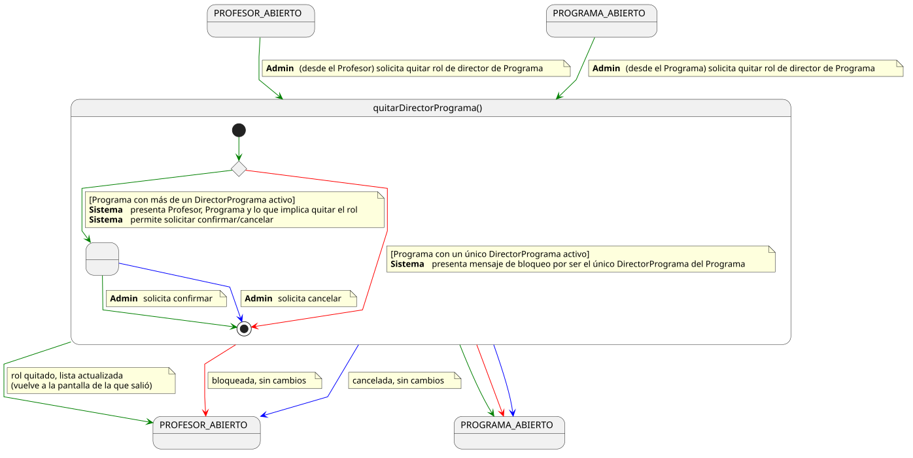
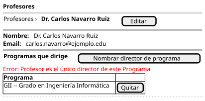
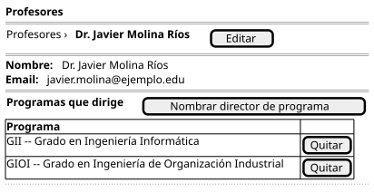
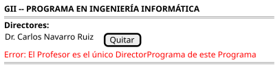

[Modelo del dominio](/RUP/00-modelo-del-dominio/README.md) / [Actores y casos de uso](/RUP/01-requisitos/01-actores-casos-uso/README.md) / [**Detalle**](/RUP/01-requisitos/03-detalle-casos-uso/README.md) / [Análisis](/RUP/02-analisis/casos-uso/quitarDirectorPrograma/README.md) / [Diseño](/RUP/03-diseño/casos-uso/quitarDirectorPrograma/README.md) / [Mockups navegables](/docs/PROPUESTA_WIREFRAME/README.md) Subconjunto público de [pyCelda](https://github.com/mmasias/pyCelda) -- incluye modelo de dominio, requisitos, análisis y diseño completos; desarrollo solo para 5 casos de uso elegidos como ejemplo. Sin dashboard de seguimiento.

# pyCelda > quitarDirectorPrograma()

> |[🏠️](/README.md)|[DdC](/images/RUP/01-requisitos/01-actores-casos-uso/diagramaContextoAdmin.svg)|**Detalle**|[Análisis](/RUP/02-analisis/casos-uso/quitarDirectorPrograma/README.md)|[Diseño](/RUP/03-diseño/casos-uso/quitarDirectorPrograma/README.md)|Desarrollo|Pruebas|
> |-|-|-|-|-|-|-|

||
|-|
|
Código fuente: [especificacion.puml](especificacion.puml)
|

|Bloqueada (único DirectorPrograma del Programa)|Confirmación (queda otro DirectorPrograma)|Desde el Programa|
|:-:|:-:|:-:|
||||
|||Código fuente: [wireframes.puml](wireframes.puml)|

## Información del caso de uso

|Atributo|Valor|
|-|-|
|**Actor**|`Admin`|
|**Objetivo**|Quitar el rol `DirectorPrograma` a un `Profesor` sobre un `Programa` concreto, siempre que quede al menos otro director|
|**Tipo**|Primario, esencial|
|**Nivel**|Objetivo de usuario|

**Mismo patrón `<<choice>>` bloqueante que `eliminarFacultad()`/`eliminarProfesor()`**, aplicado a quitar un rol en vez de a borrar una entidad: un `Programa` no puede quedarse sin ningún `DirectorPrograma`, así que si el `Profesor` es el único director de ese `Programa`, el sistema bloquea y no retira el rol. Decisión cerrada en la discussion [#18](https://github.com/mmasias/pyCelda/discussions/18). Desde el issue [#885](https://github.com/mmasias/pyCelda/issues/885) el caso tiene pantalla propia, como las demás acciones destructivas de `Admin`: si es el único director, la pantalla lo dice antes de intentar nada y solo ofrece volver; si queda otro, presenta el `Profesor`, el `Programa` y lo que implica quitar el rol, y pide confirmar o cancelar.

**Segunda entrada desde `PROGRAMA_ABIERTO`, issue [#492](https://github.com/mmasias/pyCelda/issues/492)**: **flujo alternativo del mismo caso de uso**, no uno nuevo -- mismo objetivo de actor, misma regla de negocio, misma pantalla de confirmación o bloqueo. Al terminar (confirmar, cancelar o volver desde el bloqueo), el `Admin` regresa a la pantalla desde la que salió: la ficha del `Profesor` o la del `Programa`.

## Notas de diseño y trazabilidad

- Pantalla propia de confirmación y bloqueo desde el issue [#885](https://github.com/mmasias/pyCelda/issues/885) (antes, #492 y #872 documentaban que las dos entradas actuaban con un solo clic y el bloqueo llegaba como error tras el intento). Componente `QuitarDirectorPrograma.tsx`, ruta `/profesores/:id/directores-programa/:programaId/quitar`, con el mismo prefijo `/profesores/:id` que `definirDirectorPrograma()` (`/profesores/:id/definir-director-programa`).
- Vuelta a la pantalla de origen: la entrada desde el Programa añade `?desde=programa` a la ruta y la pantalla vuelve a la ficha del Programa (`/admin/programas/:id`); sin el parámetro vuelve a la ficha del Profesor. Se eligió el parámetro de consulta, y no el estado de navegación, porque sobrevive a recargar la página.
- La fase de bloqueo se decide con los directores del Programa que ya sirve la ficha del Programa de Admin (`GET /admin/programas/{id}`): no se reimplementa la regla. El `409` del backend (`DELETE /profesores/{profesor_id}/directores-programa/{programa_id}`, sin cambios) sigue siendo la garantía; si llega al confirmar (otro Admin quitó al otro director entretanto), se muestra como error en la misma pantalla.
- Las variantes del wireframe conservan sus nombres (`bloqueada`, `confirmacion`, `desdePrograma`): las dos primeras dibujan la pantalla nueva entrando desde el Profesor (el botón de vuelta dice "Volver al programa" si se entró desde el Programa); `desdePrograma` dibuja la ficha del Programa con los `[Quitar]` que llevan a ella.
- En la pantalla construida los botones `[Quitar]` de las dos fichas y `[Confirmar]` llevan el icono `➖`.

## Referencias

- [Diagrama de contexto de Admin](/RUP/01-requisitos/01-actores-casos-uso/diagramaContextoAdmin.puml) -- `PROFESOR_ABIERTO --> PROFESOR_ABIERTO : quitarDirectorPrograma()`, y ahora también `PROGRAMA_ABIERTO --> PROGRAMA_ABIERTO : quitarDirectorPrograma()` (issue #492)
- [actoresCasosUsoAdminCatalogos.puml](/RUP/01-requisitos/01-actores-casos-uso/actoresCasosUsoAdminCatalogos.puml) -- catálogo de casos de uso de `Admin` sobre `Profesor` (sin cambio: flujo alternativo, no entrada nueva de catálogo)
- [Modelo del dominio](/RUP/00-modelo-del-dominio/modeloDominio.puml) -- `Programa o- DirectorPrograma` (agregación, muchos a muchos)
- [Discussion #18](https://github.com/mmasias/pyCelda/discussions/18) -- cierre del `<<choice>>` bloqueante
- [`definirDirectorPrograma()`](/RUP/01-requisitos/03-detalle-casos-uso/definirDirectorPrograma/README.md) -- caso de uso complementario (alta del rol), misma segunda entrada
- [`abrirPrograma()`](../abrirPrograma/README.md) -- portada donde vive la sección "Directores" que hospeda esta segunda entrada
- [Issue #492](https://github.com/mmasias/pyCelda/issues/492) -- origen de la segunda entrada
- [Issue #885](https://github.com/mmasias/pyCelda/issues/885) -- pantalla propia de confirmación y bloqueo
