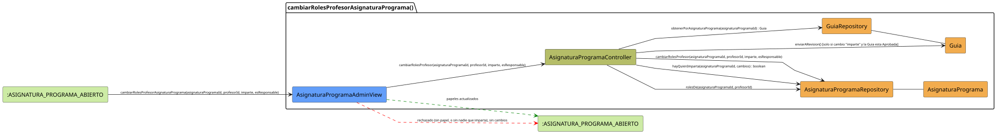

[Modelo del dominio](/RUP/00-modelo-del-dominio/README.md) / [Actores y casos de uso](/RUP/01-requisitos/01-actores-casos-uso/README.md) / [Detalle](/RUP/01-requisitos/03-detalle-casos-uso/README.md) / [**Análisis**](/RUP/02-analisis/README.md) / [Diseño](/RUP/03-diseño/README.md) Subconjunto público de [pyCelda](https://github.com/mmasias/pyCelda) -- incluye modelo de dominio, requisitos, análisis y diseño completos; desarrollo solo para 5 casos de uso elegidos como ejemplo. Sin dashboard de seguimiento.

# pyCelda > cambiarRolesProfesorAsignaturaPrograma()

> |[🏠️](/README.md)|[DdC](/images/RUP/01-requisitos/01-actores-casos-uso/diagramaContextoAdmin.svg)|[Detalle](/RUP/01-requisitos/03-detalle-casos-uso/cambiarRolesProfesorAsignaturaPrograma/README.md)|**Análisis**|[Diseño](/RUP/03-diseño/casos-uso/cambiarRolesProfesorAsignaturaPrograma/README.md)|Desarrollo|Pruebas|
> |-|-|-|-|-|-|-|

## Propósito

Traducción a clases de análisis del caso de uso [`cambiarRolesProfesorAsignaturaPrograma()`](/RUP/01-requisitos/03-detalle-casos-uso/cambiarRolesProfesorAsignaturaPrograma/README.md): cambia las marcas `imparte` / `esResponsable` de una asignación `AsignaturaPrograma -- Profesor` existente, con la regla "al menos uno imparte" y el mismo efecto colateral sobre la `Guia` activa que [`asignarProfesorAAsignaturaPrograma()`](../asignarProfesorAAsignaturaPrograma/README.md) (issue [#254](https://github.com/mmasias/pyCelda/issues/254)). Origen: issue [#824](https://github.com/mmasias/pyCelda/issues/824).

||
|-|
|
Código fuente: [colaboracion.puml](colaboracion.puml)
|

## Clases de vista

### `AsignaturaProgramaAdminView`

**Responsabilidades:**
- presenta, por cada `Profesor` asignado, sus dos marcas como casillas editables.
- no envía el cambio si las dos casillas quedarían desmarcadas; presenta el motivo de un rechazo del sistema.

**Colaboraciones:**
- **Entrada:** `:ASIGNATURA_PROGRAMA_ABIERTO` -- el `Admin` marca o desmarca una casilla.
- **Control:** `AsignaturaProgramaController`.
- **Salida:** `:ASIGNATURA_PROGRAMA_ABIERTO` (lista recargada).

## Clases de controlador

### `AsignaturaProgramaController`

**Responsabilidades:**
- rechaza el cambio si el `Profesor` no está asignado, si las dos marcas quedan a falso o si la `AsignaturaPrograma` quedaría con profesorado y sin nadie que imparta.
- sin cambio real, no hace nada.
- con cambio real, guarda las marcas y, si cambia `imparte` y la `Guia` activa está `Aprobada`, dispara `Guia.enviarARevision()` + fila de `HistorialCambio`; si solo cambia `esResponsable`, actualiza directamente esa marca en `Guia -- Profesor`, sin cambiar el estado de la `Guia` (issue [#827](https://github.com/mmasias/pyCelda/issues/827)).

**Colaboraciones:**
- **Entrada:** `AsignaturaProgramaAdminView`.
- **Salida:** `AsignaturaProgramaRepository`, `GuiaRepository`, `Guia`.

## Clases de modelo

### `AsignaturaProgramaRepository`

**Responsabilidades:**
- `rolesDe(asignaturaProgramaId, profesorId)`: marcas actuales, o nada si no está asignado.
- `hayQuienImparta(asignaturaProgramaId, cambios)`: simula la asignación tras el cambio y comprueba la regla "al menos uno imparte" (también la usan asignar y desasignar).
- `cambiarRolesProfesor(asignaturaProgramaId, profesorId, imparte, esResponsable)`.

**Colaboraciones:**
- **Entrada:** `AsignaturaProgramaController`.
- **Salida:** gestiona `AsignaturaPrograma -- Profesor`.

### `Guia` / `GuiaRepository`

**Responsabilidades:**
- `GuiaRepository.obtenerPorAsignaturaPrograma(asignaturaProgramaId)` localiza la `Guia` activa; `Guia.enviarARevision()` la pasa de `Aprobada` a `EnRevision`. Al re-aprobar, `Guia.aprobar()` copia la asignación con sus marcas a `Guia -- Profesor`.

**Colaboraciones:**
- **Entrada:** `AsignaturaProgramaController`.
- **Salida:** gestiona `Guia`.

## Referencias

- [Especificación de Requisitos](/RUP/01-requisitos/03-detalle-casos-uso/cambiarRolesProfesorAsignaturaPrograma/README.md).
- [`asignarProfesorAAsignaturaPrograma()`](../asignarProfesorAAsignaturaPrograma/README.md) / [`desasignarProfesorAsignaturaPrograma()`](../desasignarProfesorAsignaturaPrograma/README.md) -- misma regla y mismo efecto colateral.
