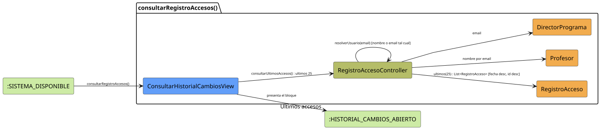

[Modelo del dominio](/RUP/00-modelo-del-dominio/README.md) / [Actores y casos de uso](/RUP/01-requisitos/01-actores-casos-uso/README.md) / [Detalle](/RUP/01-requisitos/03-detalle-casos-uso/README.md) / [**Análisis**](/RUP/02-analisis/README.md) / [Diseño](/RUP/03-diseño/README.md) Subconjunto público de [pyCelda](https://github.com/mmasias/pyCelda) -- incluye modelo de dominio, requisitos, análisis y diseño completos; desarrollo solo para 5 casos de uso elegidos como ejemplo. Sin dashboard de seguimiento.

# pyCelda > consultarRegistroAccesos()

> |[🏠️](/README.md)|[DdC](/images/RUP/01-requisitos/01-actores-casos-uso/diagramaContextoAdmin.svg)|[Detalle](/RUP/01-requisitos/03-detalle-casos-uso/consultarRegistroAccesos/README.md)|**Análisis**|[Diseño](/RUP/03-diseño/casos-uso/consultarRegistroAccesos/README.md)|Desarrollo|Pruebas|
> |-|-|-|-|-|-|-|

## Propósito

Traducción a clases de análisis del caso de uso [`consultarRegistroAccesos()`](/RUP/01-requisitos/03-detalle-casos-uso/consultarRegistroAccesos/README.md) (issue [#820](https://github.com/mmasias/pyCelda/issues/820)): auditoría de solo lectura, sin `<<choice>>`, de los últimos 25 intentos de inicio de sesión de `Profesor`/`DirectorPrograma`. Comparte vista con [`consultarHistorialCambios()`](../consultarHistorialCambios/README.md) -- es un bloque más de la pantalla de Auditoría -- y tiene controlador propio. `RegistroAcceso` solo se **lee** aquí; lo escribe [`iniciarSesion()`](../iniciarSesion/README.md).

||
|-|
|
Código fuente: [colaboracion.puml](colaboracion.puml)
|

## Clases de vista

### `ConsultarHistorialCambiosView`

**Responsabilidades (añadidas por este caso de uso):**
- presenta el bloque "Últimos accesos": fecha, usuario y resultado ("Acceso", "Rechazado: fuera de dominio", "Rechazado: no autorizado").
- presenta la tabla vacía sin error cuando no hay intentos registrados.

**Colaboraciones:**
- **Entrada:** `:SISTEMA_DISPONIBLE` -- el `Admin` solicita consultar la Auditoría (desde [`abrirPanelAdministracion()`](../abrirPanelAdministracion/README.md)).
- **Control:** `RegistroAccesoController`.
- **Salida:** `:HISTORIAL_CAMBIOS_ABIERTO`.

## Clases de controlador

### `RegistroAccesoController`

**Responsabilidades:**
- consulta los últimos 25 intentos (`consultarUltimosAccesos()`), del más reciente al más antiguo, desempatando por identificador.
- resuelve el usuario de cada fila por email (`resolverUsuario(email)`): nombre del `Profesor`, o del `Profesor` homónimo de un `DirectorPrograma`; sin coincidencia, el email tal cual.
- no valida ni muta nada -- caso de uso de solo lectura.

**Colaboraciones:**
- **Entrada:** `ConsultarHistorialCambiosView`.
- **Salida:** `RegistroAcceso`, `Profesor`, `DirectorPrograma`.

## Clases de modelo

### `RegistroAcceso`

**Responsabilidades:**
- porta `email`, `exitoso`, `motivoRechazo` (`fuera_de_dominio` | `no_autorizado`, solo si no tuvo éxito) y `fecha`.
- se **lee** aquí, nunca se escribe: lo registra `iniciarSesion()` en cada intento de acceso académico (no en el de `Admin`).
- sin relación con otras clases del dominio: el email se guarda tal cual, porque un intento rechazado puede no corresponder a nadie del catálogo.

**Colaboraciones:**
- **Entrada:** consultada por `RegistroAccesoController`.

### `Profesor` / `DirectorPrograma`

**Responsabilidades:**
- aportan el nombre que se muestra, cruzando por email (mismo criterio que `consultarHistorialCambios()`).

**Colaboraciones:**
- **Entrada:** consultados por `RegistroAccesoController`.

## Referencias

- [Especificación de Requisitos](/RUP/01-requisitos/03-detalle-casos-uso/consultarRegistroAccesos/especificacion.puml) y [wireframe](/RUP/01-requisitos/03-detalle-casos-uso/consultarRegistroAccesos/wireframes.puml).
- [`iniciarSesion()`](../iniciarSesion/README.md) -- escribe `RegistroAcceso`.
- [`consultarHistorialCambios()`](../consultarHistorialCambios/README.md) -- caso de uso hermano, misma vista.
