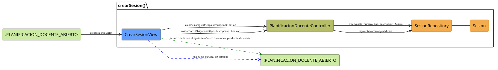

[Modelo del dominio](/RUP/00-modelo-del-dominio/README.md) / [Actores y casos de uso](/RUP/01-requisitos/01-actores-casos-uso/README.md) / [Detalle](/RUP/01-requisitos/03-detalle-casos-uso/README.md) / [**Análisis**](/RUP/02-analisis/README.md) / [Diseño](/RUP/03-diseño/README.md) Subconjunto público de [pyCelda](https://github.com/mmasias/pyCelda) -- incluye modelo de dominio, requisitos, análisis y diseño completos; desarrollo solo para 5 casos de uso elegidos como ejemplo. Sin dashboard de seguimiento.

# pyCelda > crearSesion()

> |[🏠️](/README.md)|[DdC](/images/RUP/01-requisitos/01-actores-casos-uso/diagramaContextoProfesor.svg)|[Detalle](/RUP/01-requisitos/03-detalle-casos-uso/crearSesion/README.md)|**Análisis**|[Diseño](/RUP/03-diseño/casos-uso/crearSesion/README.md)|Desarrollo|Pruebas|
> |-|-|-|-|-|-|-|

## Propósito

Traducción a clases de análisis del caso de uso [`crearSesion()`](/RUP/01-requisitos/03-detalle-casos-uso/crearSesion/README.md): CRUD real e inmediato contra `SesionRepository`, sin ninguna interacción con `Guia`. La fila se crea con `guiaId` desde el principio (pertenece a esta `Guia` desde el momento de crearse), pero no queda **vinculada** a la `PlanificacionDocente` oficial hasta que [`guardarBorradorGuia()`](../guardarBorradorGuia/README.md)/[`enviarGuiaARevision()`](../enviarGuiaARevision/README.md) sincronicen. Sin `<<choice>>` -- `Sesion` no se enlaza estructuralmente con `SistemaEvaluacion`/`PonderacionEvaluacion` en esta iteración (decisión 4 de discussion [#140](https://github.com/mmasias/pyCelda/discussions/140)): no hay regla de negocio que pueda rechazar el alta. `numero` no se solicita: lo calcula el sistema como el siguiente correlativo (o `1` si la planificación docente está vacía) y la tabla lo muestra como la posición de la fila, no editable (decisión 6).

||
|-|
|
Código fuente: [colaboracion.puml](colaboracion.puml)
|

## Clases de vista

### `CrearSesionView`

**Responsabilidades:**
- presenta una fila nueva al final del listado, sin pantalla aparte: selector `tipo` con los seis valores del enum cerrado (`CLASE_TEORICA`, `CLASE_PRACTICA`, `CLASE_TEORICO_PRACTICA`, `CLASE_LABORATORIO`, `EVALUACION_CONTINUA`, `EVALUACION_PARCIAL`; preseleccionado el primero) y `descripcion`, obligatoria.
- muestra como número la posición de la fila, no editable -- el correlativo persistido lo calcula el sistema.
- da de alta la fila al confirmar la descripción (Enter o salir del campo) o al cambiar el tipo con la descripción ya escrita; sin descripción no pide nada al Controlador. No hay botón "Crear".
- permite solicitar quitar la fila nueva antes de darla de alta (rama azul, sin llamar al Controlador).
- tras el alta, la fila pasa a ser una sesión más del listado de `PLANIFICACION_DOCENTE_ABIERTO`, pendiente de vincular.

**Colaboraciones:**
- **Entrada:** `:PLANIFICACION_DOCENTE_ABIERTO` -- el `Profesor` solicita crear una sesión desde el listado de la Planificación docente.
- **Control:** `PlanificacionDocenteController`.
- **Salida:** `:PLANIFICACION_DOCENTE_ABIERTO` -- sesión creada con el siguiente número correlativo, pendiente de vincular (verde); o fila nueva quitada, sin cambios (azul).

## Clases de controlador

### `PlanificacionDocenteController`

**Responsabilidades:**
- valida los obligatorios (`tipo`, `descripcion`).
- calcula el correlativo antes de crear (`SesionRepository.siguienteNumero(guiaId)`) -- la última `Sesion` existente más uno, o `1` si la planificación docente está vacía.
- crea la `Sesion` directamente en `SesionRepository`, real e inmediato -- ninguna llamada a `Guia`.

**Colaboraciones:**
- **Entrada:** `CrearSesionView`.
- **Salida:** `SesionRepository`.

## Clases de modelo

### `Sesion`

**Responsabilidades:**
- porta `numero`, `tipo` (enum cerrado de seis valores), `descripcion` y `guiaId` -- pertenece a una `Guia` desde su creación, aunque todavía no esté vinculada a la `PlanificacionDocente` oficial.

**Colaboraciones:**
- **Entrada:** creada por `SesionRepository`.

### `SesionRepository`

**Responsabilidades:**
- calcula el siguiente número correlativo para la `Guia` (`siguienteNumero(guiaId)`).
- crea la `Sesion` (`crear(guiaId, numero, tipo, descripcion)`) -- persistencia real e inmediata, no una mutación de sesión.

**Colaboraciones:**
- **Entrada:** `PlanificacionDocenteController`.
- **Salida:** gestiona `Sesion`.

## Referencias

- [Especificación de Requisitos](/RUP/01-requisitos/03-detalle-casos-uso/crearSesion/especificacion.puml) y [wireframes](/RUP/01-requisitos/03-detalle-casos-uso/crearSesion/wireframes.puml) -- fuente de verdad del alta en una fila nueva de la tabla, con `numero` automático (alineada con la pantalla construida en #857).
- [Diagrama de contexto de Profesor](/RUP/01-requisitos/01-actores-casos-uso/diagramaContextoProfesor.puml) -- `PLANIFICACION_DOCENTE_ABIERTO --> PLANIFICACION_DOCENTE_ABIERTO : crearSesion()`.
- [Modelo del dominio](/RUP/00-modelo-del-dominio/modeloDominio.puml) -- `PlanificacionDocente *-- Sesion`, `Sesion{numero, tipo, descripcion}`.
- [`abrirPlanificacionDocente()`](../abrirPlanificacionDocente/README.md) -- quien fusiona lo vinculado con lo pendiente-sin-vincular para presentarlo.
- [`editarSesion()`](../editarSesion/README.md) / [`eliminarSesion()`](../eliminarSesion/README.md) -- mismos participantes sobre la `Sesion` creada aquí.
- [`guardarBorradorGuia()`](../guardarBorradorGuia/README.md) / [`enviarGuiaARevision()`](../enviarGuiaARevision/README.md) -- quienes vinculan esta fila a la `PlanificacionDocente` oficial, o la borran (`db.delete`) si el `Profesor` la excluyó de la lista de trabajo (issue [#93](https://github.com/mmasias/pyCelda/issues/93)).
- [Discussion #140](https://github.com/mmasias/pyCelda/discussions/140) -- cierre de las 8 decisiones de diseño (decisión 4: sin enlace a `SistemaEvaluacion`; decisión 6: correlativo automático).
