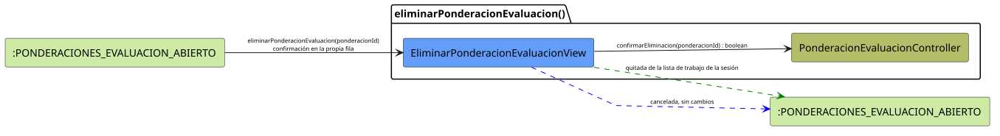

[Modelo del dominio](/RUP/00-modelo-del-dominio/README.md) / [Actores y casos de uso](/RUP/01-requisitos/01-actores-casos-uso/README.md) / [Detalle](/RUP/01-requisitos/03-detalle-casos-uso/README.md) / [**Análisis**](/RUP/02-analisis/README.md) / [Diseño](/RUP/03-diseño/README.md) Subconjunto público de [pyCelda](https://github.com/mmasias/pyCelda) -- incluye modelo de dominio, requisitos, análisis y diseño completos; desarrollo solo para 5 casos de uso elegidos como ejemplo. Sin dashboard de seguimiento.

# pyCelda > eliminarPonderacionEvaluacion()

> |[🏠️](/README.md)|[DdC](/images/RUP/01-requisitos/01-actores-casos-uso/diagramaContextoProfesor.svg)|[Detalle](/RUP/01-requisitos/03-detalle-casos-uso/eliminarPonderacionEvaluacion/README.md)|**Análisis**|[Diseño](/RUP/03-diseño/casos-uso/eliminarPonderacionEvaluacion/README.md)|Desarrollo|Pruebas|
> |-|-|-|-|-|-|-|

## Propósito

Traducción a clases de análisis del caso de uso [`eliminarPonderacionEvaluacion()`](/RUP/01-requisitos/03-detalle-casos-uso/eliminarPonderacionEvaluacion/README.md): confirmación simple, sin `<<choice>>` (nada depende estructuralmente de una `PonderacionEvaluacion`). Su único efecto es quitar el ítem de la **lista de trabajo de la sesión** -- la misma lista que `abrirPonderacionesEvaluacion()`/`abrirGuia()` construyen por fusión vinculado+pendiente, y que [`guardarBorradorGuia()`](../guardarBorradorGuia/README.md) recibirá completa al guardar. **No toca la fila de `PonderacionEvaluacion`** -- no la borra, no la edita, ningún repositorio de esa entidad interviene aquí -- y **no toca `Guia`**. Por eso este es, deliberadamente, el primer caso de uso del catálogo sin ninguna clase de Modelo en su diagrama de colaboración: no hay ninguna entidad de dominio involucrada en la operación, solo Vista y Controlador. La ausencia no es un olvido -- es el reflejo correcto de que "eliminar" aquí significa "excluir de la lista que se enviará a `guardarBorradorGuia()`", que es quien de verdad decide, por ausencia en esa lista, desvincular la fila real.

||
|-|
|
Código fuente: [colaboracion.puml](colaboracion.puml)
|

## Clases de vista

### `EliminarPonderacionEvaluacionView`

**Responsabilidades:**
- no es una pantalla aparte: es el estado de confirmación de la propia fila del listado de `PONDERACIONES_EVALUACION_ABIERTO`, que ya muestra la `PonderacionEvaluacion` (`descripcion`, `SistemaEvaluacion`, `ponderacion`), sin releer nada.
- presenta la confirmación en la fila (el botón de eliminar pasa a "pulsa de nuevo para confirmar" y aparece "Cancelar" a su lado) y permite solicitar confirmar (segunda pulsación) o cancelar.
- en la rama verde, quita el ítem de la lista de trabajo de la sesión y presenta la lista actualizada.
- en la rama azul, devuelve la fila a su estado normal sin tocar la lista.

**Colaboraciones:**
- **Entrada:** `:PONDERACIONES_EVALUACION_ABIERTO` -- el `Profesor` solicita eliminar una `PonderacionEvaluacion` con el botón de eliminar de su fila en el listado.
- **Control:** `PonderacionEvaluacionController`.
- **Salida:** `:PONDERACIONES_EVALUACION_ABIERTO` en ambos casos -- self-loop, con "quitada de la lista de trabajo" (verde) o "cancelada, sin cambios" (azul).

## Clases de controlador

### `PonderacionEvaluacionController`

**Responsabilidades:**
- confirma la eliminación (`confirmarEliminacion(ponderacionId)`) -- sin validar nada, no hay `<<choice>>` bloqueante ni regla de negocio que comprobar. Mismo controlador que ya usan `crearPonderacionEvaluacion()`/`editarPonderacionEvaluacion()`, no uno nuevo.
- no llama a ningún repositorio ni a `Guia` -- no hay nada que persistir en este caso de uso, la lista de trabajo es responsabilidad de la Vista.

**Colaboraciones:**
- **Entrada:** `EliminarPonderacionEvaluacionView`.
- **Salida:** ninguna.

## Flujo de colaboración principal

1. Desde `:PONDERACIONES_EVALUACION_ABIERTO`, el `Profesor` solicita eliminar una `PonderacionEvaluacion` con el botón de eliminar de su fila en el listado; `EliminarPonderacionEvaluacionView` presenta la confirmación en esa misma fila, sin abrir otra pantalla ni releer nada.

### Rama verde (confirmar)

2. El `Profesor` solicita confirmar (segunda pulsación del mismo botón); la Vista pide al Controlador confirmar la eliminación (`confirmarEliminacion(ponderacionId)`); el Controlador no valida nada y confirma. La Vista quita el ítem de la lista de trabajo de la sesión y presenta la lista actualizada; la colaboración termina en `:PONDERACIONES_EVALUACION_ABIERTO`.

### Rama azul (cancelar)

3. El `Profesor` solicita cancelar; la Vista devuelve la fila a su estado normal sin tocar la lista de trabajo; la colaboración termina en `:PONDERACIONES_EVALUACION_ABIERTO`, sin cambios.

## Notas de trazabilidad

- Alineado con el flujo construido (#857, río abajo de #855): la confirmación es en la propia fila del listado, sin pantalla de confirmación aparte; `EliminarPonderacionEvaluacionView` nombra ese estado de la fila, no una pantalla. La lista de trabajo la guarda la Vista (en la aplicación, la marca de "eliminada" vive en el almacenamiento de la pestaña del navegador hasta [`guardarBorradorGuia()`](../guardarBorradorGuia/README.md)).

## Referencias

- [Especificación de Requisitos](/RUP/01-requisitos/03-detalle-casos-uso/eliminarPonderacionEvaluacion/especificacion.puml) y [wireframes](/RUP/01-requisitos/03-detalle-casos-uso/eliminarPonderacionEvaluacion/wireframes.puml) -- fuente de verdad del patrón confirmar/cancelar sin `<<choice>>`.
- [Diagrama de contexto de Profesor](/RUP/01-requisitos/01-actores-casos-uso/diagramaContextoProfesor.puml) -- `PONDERACIONES_EVALUACION_ABIERTO --> PONDERACIONES_EVALUACION_ABIERTO : eliminarPonderacionEvaluacion()`.
- [Modelo del dominio](/RUP/00-modelo-del-dominio/modeloDominio.puml) -- `Guia *-d- PonderacionEvaluacion`, sin entidad que dependa de ella.
- [`guardarBorradorGuia()`](../guardarBorradorGuia/README.md) -- quien recibe la lista de trabajo ya sin este ítem y desvincula la fila real por ausencia (`Guia.sincronizarPonderaciones()`).
- [`crearPonderacionEvaluacion()`](../crearPonderacionEvaluacion/README.md) / [`editarPonderacionEvaluacion()`](../editarPonderacionEvaluacion/README.md) -- mismo `PonderacionEvaluacionController`, reutilizado aquí.
