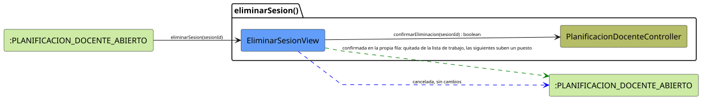

[Modelo del dominio](/RUP/00-modelo-del-dominio/README.md) / [Actores y casos de uso](/RUP/01-requisitos/01-actores-casos-uso/README.md) / [Detalle](/RUP/01-requisitos/03-detalle-casos-uso/README.md) / [**Análisis**](/RUP/02-analisis/README.md) / [Diseño](/RUP/03-diseño/README.md) Subconjunto público de [pyCelda](https://github.com/mmasias/pyCelda) -- incluye modelo de dominio, requisitos, análisis y diseño completos; desarrollo solo para 5 casos de uso elegidos como ejemplo. Sin dashboard de seguimiento.

# pyCelda > eliminarSesion()

> |[🏠️](/README.md)|[DdC](/images/RUP/01-requisitos/01-actores-casos-uso/diagramaContextoProfesor.svg)|[Detalle](/RUP/01-requisitos/03-detalle-casos-uso/eliminarSesion/README.md)|**Análisis**|[Diseño](/RUP/03-diseño/casos-uso/eliminarSesion/README.md)|Desarrollo|Pruebas|
> |-|-|-|-|-|-|-|

## Propósito

Traducción a clases de análisis del caso de uso [`eliminarSesion()`](/RUP/01-requisitos/03-detalle-casos-uso/eliminarSesion/README.md): confirmación simple, sin `<<choice>>` (nada depende estructuralmente de una `Sesion`). Su único efecto es quitar el ítem de la **lista de trabajo de la sesión** -- la misma lista que [`abrirPlanificacionDocente()`](../abrirPlanificacionDocente/README.md) construye por fusión vinculado+pendiente, y que [`guardarBorradorGuia()`](../guardarBorradorGuia/README.md) recibirá completa al guardar. **No toca la fila de `Sesion`** -- no la borra, no la edita, ningún repositorio de esa entidad interviene aquí -- y **no toca `Guia`**. Sin ninguna clase de Modelo en su diagrama de colaboración: no hay ninguna entidad de dominio involucrada en la operación, solo Vista y Controlador -- "eliminar" aquí significa "excluir de la lista que se enviará a `guardarBorradorGuia()`", que es quien de verdad decide, por ausencia en esa lista, borrar la fila real (`db.delete`, issue [#93](https://github.com/mmasias/pyCelda/issues/93)). La renumeración de las sesiones siguientes es presentación: la hace la Vista sobre la lista de trabajo (ver el hallazgo del `numero` presentado en [`abrirPlanificacionDocente()`](../abrirPlanificacionDocente/README.md)); el `numero` persistido de cada fila no cambia aquí.

||
|-|
|
Código fuente: [colaboracion.puml](colaboracion.puml)
|

## Clases de vista

### `EliminarSesionView`

**Responsabilidades:**
- presenta la confirmación en la propia fila del listado, sin pantalla aparte: el botón de eliminar de esa fila pasa a "pulsa de nuevo para confirmar" y aparece a su lado **Cancelar**. La fila sigue mostrando sus datos (`numero` posicional, `tipo`, `descripcion`); no se presenta ningún texto de aviso de renumeración.
- permite solicitar confirmar (segunda pulsación) o cancelar.
- en la rama verde, quita el ítem de la lista de trabajo de la sesión (una marca de exclusión guardada en el navegador, que dura mientras la pestaña siga abierta) y presenta el listado actualizado: la fila desaparece y las siguientes suben un puesto -- la renumeración se ve, no se avisa. El medidor pasa a dar las dos cifras ("En pantalla" / "Guardado") con el aviso de cambios sin guardar.
- en la rama azul, devuelve el botón a su estado normal sin tocar la lista.

**Colaboraciones:**
- **Entrada:** `:PLANIFICACION_DOCENTE_ABIERTO` -- el `Profesor` solicita eliminar una `Sesion` desde su fila en el listado.
- **Control:** `PlanificacionDocenteController`.
- **Salida:** `:PLANIFICACION_DOCENTE_ABIERTO` en ambos casos -- self-loop, con "quitada de la lista de trabajo de la sesión, sesiones siguientes renumeradas en la vista" (verde) o "cancelada, sin cambios" (azul).

## Clases de controlador

### `PlanificacionDocenteController`

**Responsabilidades:**
- confirma la eliminación (`confirmarEliminacion(sesionId)`) -- sin validar nada, no hay `<<choice>>` bloqueante ni regla de negocio que comprobar. Mismo controlador que ya usan `abrirPlanificacionDocente()`/`crearSesion()`/`editarSesion()`, no uno nuevo.
- no llama a ningún repositorio ni a `Guia` -- no hay nada que persistir en este caso de uso, la lista de trabajo es responsabilidad de la Vista.

**Colaboraciones:**
- **Entrada:** `EliminarSesionView`.
- **Salida:** ninguna.

## Flujo de colaboración principal

1. Desde `:PLANIFICACION_DOCENTE_ABIERTO`, el `Profesor` pulsa eliminar en la fila de una `Sesion`; `EliminarSesionView` presenta la confirmación en esa misma fila ("pulsa de nuevo para confirmar" y **Cancelar**), sin pantalla aparte, sin releer nada y sin texto de aviso de renumeración.

### Rama verde (confirmar)

2. El `Profesor` solicita confirmar; la Vista pide al Controlador confirmar la eliminación (`confirmarEliminacion(sesionId)`); el Controlador no valida nada y confirma. La Vista quita el ítem de la lista de trabajo de la sesión y presenta el listado actualizado: la fila desaparece y las siguientes suben un puesto (renumeración visible, sin aviso en texto); la colaboración termina en `:PLANIFICACION_DOCENTE_ABIERTO`.

### Rama azul (cancelar)

3. El `Profesor` solicita cancelar; la Vista devuelve el botón de la fila a su estado normal sin tocar la lista de trabajo; la colaboración termina en `:PLANIFICACION_DOCENTE_ABIERTO`, sin cambios.

## Referencias

- [Especificación de Requisitos](/RUP/01-requisitos/03-detalle-casos-uso/eliminarSesion/especificacion.puml) y [wireframes](/RUP/01-requisitos/03-detalle-casos-uso/eliminarSesion/wireframes.puml) -- fuente de verdad del patrón confirmar/cancelar en la propia fila, sin `<<choice>>`; la renumeración se ve al confirmar, sin aviso en texto (alineado con la pantalla construida en #855 y #857).
- [Diagrama de contexto de Profesor](/RUP/01-requisitos/01-actores-casos-uso/diagramaContextoProfesor.puml) -- `PLANIFICACION_DOCENTE_ABIERTO --> PLANIFICACION_DOCENTE_ABIERTO : eliminarSesion()`.
- [Modelo del dominio](/RUP/00-modelo-del-dominio/modeloDominio.puml) -- `PlanificacionDocente *-- Sesion`, sin entidad que dependa de `Sesion`.
- [`guardarBorradorGuia()`](../guardarBorradorGuia/README.md) -- quien recibe la lista de trabajo ya sin este ítem y borra la fila real por ausencia (`db.delete`, issue [#93](https://github.com/mmasias/pyCelda/issues/93)).
- [`abrirPlanificacionDocente()`](../abrirPlanificacionDocente/README.md) -- quien construye la lista de trabajo por fusión y donde vive el hallazgo del `numero` presentado.
- [`crearSesion()`](../crearSesion/README.md) / [`editarSesion()`](../editarSesion/README.md) -- mismo `PlanificacionDocenteController`, reutilizado aquí.
- [Discussion #140](https://github.com/mmasias/pyCelda/discussions/140) -- cierre de las 8 decisiones de diseño de la Planificación docente.
