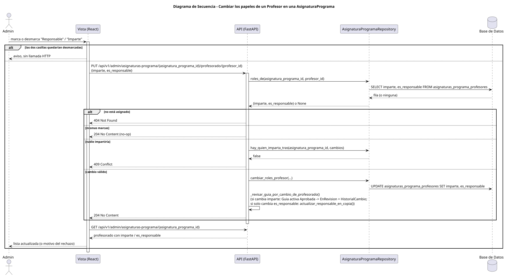

[Modelo del dominio](/RUP/00-modelo-del-dominio/README.md) / [Actores y casos de uso](/RUP/01-requisitos/01-actores-casos-uso/README.md) / [Detalle](/RUP/01-requisitos/03-detalle-casos-uso/README.md) / [Análisis](/RUP/02-analisis/README.md) / **Diseño** Subconjunto público de [pyCelda](https://github.com/mmasias/pyCelda) -- incluye modelo de dominio, requisitos, análisis y diseño completos; desarrollo solo para 5 casos de uso elegidos como ejemplo. Sin dashboard de seguimiento.

# pyCelda > cambiarRolesProfesorAsignaturaPrograma() > Diseño

> |[🏠️](/README.md)|[DdC](/images/RUP/01-requisitos/01-actores-casos-uso/diagramaContextoAdmin.svg)|[Detalle](/RUP/01-requisitos/03-detalle-casos-uso/cambiarRolesProfesorAsignaturaPrograma/README.md)|[Análisis](/RUP/02-analisis/casos-uso/cambiarRolesProfesorAsignaturaPrograma/README.md)|**Diseño**|Desarrollo|Pruebas|
> |-|-|-|-|-|-|-|

## Información del artefacto

- **Proyecto**: pyCelda
- **Fase RUP**: Elaboración
- **Disciplina**: Diseño
- **Versión**: 1.0
- **Fecha**: 2026-11-17

## Propósito

Bajada a diseño del caso de análisis [`cambiarRolesProfesorAsignaturaPrograma()`](/RUP/02-analisis/casos-uso/cambiarRolesProfesorAsignaturaPrograma/README.md) (issue [#824](https://github.com/mmasias/pyCelda/issues/824)). Un único endpoint `PUT` cambia las dos marcas de la asignación.

## Diagrama de secuencia de diseño

||
|-|
|
Código fuente: [secuencia.puml](secuencia.puml)
|

## Participantes

- **Vista**: `AsignaturaProgramaAdmin.tsx` -- columnas "Responsable" e "Imparte" con casillas en la tabla de profesorado; al cambiar una, `PUT` y recarga del detalle.
- **API**: `routers/asignatura_programa.py::cambiar_roles_profesor_asignatura_programa(asignatura_programa_id, profesor_id, datos)` -- `CambiarRolesProfesorRequest` (`422` con las dos a `false`); `404` si la `AsignaturaPrograma` no existe o el `Profesor` no está asignado; `409` si nadie impartiría.
- **Modelo**: columnas `imparte` y `es_responsable` (`Boolean`, `NOT NULL`, default `true`) en `asignaturas_programa_profesores` y en `guias_profesores`; `copiar_profesorado_a_guia()` copia la asignación con sus marcas a nivel de tabla.
- **Repositorio**: `AsignaturaProgramaRepository.roles_de()`, `.hay_quien_imparta_tras()` (compartido con asignar y desasignar), `.cambiar_roles_profesor()`.

## Decisiones de diseño

- **`PUT` sobre la asignación, no `PATCH`**: el cuerpo trae siempre las dos marcas; es la representación completa del recurso "asignación".
- **No-op si no cambia nada**: como asignar a quien ya está asignado; no manda la guía a revisión.
- **La regla se comprueba simulando el resultado** (`hay_quien_imparta_tras`), no consultando después: el `409` llega sin haber escrito nada.
- **Copia a la guía a nivel de tabla**: asignar la relación `profesorado` (`secondary=`) insertaría las filas con el default, no con las marcas de la asignación vigente.
- **Autorización de `Admin`: `Depends(require_admin)`**. Sin capa Service.

## Referencias

- [`cambiarRolesProfesorAsignaturaPrograma()` en Análisis](/RUP/02-analisis/casos-uso/cambiarRolesProfesorAsignaturaPrograma/README.md).
- [`asignarProfesorAAsignaturaPrograma()` en Diseño](/RUP/03-diseño/casos-uso/asignarProfesorAAsignaturaPrograma/README.md) / [`desasignarProfesorAsignaturaPrograma()` en Diseño](/RUP/03-diseño/casos-uso/desasignarProfesorAsignaturaPrograma/README.md).
