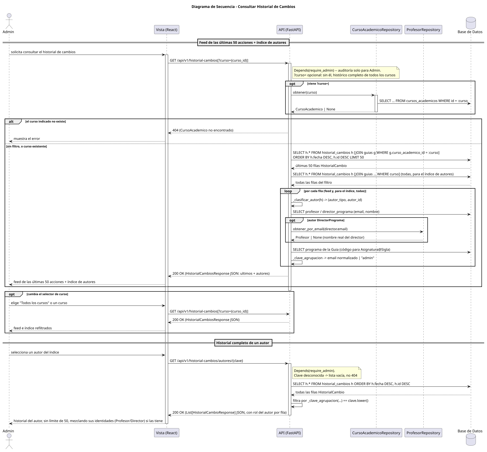

[Modelo del dominio](/RUP/00-modelo-del-dominio/README.md) / [Actores y casos de uso](/RUP/01-requisitos/01-actores-casos-uso/README.md) / [Detalle](/RUP/01-requisitos/03-detalle-casos-uso/README.md) / [Análisis](/RUP/02-analisis/README.md) / **Diseño** Subconjunto público de [pyCelda](https://github.com/mmasias/pyCelda) -- incluye modelo de dominio, requisitos, análisis y diseño completos; desarrollo solo para 5 casos de uso elegidos como ejemplo. Sin dashboard de seguimiento.

# pyCelda > consultarHistorialCambios() > Diseño

> |[🏠️](/README.md)|[DdC](/images/RUP/01-requisitos/01-actores-casos-uso/diagramaContextoAdmin.svg)|[Detalle](/RUP/01-requisitos/03-detalle-casos-uso/consultarHistorialCambios/README.md)|[Análisis](/RUP/02-analisis/casos-uso/consultarHistorialCambios/README.md)|**Diseño**|Desarrollo|Pruebas|
> |-|-|-|-|-|-|-|

## Información del artefacto

- **Proyecto**: pyCelda
- **Fase RUP**: Elaboración
- **Disciplina**: Diseño
- **Versión**: 1.1
- **Fecha**: 2026-11-20 (1.0: 2026-10-03)
- **Autor**: Claude Sonnet 5.5 (vía Claude Code)

## Propósito

Bajada a diseño del caso de análisis [`consultarHistorialCambios()`](/RUP/02-analisis/casos-uso/consultarHistorialCambios/README.md): dos `GET` de solo lectura sobre `HistorialCambio` -- `GET /api/v1/historial-cambios` (feed de las últimas 50 acciones + índice de autores, con `?curso=` opcional) y `GET /api/v1/historial-cambios/autores/{clave}` (historial completo de un autor). Sin repositorio propio: `routers/historial_cambio.py` consulta `HistorialCambio` directamente con la `Session` y reutiliza `CursoAcademicoRepository`/`ProgramaRepository`/`ProfesorRepository` como colaboradores puntuales. Las dos funciones de `HistorialCambioController` convergen en el mismo módulo, funciones sueltas, sin capa Service. Es una vista de **solo lectura**: este caso de uso nunca escribe en `HistorialCambio`.

## Diagrama de secuencia de diseño

||
|-|
|
Código fuente: [secuencia.puml](secuencia.puml)
|

## Participantes

- **Vista**: `ConsultarHistorialCambiosView` -- `HistorialCambios.tsx` (`/admin/historial-cambios`: feed + autores + selector de curso) y `HistorialCambiosAutor.tsx` (`/admin/historial-cambios/autores/:clave`: historial de un autor, con columna de rol). Carga en paralelo `GET /api/v1/historial-cambios` y el selector de curso (`GET /api/v1/cursos-academicos`, el de lectura de [`abrirCursosAcademicos()`](/RUP/03-diseño/casos-uso/abrirCursosAcademicos/README.md)); al cambiar de curso, repite el primero con `?curso=`.
- **API**: `routers/historial_cambio.py::consultar_historial_cambios(curso)` / `consultar_historial_cambios_de_autor(clave)`. Helpers: `_clasificar_autor()`, `_email_de()`, `_clave_agrupacion()`, `_resolver_autor()`, `_a_response()`.
- **Modelo**: `HistorialCambio` (solo lectura); `Profesor`, `DirectorPrograma` para resolver al autor; `Guia.curso_academico_id` para el filtro por join.
- **Repositorios**: `CursoAcademicoRepository.obtener(curso)` (`404` si el filtro apunta a un curso inexistente); `ProgramaRepository.obtener(programa_id)` (código del `Programa`); `ProfesorRepository.obtener_por_email(email)` (nombre del `DirectorPrograma`).
- **Schemas**: `HistorialCambiosResponse` (`ultimos` + `autores`), `HistorialCambioResponse`, `AutorHistorialResponse`, `AutorIndiceResponse`.

## Decisiones de diseño

- **`autor_id` no es un único espacio de identificadores; la tabla la dice `autor_tipo`** (`_clasificar_autor`, issue [#838](https://github.com/mmasias/pyCelda/issues/838), esquema 10): `historial_cambios.autor_tipo` vale `profesor`, `director_programa` o `admin` (este último con el centinela `AUTOR_ADMIN_CENTINELA`, `0`: Admin no tiene tabla). Toda escritura lo da explícito -- `HistorialCambio.registrar()` lo exige sin valor por defecto, y en las escrituras que pueden hacer Profesor o Director el par (tipo, id) sale de un único helper, `autor_de(como_director, director_programa_id, profesor_id)`. Ni `_clasificar_autor` ni `Guia.ultima_actualizacion_rol` deducen ya el tipo del `campo` o del comentario. Hasta 0.11.53 se deducía (`estado`/corrección del Director -> `DirectorPrograma`, cualquier otro campo -> `Profesor`) y las ediciones de contenido del Director aparecían a nombre del `Profesor` con el mismo id. Sin email del autor ni FK polimórfica: Admin no tiene tabla y una FK complicaría el borrado de profesores.
- **Filas anteriores al esquema 10, atribución heredada** (`migrar_autor_tipo_historial.py`): el centinela pasa a `admin`; las filas de `estado` y de corrección del Director, al tipo que ya les daba la lectura anterior; las de contenido, a `director_programa` si tienen fila hermana de corrección del Director (misma guía, mismo `autor_id`, a menos de 2 s) y a `profesor` en otro caso. **Limitación conocida, sin resolver a propósito**: algunas filas de contenido sin hermana pueden seguir mal atribuidas al `Profesor` -- las ediciones del Director sobre guías en Borrador o Rechazada entre el 2026-10-02 y el 2026-10-07 (antes de #731 no dejaban fila hermana) y, en cualquier fecha anterior al esquema 10, las sesiones pendientes que el Director creó, editó o duplicó en guías en Borrador o Rechazada. El `plan` del script da el recuento por regla, sin nombres.
- **Índice de autores fusionado por email normalizado** (`_clave_agrupacion`, issue [#401](https://github.com/mmasias/pyCelda/issues/401)): `Profesor.email` y `DirectorPrograma.email` son `unique`; la misma persona con fila en las dos tablas fusiona en una sola entrada, con clave en minúsculas. `Admin` (sin email) queda aislado con clave literal `"admin"`. Si el `Profesor`/`DirectorPrograma` referenciado ya no existe, se aísla por `tipo:id` -- fallback defensivo, sin fusión posible.
- **`DirectorPrograma` sin `nombre` propio** (issue [#62](https://github.com/mmasias/pyCelda/issues/62)): `_resolver_autor` cruza por email contra `Profesor` y muestra su nombre; si no hay `Profesor` con ese email, muestra el email; si el `DirectorPrograma` ya no existe, `Director #id`.
- **`?curso=` opcional, default opuesto al de `consultarEstadoGuias()`** (issue [#442](https://github.com/mmasias/pyCelda/issues/442)): **sin filtro, histórico completo de todos los cursos**; con él, join `HistorialCambio -> Guia` filtrado por `curso_academico_id`. `404` (`CursoAcademico no encontrado`) si el curso no existe. Otros filtros naturales de una auditoría (profesor, fechas, campo...) quedan fuera a propósito.
- **Feed limitado a 50, con desempate determinista**: `ORDER BY fecha DESC, id DESC LIMIT 50` -- varias filas pueden compartir el mismo `datetime.now(UTC)` si se escriben en el mismo instante; sin el desempate, "más reciente primero" no sería determinista. El índice de autores, en cambio, se calcula sobre **todas** las filas del filtro, no solo sobre las 50 del feed.
- **Historial por autor sin límite ni filtro de curso**: `consultar_historial_cambios_de_autor` carga todas las filas ordenadas y filtra en Python por clave de agrupación. Una clave desconocida **no es `404`**: es una búsqueda con cero resultados (coherente con que la clave es un email, no un identificador validable en la URL). Coste lineal en el tamaño del historial, aceptado -- es una pantalla de auditoría de uso esporádico.
- **Etiquetas de campo en el Router** (`ETIQUETAS_CAMPO`: `estado` -> "Estado", `contenido` -> "Contenido", ...); un `campo` sin etiqueta se devuelve tal cual (p.ej. `bibliografia`, escrito por [`importarBibliografiaDeGuiaHermana()`](/RUP/03-diseño/casos-uso/importarBibliografiaDeGuiaHermana/README.md), hoy sin entrada en el mapa).
- **Columna Guía en texto plano `Asignatura@SiglaPrograma`** (issues [#403](https://github.com/mmasias/pyCelda/issues/403)/[#398](https://github.com/mmasias/pyCelda/issues/398)): `_a_response` carga el `Programa` por fila para la sigla; la tabla no enlaza a `abrirGuia()` -- "este listado tiene como propósito solo mostrar".
- **Sin capa Service**: Router delgado -> `Session`/Repositories (discussion [#58](https://github.com/mmasias/pyCelda/discussions/58)).
- **Autorización de `Admin`: `Depends(require_admin)`** en ambos endpoints -- la auditoría expone qué hizo cada persona; el historial de bugs de autorización del proyecto (IDOR #86/#96) hace que dejarlo implícito sea un hueco real.

## Referencias

- [`consultarHistorialCambios()` en Análisis](/RUP/02-analisis/casos-uso/consultarHistorialCambios/README.md) -- diagrama de colaboración origen.
- [Especificación de Requisitos](/RUP/01-requisitos/03-detalle-casos-uso/consultarHistorialCambios/README.md).
- [`consultarEstadoGuias()` en Diseño](/RUP/03-diseño/casos-uso/consultarEstadoGuias/README.md) -- plantilla de lectura con selector de curso (default opuesto).
- [`consultarCopiasSeguridad()` en Diseño](/RUP/03-diseño/casos-uso/consultarCopiasSeguridad/README.md) -- caso de uso hermano de auditoría de `Admin`.
- [`abrirCursosAcademicos()` en Diseño](/RUP/03-diseño/casos-uso/abrirCursosAcademicos/README.md) -- el selector de curso (`GET /cursos-academicos`) que la Vista reutiliza.
