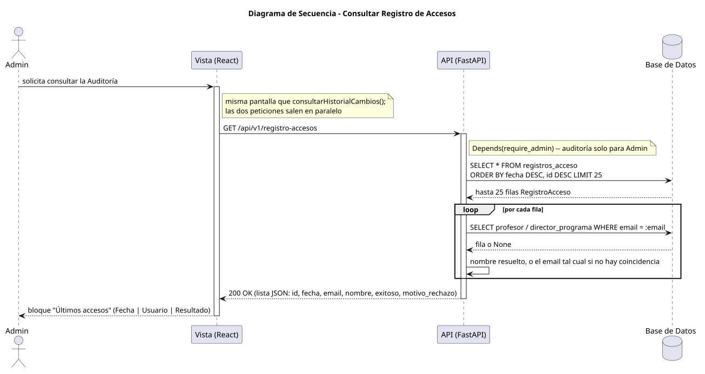

[Modelo del dominio](/RUP/00-modelo-del-dominio/README.md) / [Actores y casos de uso](/RUP/01-requisitos/01-actores-casos-uso/README.md) / [Detalle](/RUP/01-requisitos/03-detalle-casos-uso/README.md) / [Análisis](/RUP/02-analisis/README.md) / **Diseño** Subconjunto público de [pyCelda](https://github.com/mmasias/pyCelda) -- incluye modelo de dominio, requisitos, análisis y diseño completos; desarrollo solo para 5 casos de uso elegidos como ejemplo. Sin dashboard de seguimiento.

# pyCelda > consultarRegistroAccesos() > Diseño

> |[🏠️](/README.md)|[DdC](/images/RUP/01-requisitos/01-actores-casos-uso/diagramaContextoAdmin.svg)|[Detalle](/RUP/01-requisitos/03-detalle-casos-uso/consultarRegistroAccesos/README.md)|[Análisis](/RUP/02-analisis/casos-uso/consultarRegistroAccesos/README.md)|**Diseño**|Desarrollo|Pruebas|
> |-|-|-|-|-|-|-|

## Información del artefacto

- **Proyecto**: pyCelda
- **Fase RUP**: Elaboración
- **Disciplina**: Diseño
- **Versión**: 1.0
- **Fecha**: 2026-11-11
- **Autor**: Claude Opus 5.5 (vía Claude Code)

## Propósito

Bajada a diseño del caso de análisis [`consultarRegistroAccesos()`](/RUP/02-analisis/casos-uso/consultarRegistroAccesos/README.md): un `GET` de solo lectura, `GET /api/v1/registro-accesos`, que devuelve los últimos 25 intentos de inicio de sesión académico. Sin repositorio propio ni capa Service: `routers/registro_acceso.py` consulta `RegistroAcceso` directamente con la `Session`. Este caso de uso nunca escribe en `registros_acceso`; lo hace `/auth/callback` ([`iniciarSesion()`](/RUP/03-diseño/casos-uso/iniciarSesion/README.md)).

## Diagrama de secuencia de diseño

||
|-|
|
Código fuente: [secuencia.puml](secuencia.puml)
|

## Participantes

- **Vista**: `ConsultarHistorialCambiosView` -- `HistorialCambios.tsx` (`/admin/historial-cambios`, pantalla "🔍 Auditoría"), bloque "Últimos accesos". La petición sale en el mismo `Promise.all` que la del historial de cambios.
- **API**: `routers/registro_acceso.py` -- `GET /api/v1/registro-accesos`.
- **Modelo**: `RegistroAcceso` (tabla `registros_acceso`: `id`, `email`, `exitoso`, `motivo_rechazo`, `fecha`), solo lectura; `Profesor`, `DirectorPrograma` para resolver el nombre.

## Decisiones de diseño

- **Límite fijo de 25, orden determinista**: `ORDER BY fecha DESC, id DESC LIMIT 25` -- mismo desempate que el feed de `consultarHistorialCambios()`.
- **Nombre resuelto por email, con el email como respaldo**: mismo criterio que `_resolver_autor()` de `routers/historial_cambio.py` (nombre del `Profesor`; para un `DirectorPrograma`, el de su `Profesor` homónimo). Sin coincidencia -- lo normal en un rechazo `no_autorizado` o `fuera_de_dominio` --, el campo `nombre` lleva el email tal cual.
- **`RegistroAcceso` sin clave foránea**: guarda el email, no un identificador de `Profesor`/`DirectorPrograma`, porque un intento rechazado puede no corresponder a ninguna fila del catálogo.
- **Etiqueta del resultado en la Vista**: la API devuelve `exitoso` y `motivo_rechazo` crudos; `HistorialCambios.tsx` los traduce a "Acceso" / "Rechazado: fuera de dominio" / "Rechazado: no autorizado".
- **Autorización de `Admin`: `Depends(require_admin)`** -- el registro expone quién intentó entrar y cuándo.
- **Esquema**: la tabla nace con la versión de esquema 8 (`scripts/migrar_registro_accesos.py`, plan/apply), sin rellenar datos anteriores.

## Referencias

- [`consultarRegistroAccesos()` en Análisis](/RUP/02-analisis/casos-uso/consultarRegistroAccesos/README.md) -- diagrama de colaboración origen.
- [`iniciarSesion()` en Diseño](/RUP/03-diseño/casos-uso/iniciarSesion/README.md) -- escritura del registro en `/auth/callback`.
- [`consultarHistorialCambios()` en Diseño](/RUP/03-diseño/casos-uso/consultarHistorialCambios/README.md) -- caso de uso hermano en la misma pantalla.
