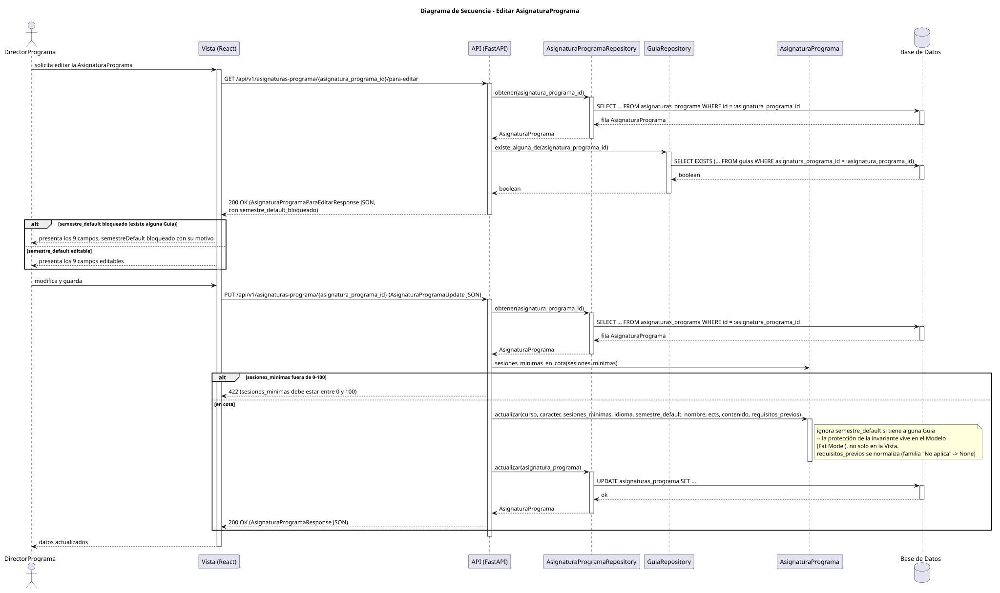

[Modelo del dominio](/RUP/00-modelo-del-dominio/README.md) / [Actores y casos de uso](/RUP/01-requisitos/01-actores-casos-uso/README.md) / [Detalle](/RUP/01-requisitos/03-detalle-casos-uso/README.md) / [Análisis](/RUP/02-analisis/README.md) / **Diseño** Subconjunto público de [pyCelda](https://github.com/mmasias/pyCelda) -- incluye modelo de dominio, requisitos, análisis y diseño completos; desarrollo solo para 5 casos de uso elegidos como ejemplo. Sin dashboard de seguimiento.

# pyCelda > editarAsignaturaPrograma() > Diseño

> |[🏠️](/README.md)|[DdC](/images/RUP/01-requisitos/01-actores-casos-uso/diagramaContextoDirectorPrograma.svg)|[Detalle](/RUP/01-requisitos/03-detalle-casos-uso/editarAsignaturaPrograma/README.md)|[Análisis](/RUP/02-analisis/casos-uso/editarAsignaturaPrograma/README.md)|**Diseño**|Desarrollo|Pruebas|
> |-|-|-|-|-|-|-|

## Información del artefacto

- **Proyecto**: pyCelda
- **Fase RUP**: Elaboración
- **Disciplina**: Diseño
- **Versión**: 1.0
- **Fecha**: 2026-08-19
- **Autor**: GLM (vía opencode)

## Propósito

Bajada a diseño del caso de análisis [`editarAsignaturaPrograma()`](/RUP/02-analisis/casos-uso/editarAsignaturaPrograma/README.md): edita los 9 atributos propios de una vez, con un `<<choice>>` que **bifurca solo la presentación del campo `semestreDefault`** (bloqueado si ya existe alguna `Guia` para esta `AsignaturaPrograma`), no el caso de uso entero -- a diferencia de los `<<choice>>` bloqueantes de este mismo lote, aquí no hay rama roja: el guardado siempre procede. La consulta de bloqueo ocurre ANTES de presentar el formulario (`obtenerParaEditar`), y la protección real de la invariante vive en `AsignaturaPrograma.actualizar()` (Fat Model). El 8.º atributo es `requisitosPrevios` (texto plano, discussion [#259](https://github.com/mmasias/pyCelda/discussions/259)); el 9.º, `sesionesMinimas` (issue [#808](https://github.com/mmasias/pyCelda/issues/808)).

## Diagrama de secuencia de diseño

||
|-|
|
Código fuente: [secuencia.puml](secuencia.puml)
|

## Participantes

- **Vista**: `EditarAsignaturaProgramaView` (React) -- presenta los 9 campos (`requisitosPrevios` como `<textarea>` junto a `contenido`; `sesionesMinimas` como `input` numérico obligatorio, 0-100, en fila propia con su aclaración); cuando `semestre_default_bloqueado` es `true`, muestra `semestreDefault` bloqueado con su motivo.
- **API**: `routers/asignatura_programa.py::obtener_para_editar(asignatura_programa_id)` / `::editar_asignatura_programa(asignatura_programa_id, datos)` -- funciones sueltas.
- **Modelo**: `AsignaturaPrograma.actualizar(curso, caracter, sesiones_minimas, idioma, semestre_default, nombre, ects, contenido, requisitos_previos)` -- aplica los 9 campos e **ignora `semestre_default` si la asignatura tiene alguna `Guia`**: la invariante vive en el Modelo, no solo en la Vista. `requisitos_previos` pasa por `AsignaturaPrograma.normalizar_requisitos_previos()` (la familia "No aplica" -> `None`). `AsignaturaPrograma.sesiones_minimas_en_cota(valor)` (classmethod) comprueba la cota 0-100 antes de `actualizar()`.
- **Repositorio**: `AsignaturaProgramaRepository.obtener(asignatura_programa_id)` / `.actualizar(asignatura_programa)`; `GuiaRepository.existe_alguna_de(asignatura_programa_id)` -- método nuevo del repositorio del hilo `Guia`, reutilizado sin duplicar.

## Decisiones de diseño

- **El `<<choice>>` se traduce en un campo del response, no en una rama de servidor**: `AsignaturaProgramaParaEditarResponse` incluye `semestre_default_bloqueado` junto a los 9 campos; el `alt` que lo consume es de la Vista (qué presenta), mientras el backend tiene un único camino. Es la traducción literal de "bifurca la consulta previa que decide qué presenta la Vista, no el flujo de guardado".
- **`requisitosPrevios` se lee en vivo, no se congela al aprobar**: el render de la guía docente lo lee de `AsignaturaPrograma` sin materializar (mismo régimen que los RA), así que editarlo aquí altera el texto de las guías ya `Aprobada`. Se acepta el riesgo por ahora -- durante la beta todo está en `Borrador`; el congelado retroactivo se decide en el issue [#219](https://github.com/mmasias/pyCelda/issues/219) para `requisitosPrevios` y los RA a la vez. Normalización en el Modelo (`normalizar_requisitos_previos`, staticmethod pura): la familia "No aplica"/"Ninguno"/"-"/vacío se guarda como `None`, y el render cae a "No aplica"; el `<<choice>>` de bloqueo no aplica a este campo.
- **`sesiones_minimas` también lo edita el `DirectorPrograma`** (issue [#808](https://github.com/mmasias/pyCelda/issues/808); antes solo `Admin`, en `PUT /api/v1/admin/asignaturas-programa/{id}`): campo obligatorio de `AsignaturaProgramaUpdate`, misma cota 0-100 y mismo `422` (`detail="sesiones_minimas debe estar entre 0 y 100"`) que la variante `Admin`, con la misma comprobación del Modelo (`sesiones_minimas_en_cota`). Editarlo no toca ninguna `Guia`: `Guia.sesiones_minimas` es una property que lo lee en vivo de la `AsignaturaPrograma`, así que el cambio vale de inmediato para la regla `c3` de [`enviarGuiaARevision()`](/RUP/03-diseño/casos-uso/enviarGuiaARevision/README.md) de todas sus guías.
- **`GET .../para-editar`, distinto del `GET .../{id}` de `abrirAsignaturaPrograma()`**: el detalle de lectura no necesita el flag de bloqueo ni el motivo, y el formulario sí -- dos vistas con distinta forma de respuesta, dos endpoints; mismo módulo `routers/asignatura_programa.py`.
- **La protección de la invariante es doble y la decisiva está en el Modelo**: la Vista bloquea el campo, pero aunque un cliente forzara un `AsignaturaProgramaUpdate` con otro `semestre_default`, `AsignaturaPrograma.actualizar()` lo ignora al comprobar sus propias `Guia` (relación ORM cargada) -- no basta con que la Vista no lo ofrezca, tal como cerró Análisis (discussion [#72](https://github.com/mmasias/pyCelda/discussions/72)).
- **El `PUT` no reconsulta `GuiaRepository`**: la decisión de ignorar `semestre_default` la toma el Modelo sobre sí mismo al aplicar `actualizar()` -- el chequeo previo (`existe_alguna_de`) pertenece solo a la fase de presentación.

## Referencias

- [`editarAsignaturaPrograma()` en Análisis](/RUP/02-analisis/casos-uso/editarAsignaturaPrograma/README.md) -- diagrama de colaboración origen, con la sección propia del `<<choice>>` (2026-08-19).
- [Especificación de Requisitos](/RUP/01-requisitos/03-detalle-casos-uso/editarAsignaturaPrograma/README.md) -- `<<choice>>` ya formalizado.
- `editarSemestreGuia()` en Diseño (retirado, [#782](https://github.com/mmasias/pyCelda/issues/782)) -- caso análogo de campo de semestre editable sin `HistorialCambio`.
- [`consultarEstadoGuias()` en Diseño](/RUP/03-diseño/casos-uso/consultarEstadoGuias/README.md) -- precedente de reutilización de un Repository del hilo `Guia`.
- [`enviarGuiaARevision()` en Diseño](/RUP/03-diseño/casos-uso/enviarGuiaARevision/README.md) -- plantilla del `alt`/`else`.
