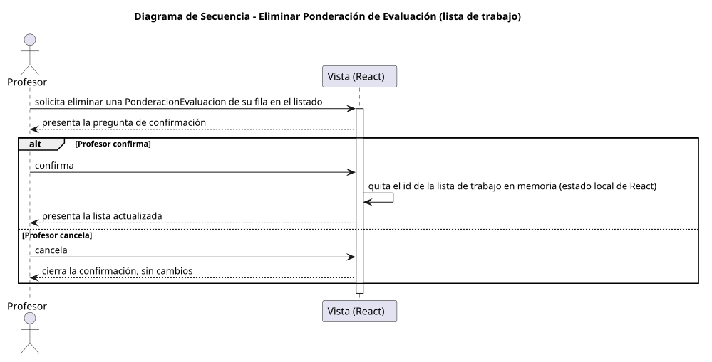

[Modelo del dominio](/RUP/00-modelo-del-dominio/README.md) / [Actores y casos de uso](/RUP/01-requisitos/01-actores-casos-uso/README.md) / [Detalle](/RUP/01-requisitos/03-detalle-casos-uso/README.md) / [Análisis](/RUP/02-analisis/README.md) / **Diseño** Subconjunto público de [pyCelda](https://github.com/mmasias/pyCelda) -- incluye modelo de dominio, requisitos, análisis y diseño completos; desarrollo solo para 5 casos de uso elegidos como ejemplo. Sin dashboard de seguimiento.

# pyCelda > eliminarPonderacionEvaluacion() > Diseño

> |[🏠️](/README.md)|[DdC](/images/RUP/01-requisitos/01-actores-casos-uso/diagramaContextoProfesor.svg)|[Detalle](/RUP/01-requisitos/03-detalle-casos-uso/eliminarPonderacionEvaluacion/README.md)|[Análisis](/RUP/02-analisis/casos-uso/eliminarPonderacionEvaluacion/README.md)|**Diseño**|Desarrollo|Pruebas|
> |-|-|-|-|-|-|-|

## Información del artefacto

- **Proyecto**: pyCelda
- **Fase RUP**: Elaboración
- **Disciplina**: Diseño
- **Versión**: 1.0
- **Fecha**: 2026-08-18
- **Autor**: Claude Sonnet 5 (vía Claude Code)

## Propósito

Bajada a diseño del caso de análisis [`eliminarPonderacionEvaluacion()`](/RUP/02-analisis/casos-uso/eliminarPonderacionEvaluacion/README.md): **sin endpoint de backend** -- decisión 2 de la discussion [#58](https://github.com/mmasias/pyCelda/discussions/58). Confirmar/cancelar es una mutación de la lista de trabajo del cliente, en la propia fila del listado (sin pantalla de confirmación aparte): el `Profesor` marca el ítem como excluido en el navegador, sin ninguna llamada a la API. Es, deliberadamente, el primer caso de la rebanada cuya secuencia de diseño no tiene ni Router ni Repository ni Base de Datos -- mismo motivo por el que Análisis ya lo cerró sin ninguna clase de Modelo en su diagrama de colaboración: no hay ninguna entidad de dominio ni persistencia involucrada en la operación. El efecto real solo se materializa después, cuando [`guardarBorradorGuia()`](/RUP/03-diseño/casos-uso/guardarBorradorGuia/README.md) reciba la lista completa (ya sin este `id`) y desvincule la fila real por ausencia.

## Diagrama de secuencia de diseño

||
|-|
|
Código fuente: [secuencia.puml](secuencia.puml)
|

## Participantes

- **Vista**: `EliminarPonderacionEvaluacionView` (React) -- no es una página: es el estado de confirmación de la fila en `PonderacionesEvaluacion.tsx` (`idAConfirmar`). La primera pulsación de la papelera cambia ese botón a "pulsa de nuevo para confirmar" y muestra "Cancelar"; la segunda (rama verde) añade el `id` a la lista de excluidos de la guía en `sessionStorage` (`excluir(clavePonderacionesExcluidas(guiaId), id)`, `listaTrabajo.ts`) y al estado `excluidos` del listado, sin red; "Cancelar" (rama azul) solo limpia `idAConfirmar`.
- **API**: ninguna -- sin ruta HTTP para este caso de uso.
- **Modelo**: ninguno -- ninguna fila de `PonderacionEvaluacion` se lee, borra ni edita.
- **Repositorio**: ninguno.

## Decisiones de diseño

- **Sin endpoint de backend, por diseño**: 7 de los 9 casos de la rebanada tienen ruta real; este y [`eliminarReferenciaBibliografica()`](/RUP/03-diseño/casos-uso/eliminarReferenciaBibliografica/README.md) son los dos que no la tienen -- decisión 2 de la discussion [#58](https://github.com/mmasias/pyCelda/discussions/58). No es una omisión de este README: es la implementación mínima real de la rebanada.
- **La eliminación es reversible hasta que se guarda el borrador**: si el `Profesor` cierra la pestaña sin guardar, el ítem sigue vinculado en la base de datos -- la marca en `sessionStorage` sobrevive a recargar la página, no a cerrar la pestaña, y no tiene efecto hasta que `guardarBorradorGuia()` reciba la lista completa (la ficha de la guía la limpia al guardar).
- **Ambas ramas (confirmar/cancelar) terminan en la misma pantalla** -- self-loop, sin navegación: la confirmación nunca sale del listado (alineado con el flujo construido en #857, río abajo de #855).

## Referencias

- [`eliminarPonderacionEvaluacion()` en Análisis](/RUP/02-analisis/casos-uso/eliminarPonderacionEvaluacion/README.md) -- diagrama de colaboración origen, ya sin ninguna clase de Modelo.
- [Especificación de Requisitos](/RUP/01-requisitos/03-detalle-casos-uso/eliminarPonderacionEvaluacion/README.md).
- [`guardarBorradorGuia()`](/RUP/03-diseño/casos-uso/guardarBorradorGuia/README.md) -- quien recibe la lista de trabajo ya sin este ítem y desvincula la fila real por ausencia.
- [`eliminarReferenciaBibliografica()`](/RUP/03-diseño/casos-uso/eliminarReferenciaBibliografica/README.md) -- mismo patrón, sobre `ReferenciaBibliografica`.
- Discussion [#58](https://github.com/mmasias/pyCelda/discussions/58) -- decisión 2, sin endpoint de backend para ambos `eliminar*()`.
