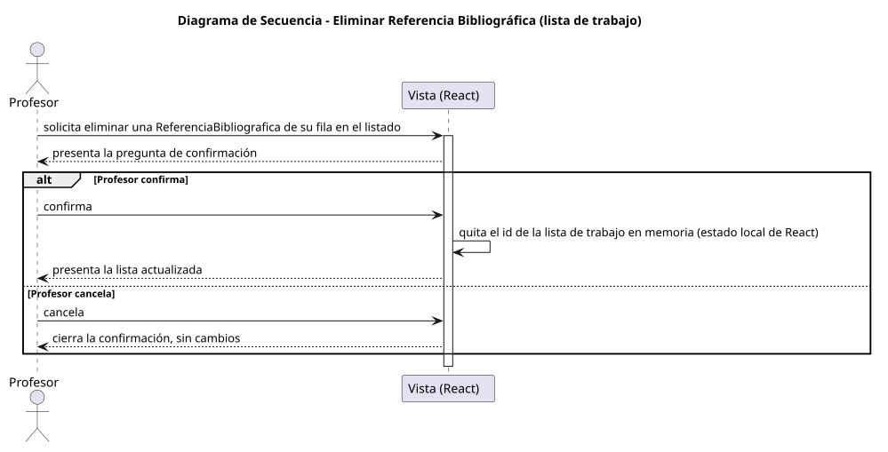

[Modelo del dominio](/RUP/00-modelo-del-dominio/README.md) / [Actores y casos de uso](/RUP/01-requisitos/01-actores-casos-uso/README.md) / [Detalle](/RUP/01-requisitos/03-detalle-casos-uso/README.md) / [Análisis](/RUP/02-analisis/README.md) / **Diseño** Subconjunto público de [pyCelda](https://github.com/mmasias/pyCelda) -- incluye modelo de dominio, requisitos, análisis y diseño completos; desarrollo solo para 5 casos de uso elegidos como ejemplo. Sin dashboard de seguimiento.

# pyCelda > eliminarReferenciaBibliografica() > Diseño

> |[🏠️](/README.md)|[DdC](/images/RUP/01-requisitos/01-actores-casos-uso/diagramaContextoProfesor.svg)|[Detalle](/RUP/01-requisitos/03-detalle-casos-uso/eliminarReferenciaBibliografica/README.md)|[Análisis](/RUP/02-analisis/casos-uso/eliminarReferenciaBibliografica/README.md)|**Diseño**|Desarrollo|Pruebas|
> |-|-|-|-|-|-|-|

## Información del artefacto

- **Proyecto**: pyCelda
- **Fase RUP**: Elaboración
- **Disciplina**: Diseño
- **Versión**: 1.0
- **Fecha**: 2026-08-18
- **Autor**: Claude Sonnet 5 (vía Claude Code)

## Propósito

Bajada a diseño del caso de análisis [`eliminarReferenciaBibliografica()`](/RUP/02-analisis/casos-uso/eliminarReferenciaBibliografica/README.md): **sin endpoint de backend**, mismo criterio que [`eliminarPonderacionEvaluacion()`](/RUP/03-diseño/casos-uso/eliminarPonderacionEvaluacion/README.md) -- decisión 2 de la discussion [#58](https://github.com/mmasias/pyCelda/discussions/58). Confirmar/cancelar ocurre en la propia fila del listado, sin pantalla aparte, y es una mutación de la lista de trabajo del cliente: el `Profesor` añade el `id` a la lista de excluidos de la guía (en `sessionStorage`, reflejada en el estado local de React), sin ninguna llamada a la API. Sin Router, sin Repository, sin Base de Datos -- el efecto real solo se materializa después, cuando [`guardarBorradorGuia()`](/RUP/03-diseño/casos-uso/guardarBorradorGuia/README.md) reciba la lista completa (ya sin este `id`) y desvincule la fila real por ausencia.

## Diagrama de secuencia de diseño

||
|-|
|
Código fuente: [secuencia.puml](secuencia.puml)
|

## Participantes

- **Vista**: `EliminarReferenciaBibliograficaView` (React), realizada dentro del propio listado `ReferenciasBibliograficas.tsx` (estado `idAConfirmar`), no como pantalla aparte -- la primera pulsación de la papelera convierte ese botón en "🗑️ pulsa de nuevo para confirmar" y añade **Cancelar** a su lado; en la rama verde, la segunda pulsación añade el `id` a la lista de excluidos (`excluir(claveReferenciasExcluidas(guiaId), id)`, en `sessionStorage`) y la fila desaparece; en la rama azul, **Cancelar** devuelve la fila a su estado normal. Sin red.
- **API**: ninguna -- sin ruta HTTP para este caso de uso.
- **Modelo**: ninguno -- ninguna fila de `ReferenciaBibliografica` se lee, borra ni edita.
- **Repositorio**: ninguno.

## Decisiones de diseño

- **Sin endpoint de backend, por diseño**: mismo criterio que [`eliminarPonderacionEvaluacion()`](/RUP/03-diseño/casos-uso/eliminarPonderacionEvaluacion/README.md) -- decisión 2 de la discussion [#58](https://github.com/mmasias/pyCelda/discussions/58).
- **La eliminación es reversible hasta que se guarda el borrador**: si el `Profesor` cierra la pestaña sin guardar, el ítem sigue vinculado en la base de datos. [`guardarBorradorGuia()`](/RUP/03-diseño/casos-uso/guardarBorradorGuia/README.md) lee la lista de excluidos y la limpia al guardar.
- **Confirmación en la propia fila, sin pantalla aparte** (issue [#855](https://github.com/mmasias/pyCelda/issues/855)): la pantalla construida nunca abrió una vista de confirmación propia; el diagrama de secuencia lo refleja.
- **Ambas ramas (confirmar/cancelar) terminan en la misma pantalla** -- self-loop, sin navegación: nunca se sale del listado.

## Referencias

- [`eliminarReferenciaBibliografica()` en Análisis](/RUP/02-analisis/casos-uso/eliminarReferenciaBibliografica/README.md) -- diagrama de colaboración origen, ya sin ninguna clase de Modelo.
- [Especificación de Requisitos](/RUP/01-requisitos/03-detalle-casos-uso/eliminarReferenciaBibliografica/README.md).
- [`guardarBorradorGuia()`](/RUP/03-diseño/casos-uso/guardarBorradorGuia/README.md) -- quien recibe la lista de trabajo ya sin este ítem y desvincula la fila real por ausencia.
- [`eliminarPonderacionEvaluacion()`](/RUP/03-diseño/casos-uso/eliminarPonderacionEvaluacion/README.md) -- mismo patrón, sobre `PonderacionEvaluacion`.
- Discussion [#58](https://github.com/mmasias/pyCelda/discussions/58) -- decisión 2, sin endpoint de backend para ambos `eliminar*()`.
