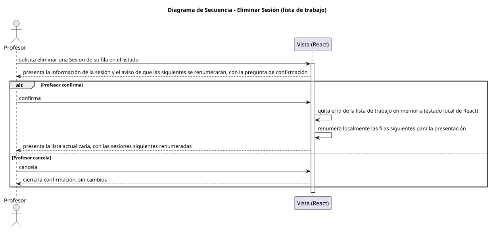

[Modelo del dominio](/RUP/00-modelo-del-dominio/README.md) / [Actores y casos de uso](/RUP/01-requisitos/01-actores-casos-uso/README.md) / [Detalle](/RUP/01-requisitos/03-detalle-casos-uso/README.md) / [Análisis](/RUP/02-analisis/README.md) / **Diseño** Subconjunto público de [pyCelda](https://github.com/mmasias/pyCelda) -- incluye modelo de dominio, requisitos, análisis y diseño completos; desarrollo solo para 5 casos de uso elegidos como ejemplo. Sin dashboard de seguimiento.

# pyCelda > eliminarSesion() > Diseño

> |[🏠️](/README.md)|[DdC](/images/RUP/01-requisitos/01-actores-casos-uso/diagramaContextoProfesor.svg)|[Detalle](/RUP/01-requisitos/03-detalle-casos-uso/eliminarSesion/README.md)|[Análisis](/RUP/02-analisis/casos-uso/eliminarSesion/README.md)|**Diseño**|Desarrollo|Pruebas|
> |-|-|-|-|-|-|-|

## Información del artefacto

- **Proyecto**: pyCelda
- **Fase RUP**: Elaboración
- **Disciplina**: Diseño
- **Versión**: 1.0
- **Fecha**: 2026-08-30
- **Autor**: Claude Sonnet 5 (vía Claude Code)

## Propósito

Bajada a diseño del caso de análisis [`eliminarSesion()`](/RUP/02-analisis/casos-uso/eliminarSesion/README.md): **sin endpoint de backend** -- decisión 2 de la discussion [#58](https://github.com/mmasias/pyCelda/discussions/58), aplicada aquí por primera vez fuera del lote original de Ponderacion/Referencia. Confirmar/cancelar es una mutación de la lista de trabajo del cliente: el `Profesor` confirma en la propia fila (doble pulsación de la papelera) y la Vista añade el `id` a la lista de excluidas de la guía (`sessionStorage`, `listaTrabajo.ts`) y renumera localmente las filas siguientes para la presentación, sin ninguna llamada a la API. Es, deliberadamente, un caso de Diseño sin Router ni Repository ni Base de Datos -- mismo motivo por el que Análisis ya lo cerró sin ninguna clase de Modelo en su diagrama de colaboración: no hay ninguna entidad de dominio ni persistencia involucrada en la operación. La baja real se materializa cuando [`guardarBorradorGuia()`](/RUP/03-diseño/casos-uso/guardarBorradorGuia/README.md)/[`enviarGuiaARevision()`](/RUP/03-diseño/casos-uso/enviarGuiaARevision/README.md) sincronizan: desde el Bloque 2 de la discussion [#206](https://github.com/mmasias/pyCelda/discussions/206) ambos reciben `ids_sesiones_final` y `Guia.sincronizar_sesiones()` borra (`db.delete`) las `Sesion` que no están en la lista -- issue [#93](https://github.com/mmasias/pyCelda/issues/93), mismo criterio que `PonderacionEvaluacion`/`ReferenciaBibliografica`.

## Diagrama de secuencia de diseño

||
|-|
|
Código fuente: [secuencia.puml](secuencia.puml)
|

## Participantes

- **Vista**: `EliminarSesionView` -- en la pantalla construida no es un componente aparte sino la confirmación en la fila de `PlanificacionDocente.tsx` (`idAConfirmar`): la primera pulsación de la papelera la convierte en "🗑️ pulsa de nuevo para confirmar" y muestra **Cancelar**; no hay texto de aviso de renumeración. En la rama verde, añade el `id` a la lista de excluidas de la guía (`excluir(claveSesionesExcluidas(guiaId), id)`, en `sessionStorage`) y al estado local `excluidos`; el listado visible se filtra y la numeración es la posición (`i + 1`), así que las filas siguientes suben un puesto, sin red. En la rama azul, `idAConfirmar` vuelve a `null`.
- **API**: ninguna -- sin ruta HTTP para este caso de uso.
- **Modelo**: ninguno -- ninguna fila de `Sesion` se lee, borra ni edita.
- **Repositorio**: ninguno.

## Decisiones de diseño

- **Sin endpoint de backend, por diseño**: mismo criterio exacto que [`eliminarPonderacionEvaluacion()`](/RUP/03-diseño/casos-uso/eliminarPonderacionEvaluacion/README.md)/[`eliminarReferenciaBibliografica()`](/RUP/03-diseño/casos-uso/eliminarReferenciaBibliografica/README.md) -- decisión 2 de la discussion [#58](https://github.com/mmasias/pyCelda/discussions/58), aplicada por primera vez fuera del lote original de Ponderacion/Referencia. No es una omisión de este README: la baja real solo se decide después, por ausencia en la lista que recibirá `guardarBorradorGuia()`.
- **Renumeración local -- la diferencia real con `eliminarPonderacionEvaluacion()`**: allí no existe el concepto de `numero`; aquí la Vista, tras quitar el `id`, renumera localmente las filas siguientes para la presentación -- el `numero` mostrado es posición en la lista fusionada, no valor persistido (ya documentado en [`abrirPlanificacionDocente()` en Análisis](/RUP/02-analisis/casos-uso/abrirPlanificacionDocente/README.md)). El `numero` persistido de cada fila no cambia -- ni aquí ni al guardar el borrador.
- **La eliminación es reversible hasta que se guarda el borrador**: si el `Profesor` cierra la pestaña sin guardar, el ítem sigue en la base de datos -- la marca de exclusión vive en `sessionStorage` (sobrevive a recargar la página, no a cerrar la pestaña) y no tiene efecto hasta que `guardarBorradorGuia()`/`enviarGuiaARevision()` la reciban completa. Desde el Bloque 2 de la discussion [#206](https://github.com/mmasias/pyCelda/discussions/206) esos dos casos de uso reciben `ids_sesiones_final` y borran por ausencia -- misma mecánica que `PonderacionEvaluacion`/`ReferenciaBibliografica`.
- **Ambas ramas (confirmar/cancelar) terminan en la misma pantalla** -- self-loop, sin navegación de salida distinta.
- **Alineado con la pantalla construida** (issues [#855](https://github.com/mmasias/pyCelda/issues/855) y #857): la confirmación es en la propia fila y la renumeración se ve al confirmar, sin aviso en texto; el medidor pasa a dar "En pantalla" y "Guardado" con el aviso de cambios sin guardar.

## Referencias

- [`eliminarSesion()` en Análisis](/RUP/02-analisis/casos-uso/eliminarSesion/README.md) -- diagrama de colaboración origen, ya sin ninguna clase de Modelo.
- [Especificación de Requisitos](/RUP/01-requisitos/03-detalle-casos-uso/eliminarSesion/README.md).
- [`eliminarPonderacionEvaluacion()` en Diseño](/RUP/03-diseño/casos-uso/eliminarPonderacionEvaluacion/README.md) -- patrón calco de este diagrama.
- [`abrirPlanificacionDocente()` en Análisis](/RUP/02-analisis/casos-uso/abrirPlanificacionDocente/README.md) -- donde vive el hallazgo del `numero` presentado como posición en la lista fusionada.
- [`guardarBorradorGuia()`](/RUP/03-diseño/casos-uso/guardarBorradorGuia/README.md) / [`enviarGuiaARevision()`](/RUP/03-diseño/casos-uso/enviarGuiaARevision/README.md) -- quienes recibirán la lista de trabajo ya sin este ítem y decidirán la desvinculación real por ausencia.
- Discussion [#58](https://github.com/mmasias/pyCelda/discussions/58) -- decisión 2, sin endpoint de backend.
- Discussion [#140](https://github.com/mmasias/pyCelda/discussions/140) -- cierre de las 8 decisiones de diseño de la Planificación docente.
