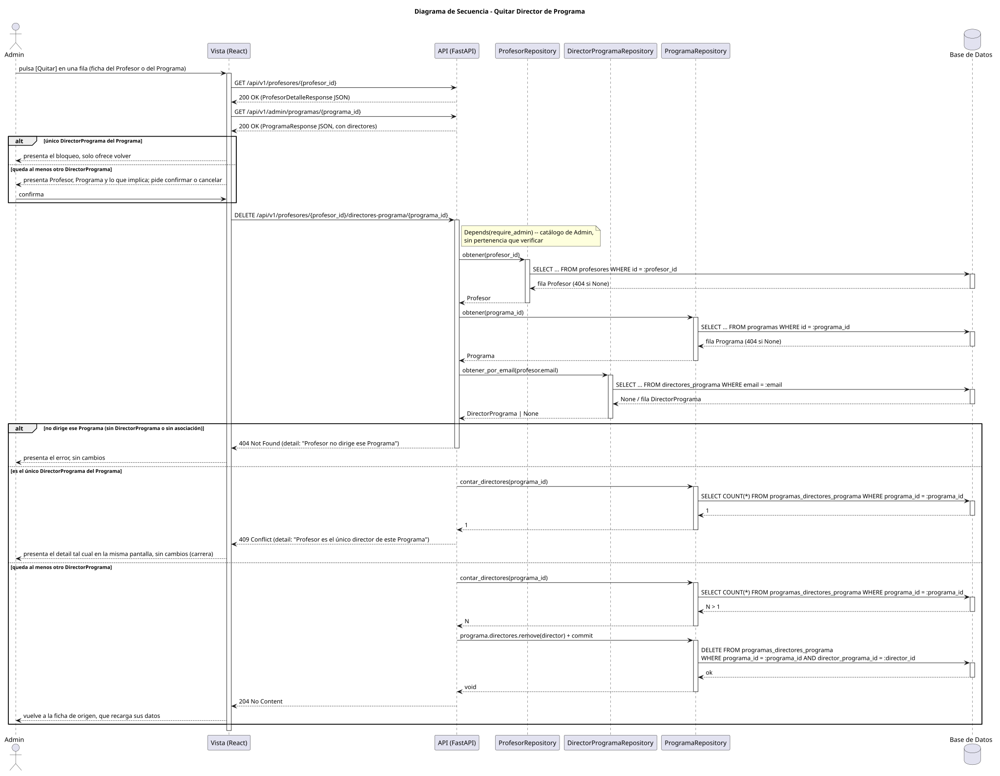

[Modelo del dominio](/RUP/00-modelo-del-dominio/README.md) / [Actores y casos de uso](/RUP/01-requisitos/01-actores-casos-uso/README.md) / [Detalle](/RUP/01-requisitos/03-detalle-casos-uso/README.md) / [Análisis](/RUP/02-analisis/README.md) / **Diseño** Subconjunto público de [pyCelda](https://github.com/mmasias/pyCelda) -- incluye modelo de dominio, requisitos, análisis y diseño completos; desarrollo solo para 5 casos de uso elegidos como ejemplo. Sin dashboard de seguimiento.

# pyCelda > quitarDirectorPrograma() > Diseño

> |[🏠️](/README.md)|[DdC](/images/RUP/01-requisitos/01-actores-casos-uso/diagramaContextoAdmin.svg)|[Detalle](/RUP/01-requisitos/03-detalle-casos-uso/quitarDirectorPrograma/README.md)|[Análisis](/RUP/02-analisis/casos-uso/quitarDirectorPrograma/README.md)|**Diseño**|Desarrollo|Pruebas|
> |-|-|-|-|-|-|-|

## Información del artefacto

- **Proyecto**: pyCelda
- **Fase RUP**: Elaboración
- **Disciplina**: Diseño
- **Versión**: 1.0
- **Fecha**: 2026-08-26
- **Autor**: GLM (vía opencode)

## Propósito

Bajada a diseño del caso de análisis [`quitarDirectorPrograma()`](/RUP/02-analisis/casos-uso/quitarDirectorPrograma/README.md): `<<choice>>` bloqueante aplicado a la baja de un rol -- un `Programa` no puede quedarse sin ningún `DirectorPrograma`. Un único endpoint `DELETE /api/v1/profesores/{profesor_id}/directores-programa/{programa_id}` resuelve el `<<choice>>` y la retirada: `404` si el `Profesor` no dirige ese `Programa`, `409` si es el único director, `204` si retira de verdad.

## Diagrama de secuencia de diseño

||
|-|
|
Código fuente: [secuencia.puml](secuencia.puml)
|

## Participantes

- **Vista**: el botón `[Quitar]` por fila de la sección "Programas que dirige" de la ficha del `Profesor`, o de la sección "Directores" de la ficha del `Programa` (#492), lleva a la pantalla propia `QuitarDirectorPrograma.tsx` (#885). Esta carga el `Profesor` (`GET /api/v1/profesores/{profesor_id}`) y el `Programa` con sus directores (`GET /api/v1/admin/programas/{programa_id}`); con un único director presenta el bloqueo y solo ofrece volver; si no, pide confirmar o cancelar, y al confirmar dispara el `DELETE` y vuelve a la ficha de origen. Un `409` que llegue al confirmar (carrera) se presenta como error en la misma pantalla.
- **API**: `routers/profesor.py::quitar_director_programa(profesor_id, programa_id)` -- las tres guardias (`404`/`404`/`409`) antes de retirar.
- **Modelo**: la asociación vive en la tabla M2M `programas_directores_programa` -- el router retira de `Programa.directores`; la fila `DirectorPrograma` no desaparece nunca.
- **Repositorio**: `ProgramaRepository.dirige(programa_id, director_programa_id)` (ya existía, para las guardas de pertenencia del hilo `DirectorPrograma`) / `.contar_directores(programa_id)` (nuevo), `DirectorProgramaRepository.obtener_por_email()`, `ProfesorRepository.obtener()`.

## Decisiones de diseño

- **El `<<choice>>` se presenta en la Vista y se garantiza en el `DELETE`** (#885): la pantalla propia decide la fase de bloqueo con los directores que ya sirve la ficha del `Programa` de Admin, sin regla nueva; la invariante sigue en el servidor: aunque un cliente dispare el `DELETE` a ciegas, el endpoint cuenta los directores antes de retirar y responde `409` con `detail="Profesor es el único director de este Programa"`. Antes de #885 no había pantalla de confirmación ni de bloqueo: el botón de la fila disparaba el `DELETE` y el `409` llegaba como error tras el intento.
- **`404`, no `409`, para "no dirige ese Programa"**: pedir la baja de un rol que no se tiene es un problema de identificador (la fila de `programas_directores_programa` no existe), no un conflicto de estado -- mismo reparto que el `404` de recurso inexistente.
- **`contar_directores(programa_id) == 1` como condición del bloqueo**: el conteo exacto, no `<= 1` -- llegar aquí ya implica (vía `dirige()`) que este director es una de las filas; si el total es 1, es él.
- **La fila `DirectorPrograma` sobrevive a la retirada**: un `DirectorPrograma` sin ningún `Programa` sigue resolviendo el email en el login y deja de ser bloqueo en `eliminarProfesor()` -- retirar el rol no es borrar la cuenta.
- **`204 No Content`**: la mutación es la retirada de una fila M2M, no hay entidad que devolver -- la Vista refresca el detalle con su `GET`.
- **Rama "cancelada" sin llamada HTTP**: cancelar en la pantalla de confirmación vuelve a la ficha de origen sin tocar el servidor.
- **Autorización de `Admin`: `Depends(require_admin)`** -- escritura sobre el rol que gobierna el acceso del hilo `DirectorPrograma`, explícito.
- **Sin capa Service**: Router delgado -> Repository.

## Referencias

- [`quitarDirectorPrograma()` en Análisis](/RUP/02-analisis/casos-uso/quitarDirectorPrograma/README.md) -- diagrama de colaboración origen.
- [Especificación de Requisitos](/RUP/01-requisitos/03-detalle-casos-uso/quitarDirectorPrograma/README.md) y [discussion #18](https://github.com/mmasias/pyCelda/discussions/18) -- cierre del `<<choice>>` del único director.
- [`definirDirectorPrograma()` en Diseño](/RUP/03-diseño/casos-uso/definirDirectorPrograma/README.md) -- el alta complementaria del rol.
- [`eliminarProfesor()` en Diseño](/RUP/03-diseño/casos-uso/eliminarProfesor/README.md) -- el consumidor del estado resultante: un `DirectorPrograma` sin `Programa` deja de bloquear el borrado.
