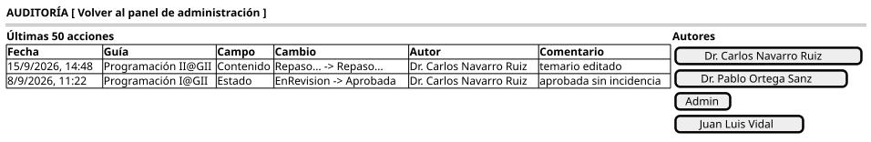
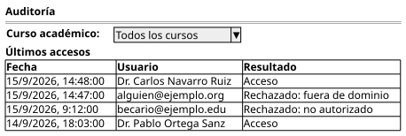

[Manual de Admin](README.md)

# Auditoría

## Qué es

Una consulta de solo lectura del historial de cambios de las guías docentes (quién cambió qué, cuándo y con qué comentario) y de los últimos intentos de entrada en la aplicación. No permite modificar ni borrar nada.

## Cómo llegar

Pulsar [**🔍 Auditoría**](auditoria.md#qué-registra) en el panel de administración. Para volver al panel, [**⚙️ Panel**](entrarYElPanel.md#el-panel-de-administración), arriba a la derecha.

## Qué registra

|
|:-:
[Ver la pantalla en el prototipo navegable](/docs/PROPUESTA_WIREFRAME/admin/consultarHistorialCambios.md)

Cada fila es un cambio en una guía. Los tipos de cambio (columna **Campo**) son:

- **Estado**: cambios de estado de la guía (aprobar, rechazar, revocar, enviar a revisión, o la vuelta a **Borrador** por una corrección directa del director). Cuando el profesor edita una guía Aprobada, la vuelta a **Borrador** queda a su nombre con el comentario "edición del Profesor sobre la guía aprobada". Cuando Admin cambia el profesorado de una asignatura con la guía Aprobada, esta vuelve a revisión y queda registrado a nombre de **Admin**.
- **Corrección del Director**: el director corrigió una guía en **Borrador** o **Rechazada**, que no cambia de estado: el cambio figura con el mismo estado antes y después (`Borrador → Borrador` o `Rechazada → Rechazada`).
- **Contenido**: edición del temario.
- **Planificación docente**: crear, editar, duplicar o generar las sesiones.
- **Ponderaciones de evaluación**: altas y bajas de ponderaciones, y la edición de un instrumento ya incluido en la guía (descripción y peso antes y después; si cambia el sistema de evaluación, el comentario lo indica, p. ej. "sistema: Evaluación continua -> Evaluación final").
- **Referencias bibliográficas**: altas y bajas de referencias.

## Filtro

Hay un único filtro, el selector **Curso académico:**. Por defecto muestra **Todos los cursos** (el histórico completo); cada curso aparece como `AAAA-AAAA`, con el sufijo "(vigente)" el Activo. Al elegir uno, la pantalla se recarga solo con los cambios de las guías de ese curso. No hay filtros por fechas, profesor o campo.

## Cómo leer cada fila

Bajo **Últimas 50 acciones** (o "Sin acciones registradas todavía."), de la más reciente a la más antigua:

- **Fecha**: fecha y hora del cambio.
- **Guía**: `Asignatura@CÓDIGO` del programa, o "--" si no se puede determinar.
- **Campo**: tipo de cambio, de la lista anterior.
- **Cambio**: valor anterior → valor nuevo (p. ej. `Borrador → En revisión`, `3 sesiones → 4 sesiones`).
- **Autor**: nombre de quien lo hizo. Para un director sin nombre registrado se muestra su correo; **Admin** para los cambios del sistema atribuidos a Admin.
- **Comentario**: el motivo o resumen (p. ej. "temario editado"), o "--".

## Autores

|
|:-:
[Ver la pantalla en el prototipo navegable](/docs/PROPUESTA_WIREFRAME/admin/consultarHistorialCambios.md)

A la derecha, la lista **Autores** (o "Sin autores registrados todavía."), con un botón por persona que aparece en el historial mostrado; si es profesor y director a la vez, figura una sola vez. Al pulsar un nombre se abre **Actividad de** esa persona: todos sus cambios (sin el límite de 50 ni el filtro de curso), con las mismas columnas salvo **Rol** (**Profesor**, **Director** o **Admin**) en lugar de **Autor**. El título es una miga, **🔍 Auditoría › Actividad de ...**: pulsar **Auditoría** vuelve al historial completo.

## Últimos accesos

|
|:-:
[Ver la pantalla en el prototipo navegable](/docs/PROPUESTA_WIREFRAME/admin/consultarRegistroAccesos.md)

Debajo del historial, el bloque **Últimos accesos** (o "Sin accesos registrados todavía.") muestra los 25 intentos de inicio de sesión más recientes de profesores y directores, del más reciente al más antiguo, tanto los que entraron como los rechazados:

- **Fecha**: fecha y hora del intento.
- **Usuario**: nombre de la persona si su correo está dado de alta como profesor o director; si no (lo normal en un rechazo), el correo tal cual.
- **Resultado**: **Acceso**, **Rechazado: fuera de dominio** (cuenta de Google ajena al dominio institucional) o **Rechazado: no autorizado** (cuenta del dominio que no está dada de alta).

Los inicios de sesión de Admin no se registran. El selector **Curso académico:** no afecta a este bloque.

---

| [Cursos académicos](cursosAcademicos.md) | [Índice](README.md) |  |
|---|:-:|---|

