

[Manual de Admin](README.md)

# Estructura académica

## Qué es

La jerarquía Universidad -> Facultad -> Programa. Se pueden crear universidades y facultades; editar o eliminar universidades y facultades no está disponible en esta versión. Los programas se gestionan por completo desde aquí: crear, editar el nombre, dar de baja.

## Universidades

|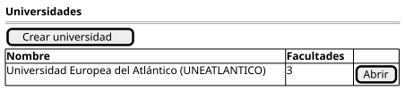
|:-:
[Ver la pantalla en el prototipo navegable](/docs/PROPUESTA_WIREFRAME/admin/abrirUniversidades.md)

|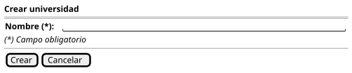
|:-:
[Ver la pantalla en el prototipo navegable](/docs/PROPUESTA_WIREFRAME/admin/crearUniversidad.md)

|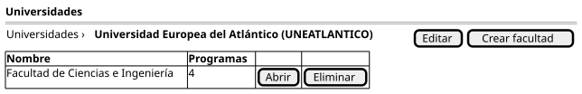
|:-:
[Ver la pantalla en el prototipo navegable](/docs/PROPUESTA_WIREFRAME/admin/abrirUniversidad.md)

|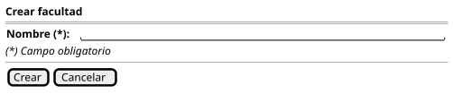
|:-:
[Ver la pantalla en el prototipo navegable](/docs/PROPUESTA_WIREFRAME/admin/crearFacultad.md)

Pulsar **Universidades** en el panel de administración. Aparece una tabla con el **Nombre** de cada universidad, el número de **Facultades** que tiene y el botón **Abrir**. El botón **➕ Crear universidad** lleva a un formulario con el **Nombre (*)** de la universidad; se confirma con **Crear** (o **Cancelar**).

Al abrir una universidad aparecen su nombre y una tabla de sus **Facultades** (**Nombre**, número de **Programas** de cada una, [**Abrir**](estructuraAcademica.md#programas-de-una-facultad)). **➕ Crear facultad** lleva a un formulario con el nombre de la facultad, dentro de esa universidad. Los botones **✏️ Editar** de la universidad y la papelera **🗑️** (Eliminar) de cada facultad aparecen desactivados: no están disponibles en esta versión.

## Programas de una facultad

|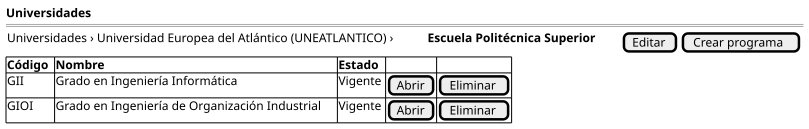
|:-:
[Ver la pantalla en el prototipo navegable](/docs/PROPUESTA_WIREFRAME/admin/abrirFacultad.md)

Al abrir una facultad aparece su nombre y una tabla de sus programas, con **Código**, **Nombre**, **Estado** (**Vigente** o **Extinguido**) y los botones [**📂 Abrir**](estructuraAcademica.md#detalle-de-un-programa) y la papelera [**🗑️**](estructuraAcademica.md#dar-de-baja-un-programa) (Eliminar) de cada uno. El botón **✏️ Editar** de la facultad aparece desactivado, igual que en la universidad.

### Crear un programa

|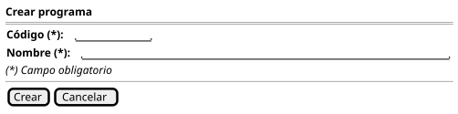
|:-:
[Ver la pantalla en el prototipo navegable](/docs/PROPUESTA_WIREFRAME/admin/crearPrograma.md)

1. Pulsar **➕ Crear programa**.
2. Rellenar **Código** y **Nombre**.
3. Pulsar **Crear**.

Tras crearlo, la pantalla pasa directamente a editar el programa recién creado.

## Detalle de un programa

|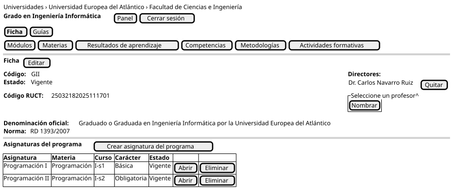
|:-:
[Ver la pantalla en el prototipo navegable](/docs/PROPUESTA_WIREFRAME/admin/abrirPrograma.md)

Las pantallas de un programa llevan su nombre en la cabecera y, encima en pequeño, la miga **🏛️ Universidades › universidad › facultad**, cuyos pasos son enlaces para subir en la estructura. Debajo va una franja de pestañas en dos filas, con la de la pantalla actual marcada (igual que en la vista del director de programa): arriba **📋 Ficha** y [**🚦 Guías**](seguimientoDeGuias.md#qué-muestra); debajo, algo más pequeñas, las de la estructura del programa.

- **📋 Ficha**: su **Código**, **Estado**, **Código RUCT**, **Denominación oficial** y **Norma** (RD 1393/2007 o RD 822/2021, la norma con la que se verificó la memoria; estos tres los carga la importación desde el RUCT y no se editan; "--" si el programa no se ha importado), los directores y una tabla de sus **Asignaturas del programa** -- ver el capítulo [Asignaturas de programa y profesorado](asignaturasDeProgramaYProfesorado.md). [**✏️ Editar**](estructuraAcademica.md#dar-de-baja-un-programa), a la derecha del título **Ficha**, cambia el nombre del programa; el código no es editable una vez creado. Al pie de esa pantalla, en **Zona de riesgo**, está [**🗑️ Eliminar**](estructuraAcademica.md#dar-de-baja-un-programa) (ver más abajo).
- [**🧱 Módulos**](estructuraAcademica.md#módulos-del-programa): los módulos en que se agrupan las materias del programa (ver más abajo).
- [**📚 Materias**](materiasYSistemasDeEvaluacion.md#qué-muestra): las materias del programa -- capítulo [Materias y sistemas de evaluación](materiasYSistemasDeEvaluacion.md).
- [**🎯 Resultados de aprendizaje**](estructuraAcademica.md#resultados-de-aprendizaje-del-programa): los resultados de aprendizaje del programa (ver más abajo).
- [**🧭 Competencias**](estructuraAcademica.md#competencias-del-programa): las competencias del programa (ver más abajo).
- [**🧩 Metodologías**](estructuraAcademica.md#metodologías-docentes-del-programa): las metodologías docentes del programa (ver más abajo).
- [**🏋️ Actividades formativas**](estructuraAcademica.md#actividades-formativas-del-programa): las actividades formativas del programa (ver más abajo).
- **🚦 Guías**: el seguimiento de sus guías docentes -- capítulo [Seguimiento de guías](seguimientoDeGuias.md).

Desde el detalle del programa ya no hay un botón **Eliminar**: se llega a él desde **Editar**. Desde el listado de programas de la facultad sigue disponible la papelera **🗑️** (Eliminar) de cada fila.

## Dar de baja un programa

|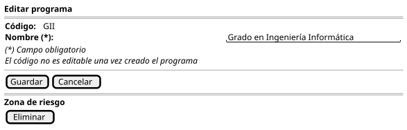
|:-:
[Ver la pantalla en el prototipo navegable](/docs/PROPUESTA_WIREFRAME/admin/editarPrograma.md)

|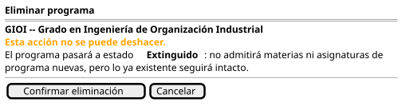
|:-:
[Ver la pantalla en el prototipo navegable](/docs/PROPUESTA_WIREFRAME/admin/eliminarPrograma.md)

Pulsar **🗑️ Eliminar** en **Zona de riesgo** de la pantalla **Editar** (desactivado si el programa ya está **Extinguido**), o la papelera **🗑️** (Eliminar) en la fila del programa en la facultad, y confirmar en **🗑️ Confirmar eliminación**. Esta acción no se puede deshacer: el programa pasa a estado **Extinguido**, deja de admitir altas nuevas apoyadas en él, pero todo lo ya existente permanece intacto.

## Metodologías docentes del programa

|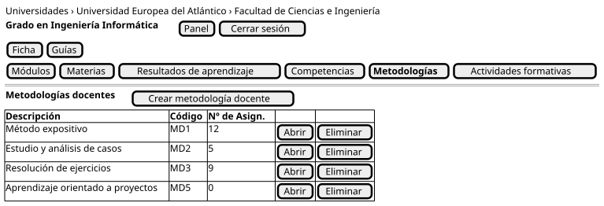
|:-:
[Ver la pantalla en el prototipo navegable](/docs/PROPUESTA_WIREFRAME/admin/abrirMetodologiasDocentes.md)

|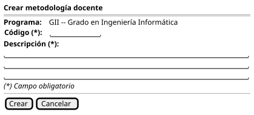
|:-:
[Ver la pantalla en el prototipo navegable](/docs/PROPUESTA_WIREFRAME/admin/crearMetodologiaDocente.md)

|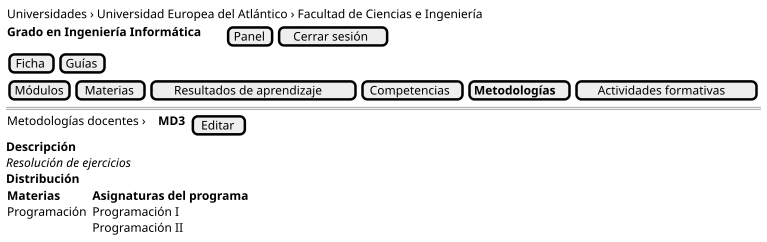
|:-:
[Ver la pantalla en el prototipo navegable](/docs/PROPUESTA_WIREFRAME/admin/abrirMetodologiaDocente.md)

|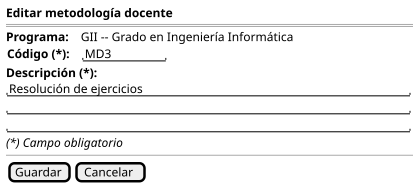
|:-:
[Ver la pantalla en el prototipo navegable](/docs/PROPUESTA_WIREFRAME/admin/editarMetodologiaDocente.md)

|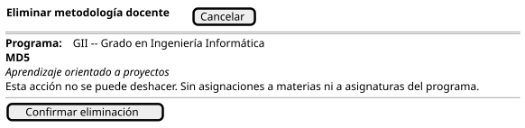
|:-:
[Ver la pantalla en el prototipo navegable](/docs/PROPUESTA_WIREFRAME/admin/eliminarMetodologiaDocente.md)

Cada programa tiene su propio catálogo de metodologías docentes, con el código y la descripción de su memoria; no se comparte con otros programas. Pulsar la pestaña **🧩 Metodologías** del programa. Funciona como las competencias: tabla con **Descripción**, **Código** y **Nº de Asign.** (cuántas asignaturas del programa la tienen; con fondo rojo suave si es 0), con **📂 Abrir** y la papelera **🗑️** (Eliminar) en cada fila.

- **➕ Crear metodología docente**: formulario con **Código (*)** y **Descripción (*)**; se confirma con **Crear** y se abre la metodología creada. El código no puede repetirse dentro del programa, sin distinguir mayúsculas y minúsculas.
- **📂 Abrir**: la miga **🧩 Metodologías docentes › código**, la descripción, **✏️ Editar** (mismos campos que el alta) y la **Distribución**: las materias y las asignaturas de programa que la tienen, cada una con un enlace a su ficha.
- **🗑️** (Eliminar): si está asociada a alguna materia o asignatura de programa, la pantalla indica **⛔ No se puede eliminar** y lista dónde; si no, pide confirmación y la baja no se puede deshacer.

Las metodologías se asocian a las materias y, de las de cada materia, a sus asignaturas, desde la sección de metodologías de cada una. El director de programa gestiona lo mismo desde su vista.

## Actividades formativas del programa

|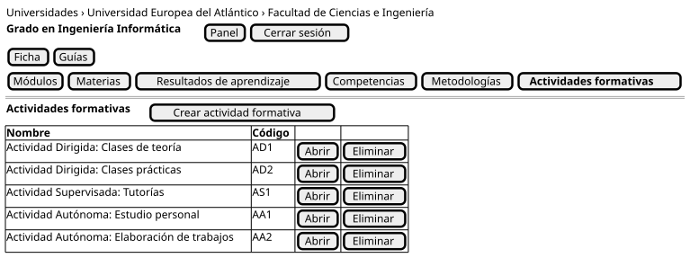
|:-:
[Ver la pantalla en el prototipo navegable](/docs/PROPUESTA_WIREFRAME/admin/abrirActividadesFormativas.md)

|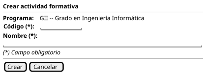
|:-:
[Ver la pantalla en el prototipo navegable](/docs/PROPUESTA_WIREFRAME/admin/crearActividadFormativa.md)

|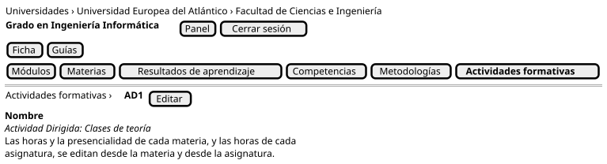
|:-:
[Ver la pantalla en el prototipo navegable](/docs/PROPUESTA_WIREFRAME/admin/abrirActividadFormativa.md)

|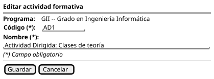
|:-:
[Ver la pantalla en el prototipo navegable](/docs/PROPUESTA_WIREFRAME/admin/editarActividadFormativa.md)

|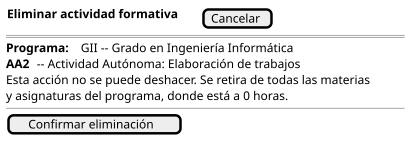
|:-:
[Ver la pantalla en el prototipo navegable](/docs/PROPUESTA_WIREFRAME/admin/eliminarActividadFormativa.md)

Igual que las metodologías, cada programa tiene su catálogo de actividades formativas, con el código y el nombre de su memoria. Pulsar la pestaña **🏋️ Actividades formativas** del programa: tabla con **Nombre** y **Código**, en orden de alta, con **📂 Abrir** y **🗑️** (Eliminar).

- **➕ Crear actividad formativa**: **Código (*)** (único en el programa) y **Nombre (*)**. Al crearla, todas las materias y asignaturas del programa reciben su fila a 0 horas.
- **📂 Abrir**: código, nombre y **✏️ Editar**.
- **🗑️** (Eliminar): bloqueada con **⛔ No se puede eliminar** si alguna materia o asignatura del programa tiene horas en ella (la pantalla dice en qué materias); si no, se retira también de las materias y asignaturas, donde estaba a 0.

Las horas y la presencialidad se reparten en cada materia, y las horas en cada asignatura (capítulos [Materias y sistemas de evaluación](materiasYSistemasDeEvaluacion.md) y [Asignaturas de programa y profesorado](asignaturasDeProgramaYProfesorado.md)).

## Resultados de aprendizaje del programa

|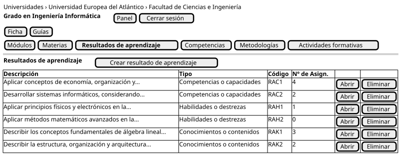
|:-:
[Ver la pantalla en el prototipo navegable](/docs/PROPUESTA_WIREFRAME/admin/abrirResultadosAprendizaje.md)

|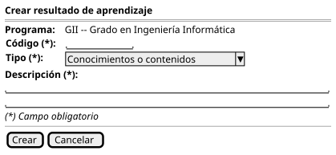
|:-:
[Ver la pantalla en el prototipo navegable](/docs/PROPUESTA_WIREFRAME/admin/crearResultadoAprendizaje.md)

|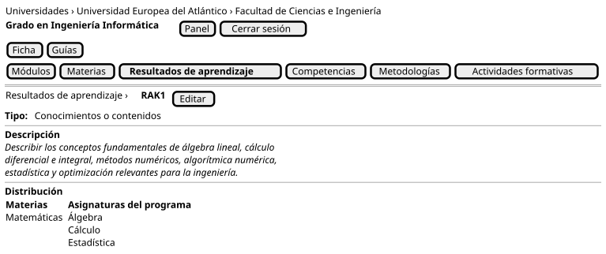
|:-:
[Ver la pantalla en el prototipo navegable](/docs/PROPUESTA_WIREFRAME/admin/abrirResultadoAprendizaje.md)

|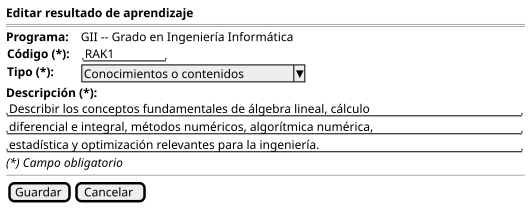
|:-:
[Ver la pantalla en el prototipo navegable](/docs/PROPUESTA_WIREFRAME/admin/editarResultadoAprendizaje.md)

|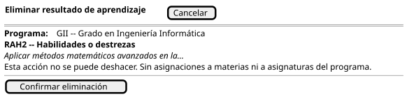
|:-:
[Ver la pantalla en el prototipo navegable](/docs/PROPUESTA_WIREFRAME/admin/eliminarResultadoAprendizaje.md)

Pulsar la pestaña **🎯 Resultados de aprendizaje** del programa. Aparece una tabla con **Descripción**, **Tipo**, **Código** y **Nº de Asign.** (el número de asignaturas a las que está asignado cada resultado, o "--" si no consta; con fondo rojo suave si es 0), con **📂 Abrir** y la papelera **🗑️** (Eliminar) en cada fila.

- **➕ Crear resultado de aprendizaje**: formulario con **Código (*)**, **Tipo (*)** y **Descripción (*)**; se confirma con **Crear** y se abre el resultado recién creado.
- **📂 Abrir**: la pestaña **🎯 Resultados de aprendizaje** queda marcada y el título es la miga **🎯 Resultados de aprendizaje › código del resultado** (la primera parte vuelve a la lista). Muestra el tipo y la descripción, el botón **✏️ Editar** (mismos campos que el alta) y la sección **Distribución**: las materias y las asignaturas de programa a las que está asignado, cada una con un enlace a su ficha, o "Sin asignaciones a materias ni a asignaturas del programa". Es la misma pantalla que la del director de programa y la de una competencia.
- En **✏️ Editar**, si el tipo del resultado no está en la lista (por ejemplo, uno cargado desde la memoria verificada del programa), el desplegable lo ofrece también, para que guardar sin tocarlo no lo cambie.
- **🗑️** (Eliminar): si el resultado está asignado a alguna materia o asignatura de programa, la pantalla indica **⛔ No se puede eliminar** y lista dónde está asignado, con un enlace a cada materia o asignatura -- hay que retirarlo primero de ahí. Si no, pide confirmación y la baja no se puede deshacer.

## Competencias del programa

|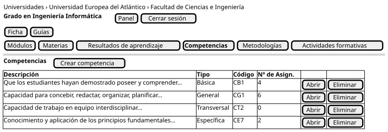
|:-:
[Ver la pantalla en el prototipo navegable](/docs/PROPUESTA_WIREFRAME/admin/abrirCompetencias.md)

|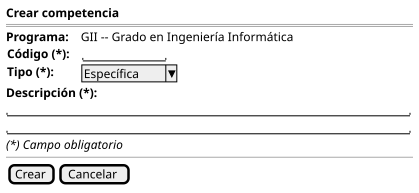
|:-:
[Ver la pantalla en el prototipo navegable](/docs/PROPUESTA_WIREFRAME/admin/crearCompetencia.md)

|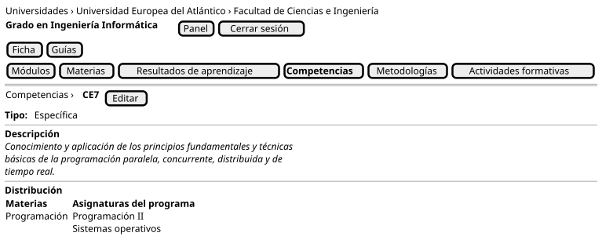
|:-:
[Ver la pantalla en el prototipo navegable](/docs/PROPUESTA_WIREFRAME/admin/abrirCompetencia.md)

|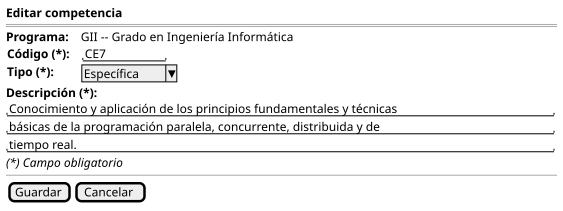
|:-:
[Ver la pantalla en el prototipo navegable](/docs/PROPUESTA_WIREFRAME/admin/editarCompetencia.md)

|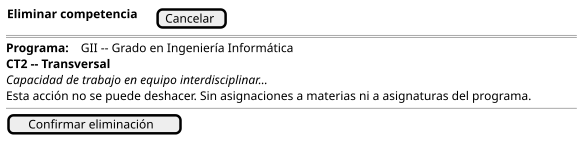
|:-:
[Ver la pantalla en el prototipo navegable](/docs/PROPUESTA_WIREFRAME/admin/eliminarCompetencia.md)

Pulsar la pestaña **🧭 Competencias** del programa. Funciona como los resultados de aprendizaje: tabla con **Descripción**, **Tipo**, **Código** y **Nº de Asign.** (cuántas asignaturas del programa tienen asociada cada competencia; con fondo rojo suave si es 0), con **📂 Abrir** y la papelera **🗑️** (Eliminar) en cada fila.

- **➕ Crear competencia**: formulario con **Código (*)**, **Tipo (*)** (Básica, General, Transversal o Específica) y **Descripción (*)**; se confirma con **Crear**. El código no puede repetirse dentro del programa, sin distinguir mayúsculas y minúsculas: si ya existe, el formulario lo indica y conserva lo escrito.
- **📂 Abrir**: muestra tipo y descripción, **✏️ Editar** (mismos campos que el alta) y la **Distribución**: las materias y las asignaturas de programa que la tienen, cada una con un enlace a su ficha.
- **🗑️** (Eliminar): si la competencia está asociada a alguna materia o asignatura de programa, la pantalla indica **⛔ No se puede eliminar** y lista dónde; si no, pide confirmación y la baja no se puede deshacer.

Las competencias se asocian a las materias y, de las de cada materia, a sus asignaturas, desde la sección **Competencias** de cada una (capítulos [Materias y sistemas de evaluación](materiasYSistemasDeEvaluacion.md) y [Asignaturas de programa y profesorado](asignaturasDeProgramaYProfesorado.md)). El director de programa gestiona lo mismo desde su vista. Los programas cuya memoria sigue el formato nuevo no tienen competencias: la lista queda vacía y no hace falta hacer nada.

## Módulos del programa

|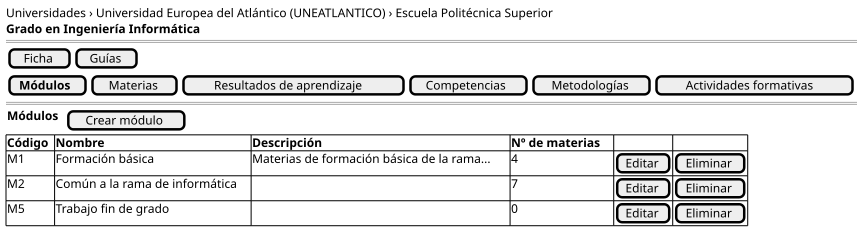
|:-:
[Ver la pantalla en el prototipo navegable](/docs/PROPUESTA_WIREFRAME/admin/abrirModulos.md)

|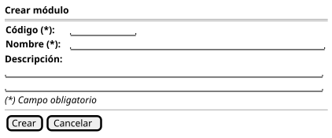
|:-:
[Ver la pantalla en el prototipo navegable](/docs/PROPUESTA_WIREFRAME/admin/crearModulo.md)

|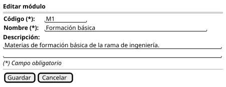
|:-:
[Ver la pantalla en el prototipo navegable](/docs/PROPUESTA_WIREFRAME/admin/editarModulo.md)

|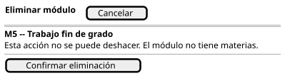
|:-:
[Ver la pantalla en el prototipo navegable](/docs/PROPUESTA_WIREFRAME/admin/eliminarModulo.md)

Un módulo agrupa materias del programa. Es opcional: una materia puede no tener módulo, y un programa puede no tener ninguno. Solo Admin los gestiona; el director de programa los ve en su lista de materias, agrupada por módulo.

Pulsar la pestaña **🧱 Módulos** del programa. Aparece una tabla con **Código**, **Nombre**, **Descripción** y **Nº de materias**, con **✏️ Editar** y la papelera **🗑️** (Eliminar) en cada fila.

- **➕ Crear módulo**: formulario con **Código (*)**, **Nombre (*)** y **Descripción** (opcional); se confirma con **Crear** y se vuelve a la lista. El código no puede repetirse dentro del programa, sin distinguir mayúsculas y minúsculas.
- **✏️ Editar**: los mismos campos, con los datos actuales.
- **🗑️** (Eliminar): si el módulo tiene materias, la pantalla lo indica y las lista; hay que cambiarles antes el módulo (editando cada materia). Si no tiene, pide confirmación.

El módulo de cada materia se elige al crearla o editarla, en el desplegable **Módulo** (capítulo [Materias y sistemas de evaluación](materiasYSistemasDeEvaluacion.md)).

## Directores del programa

|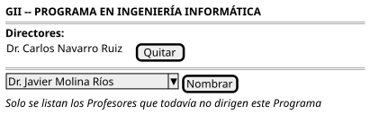
|:-:
[Ver la pantalla en el prototipo navegable](/docs/PROPUESTA_WIREFRAME/admin/definirDirectorPrograma.md)

Junto al **Código** y el **Estado** del programa, la sección **Directores** lista los directores de programa ya nombrados (el nombre de cada uno o, si no lo tiene registrado, su email) con un botón **➖** (Quitar) en cada fila.

Si queda algún profesor de la universidad sin nombrar, aparece además un selector con esos profesores disponibles y un botón **👑 Nombrar**; si ya todos dirigen el programa, en su lugar se muestra el aviso "No hay profesores disponibles: todos ya dirigen este programa."

Esta gestión también puede hacerse en sentido inverso, desde el detalle del propio profesor -- ver el capítulo [Profesores](profesores.md).

---

| [Entrar y el panel de administración](entrarYElPanel.md) | [Índice](README.md) | [Catálogo de asignaturas](catalogoDeAsignaturasYMetodologias.md) |
|---|:-:|---|

