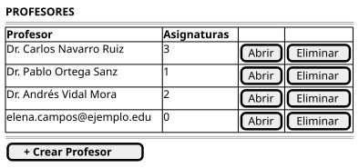
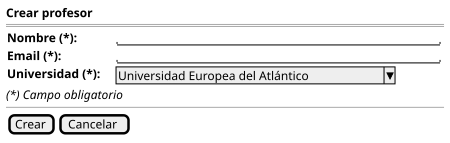
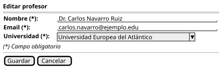
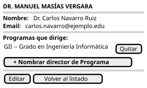
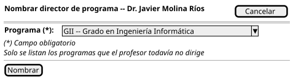
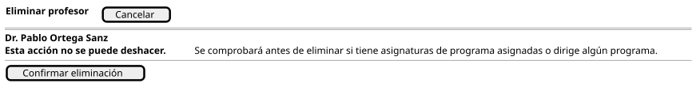

[Manual de Admin](README.md)

# Profesores

## Qué es

El alta, edición y baja del profesorado, y el nombramiento o cese de directores de programa.

## Cómo llegar

|
|:-:
[Ver la pantalla en el prototipo navegable](/docs/PROPUESTA_WIREFRAME/admin/abrirProfesores.md)

Pulsar **Profesores** en el panel de administración. Aparece una tabla con cada profesor (su nombre o, si aún no lo tiene registrado, su email), el número de asignaturas de programa que tiene asignadas, y los botones [**Abrir**](profesores.md#detalle-de-un-profesor) y [**🗑️**](profesores.md#dar-de-baja-un-profesor) (Eliminar).

## Crear un profesor

|
|:-:
[Ver la pantalla en el prototipo navegable](/docs/PROPUESTA_WIREFRAME/admin/crearProfesor.md)

1. Pulsar **➕ Crear profesor**.
2. Rellenar **Nombre** y **Email**.
3. Pulsar **Crear**.

## Editar un profesor

|
|:-:
[Ver la pantalla en el prototipo navegable](/docs/PROPUESTA_WIREFRAME/admin/editarProfesor.md)

Pulsar **Editar** en su detalle. **Nombre** y **Email** son ambos editables.

## Detalle de un profesor

|
|:-:
[Ver la pantalla en el prototipo navegable](/docs/PROPUESTA_WIREFRAME/admin/abrirProfesor.md)

Muestra las **Asignaturas asignadas** (asignatura y programa de cada una) y los **Programas que dirige**, con el botón **➖** (Quitar) en cada uno para cesarlo como director.

### Nombrar director de programa

|
|:-:
[Ver la pantalla en el prototipo navegable](/docs/PROPUESTA_WIREFRAME/admin/definirDirectorPrograma.md)

1. Pulsar **👑 Nombrar director de programa**.
2. Elegir el programa en la lista -- solo aparecen los que el profesor todavía no dirige.
3. Pulsar **Nombrar**.

Si ya dirige todos los programas existentes, la pantalla lo indica y solo ofrece volver atrás.

## Dar de baja un profesor

|
|:-:
[Ver la pantalla en el prototipo navegable](/docs/PROPUESTA_WIREFRAME/admin/eliminarProfesor.md)

Pulsar **🗑️** (Eliminar) y confirmar en **Confirmar eliminación**. Si el profesor tiene asignaturas de programa asignadas o dirige algún programa, la baja queda bloqueada y la pantalla lo indica -- hace falta desasignarlo de esas asignaturas y cesarlo como director antes de eliminarlo.

---

| [Asignaturas de programa y profesorado](asignaturasDeProgramaYProfesorado.md) | [Índice](README.md) | [Seguimiento de guías](seguimientoDeGuias.md) |
|---|:-:|---|

