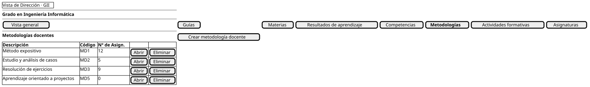
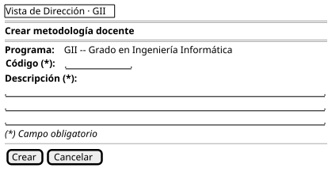
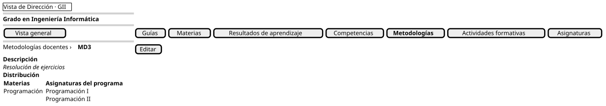
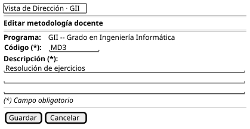
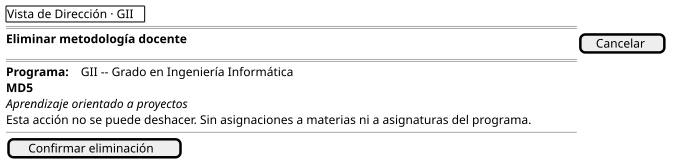
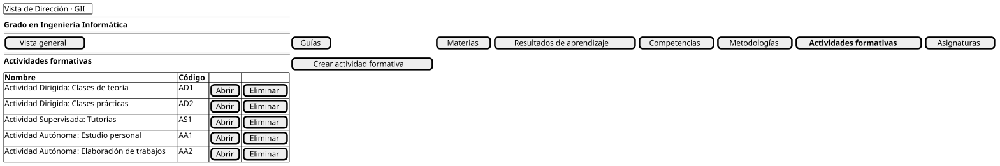
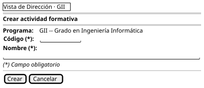
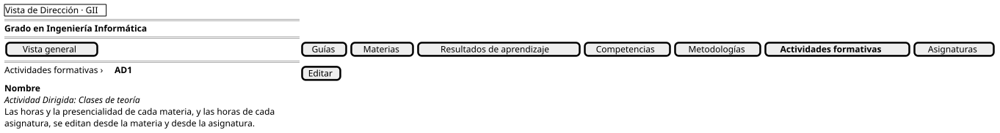
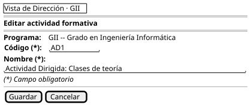
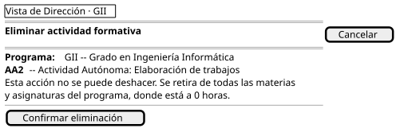

[Manual de Director de Programa](README.md)

# Metodologías docentes y actividades formativas del programa

## Qué es

Dos catálogos propios del programa, con el código y el texto de su memoria verificada: las **metodologías docentes** (código y descripción) y las **actividades formativas** (código y nombre). Cada memoria numera los suyos (la MD8 de un grado no es la de otro), así que cada programa tiene su catálogo y nada se comparte con otros programas. Los gestionan el director de programa y Admin, igual que las competencias.

De su catálogo, cada materia asocia las metodologías que usa y, de las de la materia, cada asignatura las suyas (capítulos [Gestionar materias](gestionarMaterias.md) y [Gestionar asignaturas de programa](gestionarAsignaturasDePrograma.md)). Las actividades formativas no se asocian: toda materia y toda asignatura del programa tienen una fila por cada actividad del catálogo, a 0 horas hasta que se repartan.

## Metodologías docentes

### Cómo llegar

Desde la franja del programa, pulsar [**🧩 Metodologías**](metodologiasDelPrograma.md#qué-muestra).

### Qué muestra

|
|:-:
[Ver la pantalla en el prototipo navegable](/docs/PROPUESTA_WIREFRAME/directorPrograma/abrirMetodologiasDocentes.md)

Una tabla con **Descripción**, **Código** y **Nº de Asign.** (cuántas asignaturas del programa la tienen asociada; si es 0, la celda lleva fondo rojo suave), con los botones [**📂 Abrir**](metodologiasDelPrograma.md#detalle-de-una-metodología-docente) y [**🗑️**](metodologiasDelPrograma.md#eliminar-una-metodología-docente) (Eliminar) de cada fila. [**➕ Crear metodología docente**](metodologiasDelPrograma.md#crear-una-metodología-docente) está a la derecha del título de la sección.

### Crear una metodología docente

|
|:-:
[Ver la pantalla en el prototipo navegable](/docs/PROPUESTA_WIREFRAME/directorPrograma/crearMetodologiaDocente.md)

1. Pulsar **➕ Crear metodología docente**.
2. Escribir el **Código**. No puede repetirse dentro del programa, sin distinguir mayúsculas y minúsculas; si ya lo usa otra metodología, el formulario lo indica y conserva lo escrito.
3. Escribir la **Descripción**.
4. Pulsar **Crear**. Se abre la metodología recién creada.

Para salir sin crear, **Cancelar**; si hay algo escrito, pide confirmación antes de descartarlo.

### Detalle de una metodología docente

|
|:-:
[Ver la pantalla en el prototipo navegable](/docs/PROPUESTA_WIREFRAME/directorPrograma/abrirMetodologiaDocente.md)

Al abrirla, la pestaña [**🧩 Metodologías**](metodologiasDelPrograma.md#qué-muestra) queda marcada y el título dice **🧩 Metodologías docentes › código**; pulsar la primera parte vuelve a la lista. A la derecha, [**✏️ Editar**](metodologiasDelPrograma.md#editar-una-metodología-docente). Debajo aparecen la **Descripción** y la **Distribución**: dos columnas, **Materias** y **Asignaturas del programa**, con las que la tienen asociada, cada una con un enlace a su ficha.

### Editar una metodología docente

|
|:-:
[Ver la pantalla en el prototipo navegable](/docs/PROPUESTA_WIREFRAME/directorPrograma/editarMetodologiaDocente.md)

Pulsar **✏️ Editar** y cambiar código o descripción; **Guardar** confirma los cambios y vuelve al detalle. El cambio se ve en todas las materias, asignaturas y guías que la tienen.

### Eliminar una metodología docente

|
|:-:
[Ver la pantalla en el prototipo navegable](/docs/PROPUESTA_WIREFRAME/directorPrograma/eliminarMetodologiaDocente.md)

Pulsar la papelera **🗑️** (Eliminar) en su fila.

- Si está asociada a alguna materia o asignatura del programa, la eliminación queda bloqueada: la pantalla muestra en dos columnas dónde está en uso. Hay que quitarla antes de ahí (desde la materia o la asignatura, con **➖**).
- Si no está en uso, aparece la confirmación (**🗑️ Confirmar eliminación** / **Cancelar**); la eliminación no se puede deshacer.

## Actividades formativas

### Cómo llegar

Desde la franja del programa, pulsar [**🏋️ Actividades formativas**](metodologiasDelPrograma.md#qué-muestra-1).

### Qué muestra

|
|:-:
[Ver la pantalla en el prototipo navegable](/docs/PROPUESTA_WIREFRAME/directorPrograma/abrirActividadesFormativas.md)

Una tabla con **Nombre** y **Código** de cada actividad, en el orden en que se crearon (el de la memoria), con [**📂 Abrir**](metodologiasDelPrograma.md#detalle-de-una-actividad-formativa) y [**🗑️**](metodologiasDelPrograma.md#eliminar-una-actividad-formativa) (Eliminar). [**➕ Crear actividad formativa**](metodologiasDelPrograma.md#crear-una-actividad-formativa) está a la derecha del título.

### Crear una actividad formativa

|
|:-:
[Ver la pantalla en el prototipo navegable](/docs/PROPUESTA_WIREFRAME/directorPrograma/crearActividadFormativa.md)

1. Pulsar **➕ Crear actividad formativa**.
2. Escribir el **Código** (único dentro del programa, sin distinguir mayúsculas y minúsculas) y el **Nombre**.
3. Pulsar **Crear**. Se abre la actividad recién creada, y todas las materias y asignaturas del programa reciben su fila a 0 horas.

### Detalle de una actividad formativa

|
|:-:
[Ver la pantalla en el prototipo navegable](/docs/PROPUESTA_WIREFRAME/directorPrograma/abrirActividadFormativa.md)

Al abrirla, la pestaña [**🏋️ Actividades formativas**](metodologiasDelPrograma.md#qué-muestra-1) queda marcada y la miga dice **🏋️ Actividades formativas › código**; pulsar la primera parte vuelve a la lista. A la derecha, [**✏️ Editar**](metodologiasDelPrograma.md#editar-una-actividad-formativa). Debajo aparece el **Nombre**. Las horas y la presencialidad de cada materia, y las horas de cada asignatura, no se editan aquí: se editan desde la materia y desde la asignatura.

### Editar una actividad formativa

|
|:-:
[Ver la pantalla en el prototipo navegable](/docs/PROPUESTA_WIREFRAME/directorPrograma/editarActividadFormativa.md)

En su ficha, pulsar **✏️ Editar** y cambiar código o nombre; **Guardar** confirma los cambios.

### Eliminar una actividad formativa

|
|:-:
[Ver la pantalla en el prototipo navegable](/docs/PROPUESTA_WIREFRAME/directorPrograma/eliminarActividadFormativa.md)

Pulsar la papelera **🗑️** (Eliminar) y confirmar con **🗑️ Confirmar eliminación**. Si alguna materia o asignatura del programa tiene horas en ella, la eliminación queda bloqueada con el aviso **⛔ No se puede eliminar** y las materias afectadas: hay que poner antes sus horas a 0. Si no, se retira también de todas las materias y asignaturas (donde estaba a 0) y no se puede deshacer.

Las horas y la presencialidad de cada actividad se reparten desde la materia, y las horas, desde cada asignatura.

---

| [Competencias](competencias.md) | [Índice](README.md) | [Revisar y aprobar guías](revisarYAprobarGuias.md) |
|---|:-:|---|

