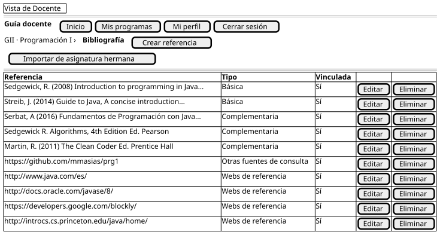
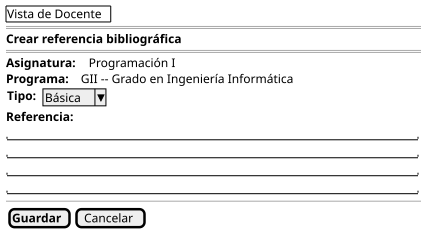
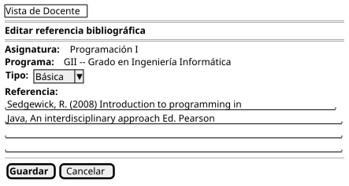
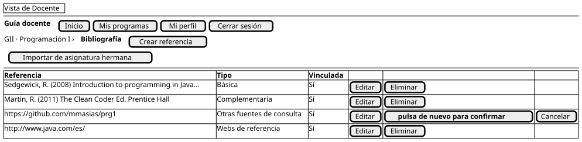
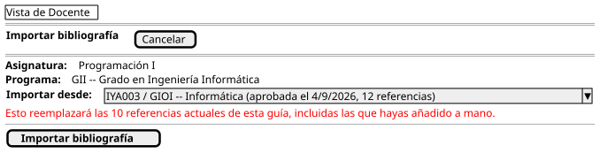

[Manual de Profesor](README.md)

# Referencias bibliográficas

## Qué es

La bibliografía de la guía: los libros, artículos y otras fuentes recomendadas al alumnado, clasificados por tipo.

## Cómo llegar

Desde la guía, pulsar [**🔧 Gestionar bibliografía**](referenciasBibliograficas.md#qué-muestra), a la derecha del título **Bibliografía**.

## Qué muestra

|
|:-:
[Ver la pantalla en el prototipo navegable](/docs/PROPUESTA_WIREFRAME/profesor/abrirReferenciasBibliograficas.md)

Una tabla con todas las referencias ya creadas, agrupadas por tipo en orden alfabético (Básica, Complementaria, Otras fuentes de consulta, Webs de referencia): **Referencia**, **Tipo** y **Vinculada** (Sí o No -- el mismo mecanismo que en las ponderaciones de evaluación: "No" mientras el cambio está pendiente de confirmar con [**💾 Guardar borrador**](redactarLaGuia.md#editar-y-guardar-el-temario) en la guía).

Dentro de cada tipo, las referencias se ordenan alfabéticamente solas (sin distinguir mayúsculas ni tildes, y sin contar comillas o corchetes iniciales), también en la guía y en el PDF; no hace falta darlas de alta en ningún orden. Los espacios y signos cuentan como en las normas de citación: Brown va antes que Browning.

Si la guía está **Aprobada**, bajo el título aparece un aviso en ámbar: guardar un cambio la devolverá a borrador. El formulario de editar lo muestra también.

## Crear una referencia

|
|:-:
[Ver la pantalla en el prototipo navegable](/docs/PROPUESTA_WIREFRAME/profesor/crearReferenciaBibliografica.md)

1. Pulsar **➕ Crear referencia**, a la derecha del título.
2. Elegir el **Tipo**: Básica, Complementaria, Webs de referencia u Otras fuentes de consulta.
3. Escribir el texto completo de la **Referencia**, con un máximo de 500 caracteres.
4. Pulsar **Guardar**; **Cancelar**, junto a él, vuelve a la lista sin crear nada.

Si la referencia supera los 500 caracteres se rechaza con el mensaje "La referencia bibliográfica supera el límite de 500 caracteres" y no se guarda. Lo mismo ocurre al importar de una asignatura hermana: si alguna referencia de la guía de origen supera el límite, la importación entera se rechaza y no se cambia nada.

## Editar o eliminar una referencia

|
|:-:
[Ver la pantalla en el prototipo navegable](/docs/PROPUESTA_WIREFRAME/profesor/editarReferenciaBibliografica.md)

|
|:-:
[Ver la pantalla en el prototipo navegable](/docs/PROPUESTA_WIREFRAME/profesor/eliminarReferenciaBibliografica.md)

Igual que con los instrumentos de evaluación: pulsar el lápiz **✏️** (Editar) de su fila para cambiarla, o pulsar la papelera **🗑️** (Eliminar) dos veces seguidas (la segunda para confirmar) para quitarla de la vista. El borrado no se hace definitivo hasta guardar el borrador de la guía. Como con los instrumentos, editar una referencia que ya forma parte de la guía se guarda en el acto y, si la guía estaba **Aprobada**, la devuelve a **Borrador**.

## Importar de una asignatura hermana

|
|:-:
[Ver la pantalla en el prototipo navegable](/docs/PROPUESTA_WIREFRAME/profesor/importarBibliografiaDeGuiaHermana.md)

Si la asignatura se imparte también en otro programa, la bibliografía de esa otra guía puede copiarse directamente en lugar de escribirla de cero: si está aprobada o, si también la tienes asignada, en revisión. El detalle, en [De qué guías hermanas se puede importar](redactarLaGuia.md#de-qué-guías-hermanas-se-puede-importar).

1. Pulsar **📥 Importar de asignatura hermana**, en la fila bajo el título, a la derecha (solo aparece si hay alguna guía de la que importar).
2. En **Importar desde**, elegir la guía de origen (el desplegable empieza en "(elige una guía)"). Cada opción muestra el código de la asignatura, el programa, el nombre de la asignatura en ese programa, su estado ("aprobada el..." o "en revisión desde...") y cuántas referencias tiene; por ejemplo, "IYA003 / GIOI -- Informática (aprobada el 4/9/2026, 12 referencias)".
3. Aparece un aviso: la importación reemplaza por completo la bibliografía actual de la guía, incluida cualquier referencia añadida a mano. Si la guía de origen no tiene ninguna referencia, el aviso lo indica explícitamente.
4. Pulsar **Importar bibliografía** para confirmar (no se activa hasta elegir una guía de origen), o **Cancelar**, arriba a la derecha, para volver a la bibliografía sin cambiar nada.

A diferencia de crear o editar una referencia a mano, importar sustituye la bibliografía de inmediato -- no hace falta pulsar [**💾 Guardar borrador**](redactarLaGuia.md#editar-y-guardar-el-temario) después.

## Volver

Bajo la cabecera, el título de la pantalla es una miga: **sigla del programa · nombre de la asignatura › Bibliografía** (por ejemplo, **GII · Programación I › Bibliografía**). [**GII · Programación I**](redactarLaGuia.md#qué-muestra) es un solo enlace que vuelve a la guía docente; [**🏠 Inicio**](entrarYVerTusAsignaturas.md#qué-muestra-inicio), arriba a la derecha, vuelve a la lista de guías. Un nombre de asignatura largo aparece recortado con puntos suspensivos; al pasar el ratón se ven el nombre completo del programa y el de la asignatura.

---

| [Ponderaciones de evaluación](ponderacionesDeEvaluacion.md) | [Índice](README.md) | [Planificación docente y cronograma](planificacionDocenteYCronograma.md) |
|---|:-:|---|

