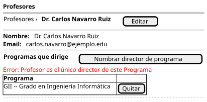
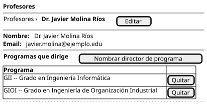
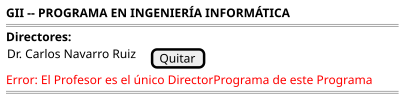

Volver: [Al inicio](/README.md) / [inicio de Admin](/docs/PROPUESTA_WIREFRAME/admin/iniciarSesion.md)

# Admin

|**Bloqueada**|**Confirmación**|**Desde el programa**|
|---|---|---|
||||

|Botón|CdU|
|---|---|
|[**Volver al profesor**](abrirProfesor.md)|abrirProfesor()|
|[**Volver al programa**](abrirPrograma.md)|abrirPrograma()|
|[**Confirmar**](abrirProfesor.md)|quitarDirectorPrograma()|
|[**Cancelar**](abrirProfesor.md)|abrirProfesor()|
|[**Quitar**](quitarDirectorPrograma.md)|quitarDirectorPrograma()|
|[**Nombrar**](definirDirectorPrograma.md)|definirDirectorPrograma()|
|[**Editar**](editarPrograma.md)|editarPrograma()|

