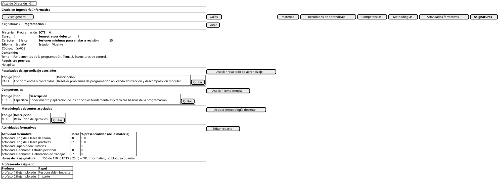

<!-- MANUAL OVERRIDE: el script no sobreescribe este fichero -->

Volver: [Al inicio](/README.md) / [inicio de DirectorPrograma](/docs/PROPUESTA_WIREFRAME/directorPrograma/iniciarSesion.md)

# DirectorPrograma

|Botón|CdU|
|---|---|
|[**Editar**](editarAsignaturaPrograma.md)|editarAsignaturaPrograma()|
|[**Asociar resultado de aprendizaje**](asociarResultadoAprendizajeAAsignaturaPrograma.md)|asociarResultadoAprendizajeAAsignaturaPrograma()|
|[**Quitar**](desasociarResultadoAprendizajeAsignaturaPrograma.md)|desasociarResultadoAprendizajeAsignaturaPrograma()|
|[**Asociar competencia**](asociarCompetenciaAAsignaturaPrograma.md)|asociarCompetenciaAAsignaturaPrograma()|
|[**Quitar**](desasociarCompetenciaAsignaturaPrograma.md)|desasociarCompetenciaAsignaturaPrograma()|
|[**Asociar metodología docente**](asociarMetodologiaDocenteAAsignaturaPrograma.md)|asociarMetodologiaDocenteAAsignaturaPrograma()|
|[**Quitar**](desasociarMetodologiaDocenteAsignaturaPrograma.md)|desasociarMetodologiaDocenteAsignaturaPrograma()|
|[**Editar reparto**](editarActividadesFormativasAsignaturaPrograma.md)|editarActividadesFormativasAsignaturaPrograma()|
|[**Vista general**](abrirPrograma.md)|abrirPrograma()|
|[**Asignaturas**](abrirAsignaturasPrograma.md)|abrirAsignaturasPrograma()|
|[**Programación**](abrirMateria.md)|abrirMateria()|

