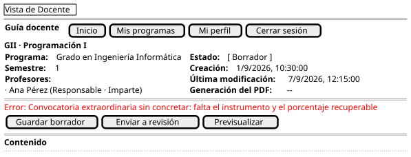
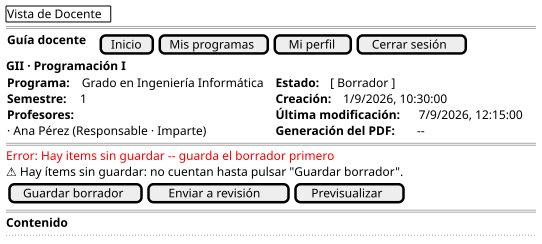
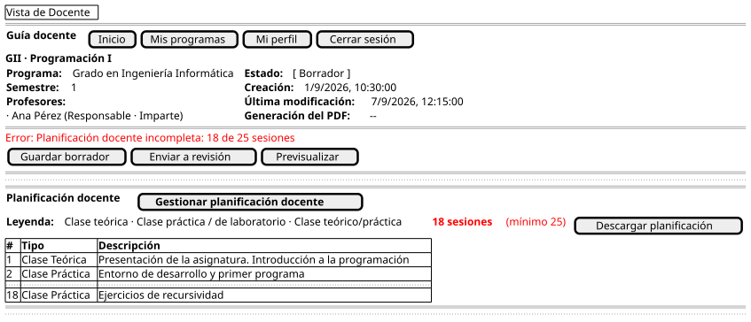
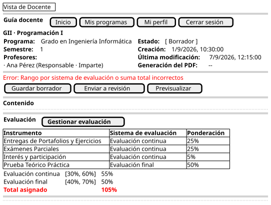
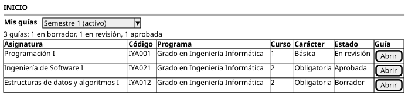

Volver: [Al inicio](/README.md) / [inicio de Profesor](/docs/PROPUESTA_WIREFRAME/profesor/iniciarSesion.md)

# Profesor

|**Error de convocatoria**|**Error: ítems sin guardar**|**Error de planificación**|**Estado de error**|**Éxito**|
|---|---|---|---|---|
||||||

|Botón|CdU|
|---|---|
|**Cerrar sesión**|cerrarSesion() (sin página: vuelve a login)|
|[**Abrir asignaturas del programa**](abrirAsignaturasPrograma.md)|abrirAsignaturasPrograma()|
|[**Volver a la guía**](abrirGuia.md)|abrirGuia()|
|[**Editar perfil propio**](editarPerfilPropio.md)|editarPerfilPropio()|

